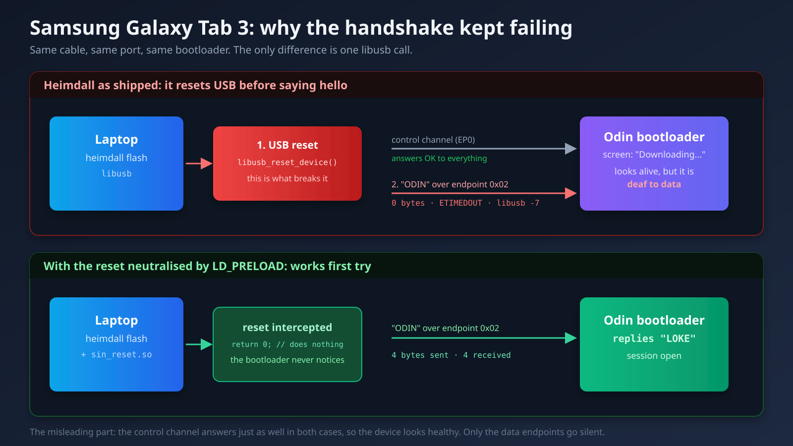

My dad uses a 7-inch Samsung Galaxy Tab 3 as the screen in his car. He has Torque Pro on it to read the engine over OBD2, RealDash, HERE Maps downloaded for offline use, a speed camera warner, and one of those launchers with enormous buttons. It works. Slowly, but it works.

The tablet is from 2013 and runs Android 4.4.2. I had been meaning to put a modern ROM on it for a while, mostly because I had just done exactly that with my Mi A2 and wanted more. I found an XDA thread with a LineageOS 14.1 build for the exact model, downloaded everything, and got started.

Spoiler: I ended up restoring Samsung's original Android. And I think that is the good ending, even if it is not the one I was after.

## A handshake that never arrived

The first wall showed up immediately. To flash a Samsung from Linux you use Heimdall, the free alternative to Odin. You put the tablet in Download Mode, plug it in, and Heimdall talks to the bootloader. That is the theory.

What I got instead, over and over:

```
Initialising protocol...
Resetting device...
ERROR: Failed to send handshake!
ERROR: Protocol initialisation failed!
```

`libusb error -7`, which means timeout. Zero bytes transferred.

And this is the part I am not proud of. In an earlier session I had concluded the problem was my laptop's USB. My ThinkBook only has xHCI controllers, meaning USB 3.0, and there are plenty of people online saying old Samsung bootloaders do not get along with those. The circulating fix is to put a USB 2.0 hub in the middle, so the old device never talks directly to the modern controller.

I bought the hub. Six euros. It arrived, I plugged it in, the tablet enumerated perfectly at 480 Mbps through it.

And it failed in exactly the same way.

## Going one level down

When a theory that felt solid collapses, the worst thing you can do is grab another equally plausible theory and keep guessing. By that point I had tried the cable, two different ports, stopping ModemManager in case it was hogging the serial port, running with `sudo`, and the hub. Five attempts, five failures, and not a single actual measurement.

So I stopped guessing and went to look at what was really happening on the wire. I wrote a hundred-line C program that talks straight to `usbfs`, the Linux kernel interface for USB devices. No Heimdall, no libusb in the middle, just raw `ioctl` calls on `/dev/bus/usb/003/104`.

The idea was simple. The Odin protocol starts by sending four bytes, `ODIN`, and waiting for four back, `LOKE`. If I can do that myself, the problem is in Heimdall. If I cannot, the problem is in the tablet.

What came out was far more interesting than I expected:

```
[claim if1] ok
[set DTR/RTS if0] ok
[clear_halt 0x02] ok
[clear_halt 0x81] ok
GET_STATUS(ep 0x02) = 00 00
GET_STATUS(ep 0x81) = 00 00
[write ODIN ep 0x02] r=-1 Connection timed out
```

Read that slowly, because the contradiction is the beautiful part. I can claim the interface. I can send control requests and it says yes to all of them. I can ask both data endpoints for their status and they answer `00 00`, which means "I am perfectly fine, I am not halted".

And then I send them four bytes and absolutely nothing happens. Not one byte, in either direction, with timeouts of up to fifteen seconds.

A USB device has two kinds of channel. The control channel, which the system uses to ask the device who it is and configure it, and the data channels, where the actual information flows. Here the control channel was running like clockwork and the data channels were dead. That rules out the cable, the port, the controller and the hub in one go, because they all travel down the same wires. If control works, the hardware works.

So the problem was the tablet. The bootloader was enumerating over USB, painting "Downloading..." on the screen, and not servicing its own data endpoints.

## The culprit was in the first line of the log

With that, I could finally ask the right question: what does Heimdall do right before the handshake?

It says so in its own output, and I had read it twenty times without seeing it:

```
Resetting device...
ERROR: Failed to send handshake!
```

Heimdall resets USB before saying hello. And it is not an oversight, it is a deliberate patch: there is a known fix in the project, from Jesse Chan, that adds that reset because it makes flashing work on a lot of modern phones. It lives in Grimler's fork, which is the one Ubuntu ships.



As it turns out, that reset bricks this 2013 bootloader's USB stack. It stays enumerated with the screen on, but stops listening on its data endpoints until you cut the power completely.

My C program worked precisely because I had not implemented the reset. Not out of cleverness, but because it looked like an unnecessary step and I skipped it.

A patch that fixes 95% of devices and breaks the remaining 5%. Nobody's code is wrong here.

## Twelve lines of fix

I had two options. Compile Heimdall from source with that call removed, which means installing build dependencies, or something rather more elegant.

`libusb_reset_device` is resolved at runtime. I checked:

```bash
$ objdump -T /usr/bin/heimdall | grep reset_device
0000000000000000  DF *UND*  0000000000000000  libusb_reset_device
```

`*UND*` means the symbol is undefined in the binary and gets looked up in the library at startup. Which means I can get in front of it with `LD_PRELOAD` and hand it my own version.

```c
// sin_reset.c
int libusb_reset_device(void *dev_handle)
{
    (void) dev_handle;
    return 0;   // LIBUSB_SUCCESS, doing nothing at all
}
```

```bash
gcc -shared -fPIC -O2 -o sin_reset.so sin_reset.c
LD_PRELOAD=./sin_reset.so heimdall flash --RECOVERY twrp.img --no-reboot
```

Heimdall believes it reset the device, keeps all of its protocol logic intact, and the bootloader never notices. First try:

```
Resetting device...
>>> [sin_reset] libusb_reset_device intercepted and skipped
Protocol initialisation successful.
Session begun.
PIT file download successful.
RECOVERY upload successful
```

Weeks of being stuck, solved without recompiling anything and without root. It is one of the most satisfying things I have done in a long time.

## And then I installed the ROM

TWRP in, backups of everything, and time to install the LineageOS 14.1 that had been sitting in my downloads folder for weeks.

First minor stumble: the installer aborted with `ERROR: 7`. Its script checks that the device is called `lt02wifi`, but TWRP identifies itself as plain `lt02`. Same device, it is just that the TWRP build is generic for the whole family. You fix it by adding two lines to the `updater-script` and repacking the zip.

It installed. It booted. And the first thing I did was check what had actually landed:

```
ro.build.display.id = cm_lt02wifi-userdebug 4.4.4 KTU84Q
ro.build.version.release = 4.4.4
ro.build.version.sdk = 19
ro.modversion = 11-20150107-UNOFFICIAL-lt02wifi
ro.build.date = Tue Jan 6 2015
```

CyanogenMod 11. Android 4.4.4. From January 2015.

The file was named `lineage OS20231007wifi07it.zip`. The XDA thread said LineageOS. And inside was CyanogenMod, which is the project LineageOS grew out of, but four major Android versions behind.

The tablet shipped with 4.4.2. After all that, I had moved it up to 4.4.4. Two decimal points.

## Stripes on the screen

As if the letdown were not enough, the screen came up with bands of stripes across the middle. My dad described it as "it looks like it is dying", which is a pretty good description.

First rule out the obvious: the panel was fine. It looked perfect in TWRP, in Download Mode, and in Samsung's Android. If three different environments render correctly and only one fails, it is not the hardware.

The kernel reports `panel_id=0x00000004` in its boot line. The Tab 3 was built with several different panels depending on the batch, and the CyanogenMod kernel for this model does not handle that variant properly. It is a known bug, reported on XDA for years, and the CM11 development thread for this device is marked as abandoned.

I could have gone looking for an alternative kernel. But I stopped to think about what I was actually gaining: Android 4.4.4 instead of 4.4.2, without Samsung's apps, and with a broken screen. All in exchange for getting into kernel compilation for a chip nobody has maintained since 2015.

## Actually checking whether something better existed

Before giving up I wanted to know whether a real LineageOS for this device existed at all, or whether I had invented the expectation.

It does not exist. The tablet runs a Marvell PXA988, which is neither Qualcomm nor Exynos. Marvell dropped that chip early, never released what was needed, and the community consensus is that this model does not go past KitKat. There is open kernel source on GitHub with seventeen commits and five stars, which tells you plenty about the activity level.

What circulates on the forums under the LineageOS name for this model is, almost always, the same thing that happened to me.

## Going back is a decision too

My dad did not like it. Fair enough: the screen looked bad and the tablet did nothing new.

Restoring was the easiest part of the whole project, precisely because the original blocker was already solved. I downloaded the exact stock firmware it shipped with, `T210XXBOB1`, and flashed it with Heimdall.

One detail here does matter: **I did not flash the bootloaders**. The firmware ships `PBL.bin` and the two `loke_*.bin` files, the primary and secondary boot stages. They are the only partitions that, if corrupted halfway through, leave you with an unrecoverable brick. And since I had never touched them, they were still pristine. I wrote only kernel, recovery, system, cache and the preloaded apps.

The check that put my mind fully at ease: before starting any of this, I had dumped the tablet's partitions to my PC. The `boot.img` from the downloaded firmware and the first 7,770,368 bytes of my dump have the same MD5. Byte for byte, it was exactly its own software.

## The part that was worth it

With the tablet back on its usual Android, what my dad actually wanted was still on the table: make it faster.

A 2013 Samsung ships with a remarkable amount of filler. I counted 226 packages out of the box. In there were eight packages just for Samsung's cloud, five for AllShare DLNA sharing, ChatON, a messaging service Samsung shut down in 2015, GameHub, VideoHub, HelpHub, preinstalled Dropbox, Flipboard, Yahoo widgets with their daemons running in the background, eight printing packages and several factory test modes.

All of that on a device with 832 MB of RAM whose job is showing a map while someone drives.

I tried the shortcut first, disabling packages over ADB without root. On this Samsung it does not work: `pm disable` does not just fail, it triggers a 7.6 MB bug report dump instead of telling you that you lack permission.

But it turns out root is not needed either. With TWRP installed you can mount `/system` read-write and delete the APKs directly, which is cleaner than installing a superuser manager that then sits there forever. I copied every file to my PC before deleting it, so the whole thing is reversible, and removed 126 files counting the `.odex` ones.

I deliberately kept the Samsung keyboard, Settings, SystemUI, the launcher, Play Store and Google services. Removing the keyboard would have been a silly way to end the afternoon.

The numbers, measured on the tablet before and after:

| | Before | After |
| --- | --- | --- |
| Installed packages | 226 | 126 |
| `/system` space used | 1.29 GB | 1.06 GB |
| Free RAM at idle | 16 MB | 122 MB |

The RAM one is what matters. Sixteen megabytes free on an 832 MB device means it was swapping constantly just to open anything. Now there is real headroom.

And an unexpected gift: Samsung's official `system.img` does not include `install-recovery.sh`, the script that reinstalls the stock recovery on every boot. The system that came on the tablet did have it, but the one in the downloaded firmware does not. So TWRP stays put indefinitely, and I can get back into it whenever I want without reflashing anything.

## What I am taking away

**A filename is not information.** I trusted that a zip was called "lineage OS" and that a forum thread said the same. Checking `build.prop` inside the zip takes ten seconds and would have saved me the entire project. It is the exact same mistake I made with the Mi A2, when I assumed I had a newer LineageOS build than I actually did. Twice in six months.

**A custom ROM is not automatically better.** This is the one that took most swallowing, because I came off a great experience with the Mi A2. But on the Mi A2 I jumped from Android 10 to Android 12, on a well-supported Qualcomm chip with an active community. Here the jump was 4.4.2 to 4.4.4 on a chip nobody maintains. The community ROM was not better than Samsung's: it had less filler, sure, but also a kernel that could not paint the screen. And the filler can be removed without changing systems at all, which is exactly what I ended up doing.

**When a theory collapses, go one level down instead of reaching for another theory.** I spent six euros and several days on the USB hypothesis because it sounded reasonable and had people on the internet backing it. The C program that gave me the answer took twenty minutes to write. It should have been the first thing I did, not the last. Measuring is almost always faster than assuming, even when it looks like more work.

**Back up everything before touching anything, and leave the bootloader alone.** The dumps I made at the start are what let me go back calmly instead of in a panic. And leaving the boot stages untouched turned every failed attempt into an inconvenience rather than a dead tablet. At no point in the whole process did I not know how to get back.

**Sometimes the right goal is not the one you set.** I wanted Android 7 on a 2013 tablet. That did not exist. What did exist was stripping a hundred junk packages off the Android it already had and handing back 106 MB of RAM. Less glamorous, far more useful, and my dad says it feels faster.

The tablet is back in the car. Running the same Android it left the factory with in 2015, minus Samsung's cloud, ChatON and the Yahoo widgets. And I learned more from the project that failed than from the one that went well.

*(That is what I wrote on September 9th. Two days later it stopped being true: keep reading.)*

## Update: September 11th, 2026

Two days after writing this I went back to the tablet, because my dad told me the Play Store was not working and I assumed my cleanup had broken it. It had not. And pulling on that thread led me to something considerably worse.

### First: the tablet was stuck booting into TWRP

Android would not boot. It did not matter how I asked — `adb reboot`, `adb reboot system`, plain `reboot` — it always came back to recovery. `uptime` confirmed it really was rebooting, and the kernel command line arrived carrying `recovery_mode=1`, meaning Samsung's own bootloader was choosing recovery.

I ruled out the obvious with evidence: the kernel partition was intact (same MD5 as the official firmware), the BCB in the `MISC` partition was all zeros, there was no pending `/cache/recovery/command`, and no stuck hardware key.

The cause turned out to be something I did not know: **Samsung does not store the boot mode in the `MISC` partition the way stock Android does. It stores it in the `PARAM` partition.** Comparing a dump of `PARAM` against the backup I had taken before starting, a new record showed up, literally named `samsung_bootmode_setting.inf`.

What had happened: someone ran a "Factory data reset" from Settings. Android writes the "boot into recovery" flag there and reboots. **Samsung's recovery would have done the wipe and cleared the flag; but the recovery was now TWRP, which knows nothing about that flag and left it set.** Permanent loop.

The fix, using the backup I had:

```bash
adb push partitions/p7_PARAM.img /data/good_param.img
adb shell "dd if=/data/good_param.img of=/dev/block/mmcblk0p7 bs=4096; sync"
adb reboot
```

And a rule I am keeping forever: **with TWRP installed on a Samsung, never run a factory reset from Settings.** Wipe from TWRP itself.

### The Play Store does not work, and the cleanup had nothing to do with it

I checked this APK by APK, because the suspicion was reasonable. Of the 126 files I deleted, **none belonged to Google Play**. Still in place: `Phonesky.apk` (the store), `GmsCore.apk`, `GoogleServicesFramework.apk` and `GoogleLoginService.apk`. From Google I had only removed user apps: YouTube, Drive, Hangouts, Books, Play Games.

The real reason came out of the APKs' own `AndroidManifest.xml`:

| Package | Installed version |
| --- | --- |
| Play Store | **4.9.13** |
| Google Play services | **6.1.88** |

Both from 2014. Google dropped Android 4.4 support years ago and its servers no longer talk to clients that old: you cannot even sign in. Restoring Samsung's bloat would have changed nothing, it would only have handed those 231 MB back to Yahoo and AllShare.

### Neither F-Droid nor Aurora Store, and for different reasons

The next logical step was an alternative store. Both candidates have old versions that do install on Android 4.4: **F-Droid 1.12.1** (`minSdk=14`) and **Aurora Store 4.2.3** (`minSdk=19`), both pulled from F-Droid's archive.

Installing is not the same as working. To know in advance, I extracted the tablet's certificate store without touching the device, pulling it out of the official `system.img` with `simg2img` and `debugfs`: **156 certificates, all from 2015**. It has `DST Root CA X3`, **expired on September 30th, 2021**, and it does **not** have `ISRG Root X1`, Let's Encrypt's root, which Android did not ship until 7.1.1.

With that you can simulate exactly which connections the tablet would validate:

```bash
openssl s_client -connect f-droid.org:443 -CAfile tablet_certificates.pem
```

| Server | Validates? |
| --- | --- |
| `f-droid.org` and its three official mirrors | ❌ all four fail |
| `android.clients.google.com` | ✅ |
| `auroraoss.com` | ✅ |

So **F-Droid installs but cannot reach its own repository or any mirror**, because its entire infrastructure runs on Let's Encrypt.

Aurora looked like the winner, so I installed it and drove it all the way through. It starts up perfectly, interface translated, and the onboarding works (you have to pick "Native installer", since the default one wants Android 5.0+). It reaches the sign-in screen and dies there: both "Anonymous" and "Anonymous (insecure)" fail with a badly worded "No Error". The log is clearer:

```
FUEL [POST:-1] https://auroraoss.com/api/auth
```

Code −1: the request never completes. All three servers **require TLS 1.2**, and Android 4.4 can speak it but **ships with it disabled by default**; the app has to enable it explicitly. Aurora 4.2.3 does not use OkHttp for this — which would enable it — but **Fuel, which sits on `HttpURLConnection`**, and there it stays on TLS 1.0.

Both die, for different reasons: **F-Droid on the certificate, Aurora on the TLS version.** There is no possible app store on this tablet. What does work is using the PC as the store: download the APKs there, where modern TLS is fine, and push them with `adb install`. I wrote a script that searches F-Droid's index for the newest version with `minSdk<=19` and installs it over USB. VLC 3.7.1 — the current release — and OsmAnd~ 4.0.9 still work on KitKat.

### Second cleanup round: 87 MB of Google processes

While I was at it: if the Play Store cannot work, the entire Google block is dead weight. This time I measured it properly with `dumpsys meminfo`, which reports PSS and discounts what is shared between processes. (The RSS column in `ps` lies: it added up to 1,528 MB on a device with 832.)

There were **fourteen Google processes running**, taking **87 MB of PSS** between them. Not one of them was useful. Adding the gallery, the mail client, the phone app on a WiFi-only tablet, Chrome and the clock widgets, it came to about **125 MB** — out of the 271 MB the whole system was using. Nearly half.

I prepared the removal, 250 MB of `/system`, and applied it from TWRP.

### And then the storage died

On reboot, the 250 MB were **back**. The APKs in `/system` again, with their original 2015 timestamps. But the first round's deletions were still gone. So it was not a reflash: `/system` had returned exactly to its state before that day's writes.

The answer was in the previous boot's kernel log:

```
mmcblk0: command error, retrying timeout
mmcblk0: timed out sending r/w cmd command, card status 0x400d00
```

**129 write command timeouts**, starting nine seconds into TWRP's boot. That `card status 0x400d00` leaves the card in `rcv` state: it accepts the write command and never completes the transfer. The writes never reached the flash, and on reboot ext4 replayed its journal and rolled back to the last consistent state.

I confirmed it with four tests:

1. **A 100 MB file written from Android** with `sync` and a verified MD5: after rebooting, `No such file or directory`.
2. **50 MB in `/cache`**, correct MD5 read back from the page cache. Unmount and remount — which forces a real read from flash — and **the file no longer existed**.
3. **Not even raw writes worked**: `dd` of 512 KB straight to the block device, bypassing the filesystem, read back with a different MD5. Not ext4, not the journal. The chip.
4. `e2fsck -fn` on `/data` finished with `WARNING: Filesystem still has errors`, and `/system`'s superblock had a last-write timestamp from an hour before the deletions I thought I had made.

Everything else ruled out: battery at 100% and 4.189 V, 31.8 °C, and no software-forced read-only flag.

This is the classic end-of-life failure mode for an eMMC: **it locks itself read-only internally but keeps reporting that writes succeeded.** That is why `sync` never errored and the `df` numbers added up: I was reading the RAM cache, not the chip.

And it explains, all at once, everything strange about that afternoon: the setup wizard reappearing, USB debugging switching itself off twice, the 250 MB coming back. One fault behind all of it.

What it does not explain is any fault of ours. We wrote a few hundred megabytes between the firmware, the cleanup and the tests; a healthy eMMC is rated for **terabytes** over its life. The chip was eleven years old and already spent. A session with heavier-than-usual writing is precisely when a chip at its limit finishes off its reserve. It was going to happen anyway.

### What I am taking away from part two

**That a `sync` returning success does not mean anything was saved.** Linux writes to RAM and tells you it is done. If you want to know whether something really hit the disk, unmount and remount, or reboot. Everything that confused me that day came from reading the cache while believing I was reading flash.

**That the manufacturer may store things where you do not expect.** I looked for the boot flag in `MISC` because that is where Android puts it. Samsung puts it in `PARAM`. Half an hour lost to assuming the standard is followed.

**And that sometimes the correct diagnosis is that the device died.** I spent a while hunting for what I had broken, because that was the comfortable explanation. The uncomfortable one was reading the kernel log and accepting that the chip was throwing writes away.

The tablet boots and runs, but it cannot reliably save anything new. For a car display that is useless: it would lose Torque's settings and the downloaded maps without warning. So **it is no longer in the car**. A second-hand SM-T210 goes for twenty euros, and replacing the chip means desoldering a BGA for considerably more than the tablet is worth.

One irony to close on: I spent two days stripping bloat off a tablet to make it faster, and it died from the very partition that bloat lived in. I would still do it again. My dad got two days of a fast tablet, and I learned how Samsung boots its devices, why Let's Encrypt broke half the internet for old Android, and what a flash chip looks like when it dies.


---

*If you have fought with Heimdall and an old Samsung, or want to share your own experience, reach me on [LinkedIn](https://linkedin.com/in/raul-casado) or [GitHub](https://github.com/RaulCasado).*

---

*Cover: Samsung Galaxy Tab 3, photo by [Intel Free Press](https://commons.wikimedia.org/wiki/File:Samsung_Galaxy_Tab_3_10.1-inch_Android_Tablet.jpg), [CC BY-SA 2.0](https://creativecommons.org/licenses/by-sa/2.0).*
