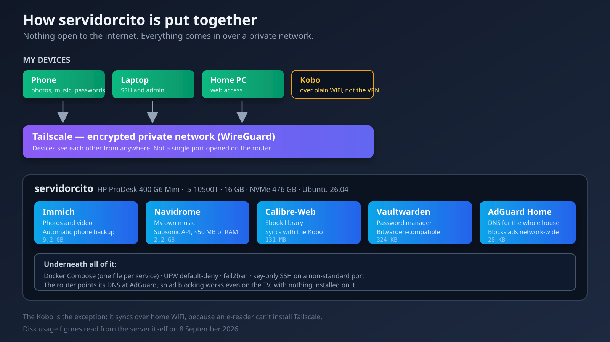
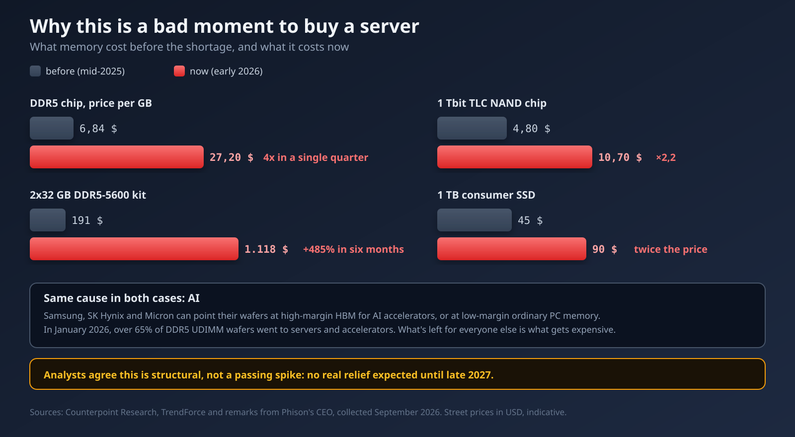

## What this is about

There's a mini PC running in a corner of my flat. It's been up for eight days straight without me touching it, and right now it holds my photos, my music, my books and my passwords. None of that goes through Google any more.

This post is how I got there: what a server actually is when you look closely, which alternatives I weighed at each decision, and why I picked what I picked. It also covers what **doesn't** work as smoothly as an enthusiastic tutorial suggests, because there are real downsides and I'd rather say them out loud.

And at the end I talk about money, because there's a factor right now that changes the advice I'd give anyone thinking of copying this.

## First: what is a server?

A server isn't a kind of computer. It's a **role** a computer plays.

Your laptop is built for you to sit in front of it: screen, keyboard, and it sleeps when you close the lid. A server is a computer you never sit in front of. It's on all the time, with no screen or keyboard attached, waiting for other devices to ask it for things over the network. You talk to it from your phone or your laptop, and it answers.

That's genuinely all there is to it. When you open Instagram, your phone asks a Meta server for photos. When I open my gallery, my phone asks a box sitting four metres away. The difference isn't technical: it's whose box it is.

"Server" doesn't mean a rack with blinking lights either. Mine is a refurbished office mini PC, about the size of a thick book, drawing less power than an old light bulb.

## The hardware: a second-hand office PC

I bought an **HP ProDesk 400 G6 Mini**. Here's what's in it:

- Intel Core i5-10500T, 6 cores and 12 threads
- 16 GB of DDR4 RAM
- A 476 GB NVMe SSD
- Integrated Intel UHD 630 graphics, no dedicated card
- Ubuntu 26.04 LTS

Why an office mini PC and not something else? I considered three options.

A **Raspberry Pi** is what everyone recommends for starting out, and it's good advice: cheap, tiny, sips power. I ruled it out because I wanted this thing to do demanding work — processing photos, maybe AI models — and a Pi runs out of headroom the moment you ask for more than file serving. SD card storage is also a known failure point.

A **commercial NAS** (a Synology, say) is the comfortable option: it comes with its own OS, its apps, a polished interface. I looked at it seriously, and got as far as comparing models and drives. I ruled it out for two reasons: it costs noticeably more for the power you get, and it locks you into their ecosystem. If one day I want to install something Synology doesn't like, that's a problem I simply don't have on plain Ubuntu.

A **cloud VPS** would have been more reliable in terms of uptime, but it breaks the whole premise. If the goal is that my photos aren't on someone else's computer, renting someone else's computer doesn't solve it.

The refurbished office mini PC wins because it's the sweet spot: real PC power, second-hand pricing, low draw, and it's hardware built to sit switched on in an office for years. These come onto the used market by the thousand when companies refresh their fleets.

## The decision that shapes everything: open no ports

Before installing anything you have to answer one question: **how do I reach the server from outside the house?**

The classic answer is port forwarding on the router. You tell the router "anything hitting port 443, send it to the server", and now you can get in from anywhere. It's what most people do, and it works.

It also means your server is exposed to the entire internet. And "the entire internet" includes bots scanning IP addresses around the clock looking for things left misconfigured. That's not paranoia: open a port and within hours somebody is probing it.

The alternative I chose is **Tailscale**, which builds a private network between my devices using WireGuard. My phone, laptop, PC and the server see each other as though they were in the same room, even when I'm across the country. And from outside that network, the server **doesn't exist**. There's no port to scan.

Downsides? Two, and they're real.

First: **anyone who wants access has to install Tailscale**. If I want to show my dad the photos on his phone, I can't just send him a link. That's genuine friction.

Second: I depend on a third-party service for coordination. Tailscale can't see my traffic — that's end-to-end encrypted — but it does manage who may connect to whom. There's [Headscale](https://github.com/juanfont/headscale), a self-hosted coordination server, and running that would be the fully consistent choice. I haven't, because it's one more piece to maintain, and I've been picking my battles.

## Photos: the hardest one to give up

Google Photos was the toughest thing to replace. Not the photos themselves, but everything around them: automatic backup, a search that finds "beach" without anyone tagging anything, faces grouped together.

I compared six options. The three that got far:

**PhotoPrism** is more mature and has a reputation for not breaking things between versions. But it has no official mobile app. Automatic phone backup was the central requirement, so it fell at the one hurdle I couldn't move.

**Ente** struck me as technically elegant: end-to-end encrypted, with face recognition running **on the phone** rather than the server, so the server barely works. It's still my plan B if mine ever falls short. It lost because its self-hosting community is much smaller, and that matters at three in the morning when something breaks and you're looking for someone who hit the same error.

**Immich** won. It's effectively a functional clone of Google Photos: native app, background auto-backup, semantic search, face recognition. And a huge community.

Now, the downside I'm not going to skip: **Immich breaks things across major versions**. It reached stable in October 2025, and by July 2026 version 3.0 already brought a mandatory migration of the vector search engine. The project itself recommends not relying on it as your only copy. I update by reading release notes, never blindly.

It's using 9.2 GB with what I've put in so far.

## Music: where the downside bites hardest

Here I run **Navidrome**, and the choice was easy. I considered Jellyfin (which does video too, but wants 2 to 4 GB of RAM) and Funkwhale (built for a federated network, which isn't what I need). Navidrome runs in about 50 MB of RAM and speaks the Subsonic API, the de facto standard — which means I can pick from dozens of mobile apps instead of being tied to one.

But this is where the most serious downside of the whole setup lives, and I want to be blunt about it because it's the one you feel daily.

**When your music lives on a server, you need a connection to listen to it.** If I get on the metro and lose signal, the music stops. If the files were on my phone, it wouldn't. Spotify has the same problem and solves it with offline downloads; that exists here too — Tempo, the app I use, syncs for offline listening — but it's a manual step you have to remember, not something that just happens.

It's an honest trade: I get a library that's genuinely mine, that nobody can pull from a catalogue, at whatever quality I choose. I lose the convenience of it simply always working.

One practical detail that cost me an afternoon: **AIMP, the player I used on Android, doesn't support Subsonic**. There's only a plugin for the desktop version. I switched to [Tempo](https://github.com/CappielloAntonio/tempo), which is open source and works with Android Auto.

## Books: my own library, and a Kobo that can breathe

This is the part that's given me the most satisfaction, and the part I expected least.

I have a Kobo. E-readers have little storage, so you end up doing a clear-out every so often, deciding what to delete. A server ends that: **the whole library lives on the server and the Kobo only carries what I'm reading now**. When I finish, I remove it and pull down another. Storage stops being a consideration.

Six options compared again. The real fight was between two.

**Kavita** is objectively better at managing enormous libraries, and its development is more consistent. If I had tens of thousands of comics, it'd be my pick without hesitation.

**Calibre-Web-Automated** won for one very specific reason: **it syncs natively with the Kobo over WiFi**. With Kavita I'd have to install KOReader on the device for OPDS access. That means messing with the Kobo, and I didn't fancy it. CWA also has an "ingest" folder: drop an EPUB in and it fixes the metadata, finds a cover and files it away. I was starting from a pile of loose unsorted files, so that saved me hours.

There's an architectural exception here worth explaining: **the Kobo is the only device that doesn't come in over Tailscale**. It can't — it's an e-reader, you can't install a VPN on it. So this one service is open to my home network. That's a deliberate concession, not an oversight: the exposed surface is my WiFi, not the internet.

## Passwords: the most useful of the lot

**Vaultwarden** is a reimplementation of Bitwarden written in Rust. It speaks the same protocol, so the official Bitwarden apps work, but it uses a fraction of the resources. It occupies 324 KB on disk.

Of all the services, this is the one that's changed my daily life most. Long, distinct passwords everywhere, autofill on phone and browser, and the database sitting in my flat.

A nice technical detail: the password manager **insists on real HTTPS**, even over a private network. The reason is that the web vault uses the browser's Web Crypto API, which only works in a "secure context". Without HTTPS the page loads but encryption fails silently, which is the worst possible way to fail.

I solved it without standing up a reverse proxy, which is what I expected to have to do: Tailscale can issue a real Let's Encrypt certificate for the server's name inside my private network and act as the proxy itself. A whole container saved.

## Ads: the service the whole house appreciates

**AdGuard Home** acts as the DNS server for the entire network. When any device at home asks "where is ads.example.com?", it answers that it doesn't exist. The ad isn't blocked: **it never gets downloaded**.

The nice thing about doing it at network level is that it works on devices where you can't install a blocker: the TV, the console, a visitor's phone.

I considered **Pi-hole**, the best known one. It lost for a concrete reason: encrypting DNS queries needs a separate helper piece, and the method half the community used — `cloudflared` in proxy mode — stopped working in February 2026 after a change on Cloudflare's side. AdGuard Home has that built in. I also looked at **Technitium**, technically superior at managing DNS zones, but that solves a problem I don't have yet. Deploying a full authoritative DNS server to block ads is a sledgehammer for a nut.

## What I decided not to build: email

I liked the idea of running my own mail on my own domain. I researched it and dropped it, and I think that's the most useful decision in the whole project.

The problem isn't setting it up. There are stacks that stand up a complete mail server in an afternoon. The problem is making it **work**:

**IP reputation.** A new mail server starts with zero reputation. Gmail and Outlook treat any IP they don't recognise as suspect by default. Without SPF, DKIM and DMARC tuned over months, your mail lands in spam or bounces without telling you. That isn't a task, it's indefinite maintenance.

**And the one that finished it: my ISP blocks outbound port 25** and won't let me set reverse DNS on my home IP. Without that, no amount of perfect configuration sends reliable mail from here. It's not a limitation I can fix.

So mail stays with a managed provider. Sometimes the right answer is not to self-host something, and I think saying so is more honest than pretending everything is doable.

## The other use: somewhere to break things

Beyond the services, the server is **a place to break things without consequences**.

Before, when I wanted to try a database, an odd container or a web dashboard, I'd install it on my laptop and end up with a system full of half-uninstalled junk. Now I spin it up on the server, try it, and if it doesn't convince me I delete the container and there's no trace left.

That's where personal dashboards live: a board showing the state of my stuff, a cron job that collects something each morning, a small API for a project. Things that would each cost a monthly subscription on a managed service, and here are just one more config file.

## Tying it in with local AI

A few weeks ago I wrote about [running local AI on an old PC](/en/blog/local-ai-lab-old-pc). That experiment was on a different machine, with a dedicated GPU, and the main conclusion was that **small, specialised models beat the big ones** on nearly every real task I set them.

That fits this server better than it might seem. A small 4B model dedicated to one job — classifying, extracting structured data, answering questions about my notes — doesn't need a high-end GPU. And the hard part is already built here: the data.

What makes sense to run here:

- **RAG over my own notes**: search my documents and have a model answer citing the retrieved passages. In that experiment I learned the deciding factor isn't the model, it's retrieval: with no RAG it got 2 of 7 questions right, and with multiple retrieval queries that climbed to 5 of 7.
- **A small assistant** for concrete, repetitive tasks, running overnight with nobody watching.
- **Dashboards fed by my own data**, without sending anything to an external API.

But there's an honest limit: **this server has no dedicated GPU**. The integrated UHD 630 is no use for inference. Everything would run on CPU, which is fine for small models but won't stretch to anything ambitious. And there's a worse bottleneck, which I'll get to now.

## The real limits of this machine

Three things surprised me when I audited the machine:

**The RAM runs in single channel.** The 16 GB is a single stick, with the second slot empty. That halves memory bandwidth. For serving photos it's irrelevant, but it's exactly the bottleneck that hurts most in CPU model inference. Fixing it means adding a second identical stick.

**The network negotiates at 100 Mb/s.** The server's card supports Gigabit; the router port it's plugged into doesn't. That caps transfers at around 12 MB/s, which you notice uploading a large batch of photos. Not the server's fault, and fixable with a better cable or a switch.

**No dedicated GPU**, as covered.

Of the three, the only one I'd genuinely consider addressing is the RAM. And that's where the problem starts.

## Why now is a bad time to buy

If you've read this far thinking about building one, here's the important warning.

**Memory and storage prices have gone through the roof.**

The numbers, collected in September 2026:

- DDR5 chips went from **$6.84 per GB** in September 2025 to **$27.20 per GB** by December. Nearly four times, in one quarter.
- A 2×32 GB DDR5-5600 kit that cost around **$191** in August 2025 now runs about **$1,118**. That's **+485%**.
- The NAND flash in SSDs has doubled in six months, from **$4.80** to **$10.70** per chip.
- A 1 TB consumer SSD has gone from roughly **$45** to almost **$90**.

The cause is the same in both cases: AI. Samsung, SK Hynix and Micron can point their wafers at high-margin HBM for AI accelerators, or at low-margin ordinary PC memory. They're choosing the former. In January 2026, more than 65% of DDR5 UDIMM wafers went to servers and accelerators.

And it doesn't look like a passing spike. Analysts agree the causes are structural, with no real relief expected **until late 2027**.

What does that mean in practice?

If you already have hardware, it's a good moment to **squeeze it**. I have 405 GB free out of 466: space is not remotely my problem.

If you were about to buy, **wait if you can**. And if you can't wait, look at the used and refurbished market, which is exactly where mine came from and where these prices bite least.

My RAM upgrade — the €30-40 a stick cost a year ago — doesn't add up right now. It stays on the list for later.

Same story with the NAS. I've studied it — compared models, drives, capacities — and the honest conclusion was that **I don't need one yet**. With 405 GB free, spending €300 or more on storage I don't need, at the worst pricing moment of the decade, would be buying for the sake of buying.

## Pros and cons, briefly

**What I gain:**

- My photos, music, books and passwords are in my flat, on a disk I can touch.
- No subscriptions. The cost is electricity, a few euros a month.
- No artificial limits on space or quality.
- Nobody pulls something from my library because a licence expired.
- Somewhere to try things without dirtying my laptop.
- Ad blocking across the whole house, TV included.

**What I lose:**

- **I am the support team.** If something falls over on a Sunday, it gets fixed when I fix it.
- **Music needs a connection**, unless you sync offline by hand.
- **Sharing with people outside is awkward**, because they have to install Tailscale.
- **Backups are my problem.** A server is not a backup: if the disk dies, everything dies. This is the least solved part of my setup and I'm not going to dress it up.
- **It needs maintaining.** Updates, release notes, checking things are still alive.
- **Not email.** Some things aren't worth self-hosting.

## Conclusion

What surprised me most wasn't the technical side. It was realising how many of the things we pay subscriptions for are, underneath, fairly simple: somewhere to keep files and a decent app to view them with. What you're paying for, nearly always, is the convenience of someone else handling it.

That convenience has real value, and I won't pretend otherwise. There are days I'd happily let Google deal with it. But when the price is that your photos, your music and your passwords live on someone else's computer, under their rules and their changing terms, handling it myself comes out ahead.

If you're considering it, my advice is to start with **one service**. Set up the password manager, or the ad blocker, and live with it for a month. Once that works and you trust it, add the next. Trying to build it all at once is the fastest route to five half-finished things and nothing working.

And if it's the hardware holding you back: look at the refurbished market, which right now is where the common sense is.

---

*If you build your own or have questions about any of these decisions, reach me on [LinkedIn](https://linkedin.com/in/raul-casado) or [GitHub](https://github.com/RaulCasado).*
