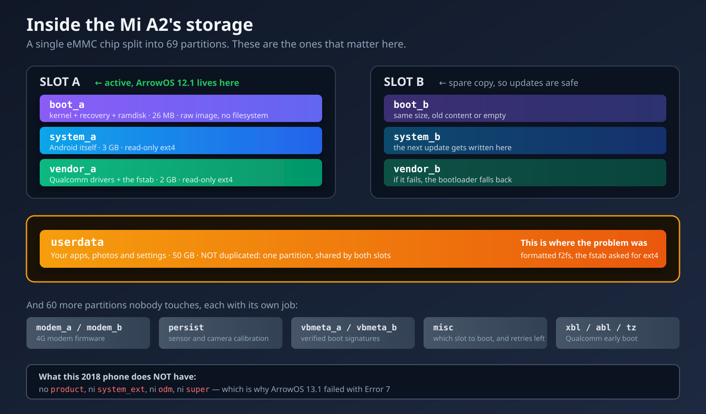

## Update: September 7th, 2026

I wrote this post back in February. Seven months later I decided to update the phone, and what was supposed to be a quiet afternoon turned into two days fighting a device that flatly refused to boot. It came down to **a single line in a config file**, but getting there meant ruling out half a dozen wrong theories first.

The original post is below, untouched. Here's what happened next.

### Where I started

I was still on LineageOS 18.1, an unofficial build from December 2023. Android 11. It worked fine, but it had gone two years without a security patch and it was starting to show.

First lesson, and I learned it before touching anything: **check what you're actually running**. I assumed I had something newer. One `getprop ro.build.display.id` settled it in a second. I'd been wrong about my own phone for months.

After comparing options I went with **ArrowOS**: it still had official builds for `jasmine_sprout` and the feedback was good.

### First, what a partition actually is, and why it explains everything

Worth stopping here, because everything that follows depends on this, and I glossed over it in
the original post.

A phone's internal storage **isn't a disk with folders** like a computer's. It's a single memory
chip (an eMMC, 64 GB in this case) that ships **split into fixed-size chunks called partitions**.
Each chunk has one job, and the layout can't be changed without rewriting the partition table —
an operation with a real chance of killing the phone for good. The Mi A2 has **69 partitions**.
Most of them nobody ever touches.



The four that matter for this story:

- **`boot`** — holds the Linux kernel and the initial ramdisk. On this phone it also holds the
  recovery, and we'll get to why that's unusual.
- **`system`** — Android itself: the framework, system apps, libraries. Mounted **read-only**,
  which is why a normal app can't modify the system.
- **`vendor`** — everything specific to the manufacturer and the chipset: Qualcomm drivers, WiFi
  firmware, and — this will matter — **the `fstab` file that says how each partition should be
  mounted**.
- **`userdata`** — your stuff: installed apps, photos, settings, accounts. By far the largest,
  around 50 of the 64 GB.

And then the ones I didn't know existed until I went looking: `modem` (4G modem firmware),
`persist` (sensor and camera calibration — wipe it and you lose auto-rotate), `vbmeta` (verified
boot signatures), `misc` (where the bootloader notes which slot to boot), and a dozen Qualcomm
early-boot partitions with cryptic names: `xbl`, `abl`, `tz`, `hyp`, `rpm`.

### A partition and a filesystem are not the same thing

This distinction is exactly where the problem hid from me for two days, so let me take it slowly.

A **partition** is the reserved space: "from this byte to that byte, this is called userdata."
It's an empty container.

A **filesystem** is how data is organised *inside* that container: where the index lives, how
directories point at things, how free space is tracked. It's a format, the same way `.pdf` and
`.docx` are different ways of storing a document.

A partition can hold any filesystem, but **whoever reads it has to know which one it is**. Think
of a VHS tape and a DVD: both are "a film", but putting the DVD in the VCR does nothing. Neither
one is broken. The machine just can't read that format.

The two in this story:

- **ext4** — Linux's standard filesystem since 2008. Mature, reliable, boring in the good way.
  It's what most Android ROMs use for `system`, `vendor` and `userdata`.
- **f2fs** — *Flash-Friendly File System*, built by Samsung in 2012 specifically for flash memory.
  In theory it performs better on phones, because it's designed around how NAND physically works.
  Some ROMs prefer it for `userdata`.

Neither is "the good one". What matters is that **what's inside the partition matches what the
system expects to find**.

### And now: what A/B partitions are

The Mi A2 is an **A/B** device, also called *seamless updates*. Google introduced it with Android 7
and made it mandatory for Android One phones.

The idea: instead of one `system`, you get **two complete copies** — `system_a` and `system_b`.
Same for `boot` and `vendor`. The phone boots from one set (the *active slot*) while the other
sits in reserve.

When an update arrives, it isn't installed over the system you're using: it's **written to the
inactive slot**, in the background, while you carry on using the phone. On reboot the bootloader
switches the active slot and you come up updated. If the update is broken and won't boot, the
bootloader **falls back to the previous slot on its own**, still intact.

It's an elegant design, and it has three practical consequences that hit me directly:

1. **There's no recovery partition.** With two copies of everything already, two more recovery
   partitions was too much space. So the recovery lives **inside `boot`**. That's why I flash TWRP
   to `boot` later on, and why I can boot it from RAM with `fastboot boot` without installing it.
2. **`userdata` is NOT duplicated.** There's only one, shared by both slots. It makes sense — you
   wouldn't want a system update to leave you with last week's photos. But it means **if `userdata`
   is broken, it doesn't matter which slot you switch to: the problem follows you**. Which is
   exactly what happened, and explains why reflashing the system over and over fixed nothing.
3. **The bootloader keeps a retry counter per slot.** If a slot fails several times in a row, it's
   marked unbootable and the bootloader jumps to the other one. I'll come back to this, because it
   cost me hours.

### Error 7, or when a ROM asks for partitions that don't exist

I downloaded ArrowOS 13.1, verified the checksum, made a backup, and on sideload:

```
Error 7 (kInstallDeviceOpenError)
```

Tried the Lineage Recovery. Same error. Flashed a fresh TWRP. Same error.

Rather than keep guessing, I pulled `payload.bin` out of the zip with `payload_dumper` and looked at which partitions it expected:

```
boot, system, vendor, product, system_ext, odm
```

And what my phone physically has:

```
boot, system, vendor
```

`product`, `system_ext` and `odm` **don't exist on the Mi A2**. It's a 2018 phone that shipped with Android 8.1, before those partitions were standard. It doesn't support dynamic partitions either, so they can't be created on the fly. `update_engine` was trying to open three block devices that weren't there, and gave up.

I confirmed it by listing all of `/dev/block/bootdevice/by-name/`. Other users reported the same thing on XDA, usually followed by "doesn't happen on 12.1". A packaging bug in that specific build.

### Second attempt: ArrowOS 12.1

This time I checked the manifest **before** flashing anything. Only `boot`, `system` and `vendor`, with sizes that matched. A clean build for this hardware.

The install was flawless. "Step 1/2, Step 2/2, Done processing script file." Not a single error.

I rebooted. ArrowOS logo. And that's where it stayed.

### A dumb detour: fastboot was missing a binary

Before that I ran `fastboot -w` to wipe userdata, and got this:

```
Erasing 'userdata'   OKAY
mke2fs failed with status 1
```

The wipe worked, but rebuilding the filesystem didn't. It turns out **the Debian/Ubuntu `fastboot` package is missing the `mke2fs` binary** it's supposed to ship in `/usr/lib/android-sdk/platform-tools/`. Not the phone's fault, not the ROM's fault: a distro packaging bug.

I worked around it by building an ext4 image by hand, sized exactly to the partition, using the system's own `mke2fs`, then flashing it with `fastboot flash userdata`. Half an hour burned on something completely unrelated to the real problem.

### The retry counter I didn't know existed

At some point the phone started showing me contradictory screens: "Can't load Android system", and sometimes claiming the active slot was B when I'd installed everything to A.

That had me going in circles until I checked:

```bash
fastboot getvar slot-retry-count:a
# slot-retry-count:a: 0
```

On an A/B device, the bootloader gives each slot a limited number of boot attempts. When they run out, **it switches to the other slot on its own** — which in my case had no system at all. Hence the confusing screens: I thought I was debugging ArrowOS while the phone was trying to boot an empty partition.

The fix is one line, and it's the kind of thing that costs you hours if you don't know it:

```bash
fastboot set_active a   # sets the slot and resets the counter back to 7
```

If you're debugging a failing boot, reset that counter **before** drawing conclusions about the ROM. I'd written off builds that were probably fine.

### 768 MB, the limit nobody warns you about

To rule out leftover bits of 13.1, I extracted `boot.img`, `system.img` and `vendor.img` from the 12.1 payload and flashed them straight over fastboot, skipping the installer.

`boot` and `vendor` went fine. `system` (3 GB) hung. No error, no timeout, nothing. The command just never finished.

```bash
fastboot getvar max-download-size
# max-download-size: 805306368   → 768 MB
```

The bootloader can't take more than 768 MB in one transfer. The fix is converting the image to *sparse* format, which splits the transfer up:

```bash
sudo apt install android-sdk-libsparse-utils
img2simg system.img system_sparse.img
fastboot flash system system_sparse.img
```

What bothers me here isn't the limit, it's that **fastboot says nothing**. It sits there silently and you assume it's just slow.

### Logs that ruled out everything except the actual problem

Clean verified partitions, counter at 7, userdata freshly formatted: still no boot. Ten minutes on the logo. Twenty. Nothing.

I needed logs. The catch is that on a phone that won't boot you can't use `adb` normally, and logcat only lives in that boot session's RAM — so rebooting into TWRP to investigate wipes exactly what you wanted to read.

The only thing that survives a reboot is the kernel log, in `pstore`. I got at it with a trick I rather liked:

```bash
fastboot boot twrp.img   # boots TWRP from RAM, flashing nothing
adb pull /sys/fs/pstore/console-ramoops-0
```

The log cut off cleanly around second 17. No panic. No error. Nothing.

I repeated it with the USB cable unplugged during boot, in case the USB controller was hanging while talking to the PC. Identical.

That left me with two facts: **the kernel boots perfectly**, and the hang happens later, in Android's own init, which doesn't get recorded there. Meanwhile `adb devices` showed the phone as `unauthorized`, steadily, with no disconnects. Meaning `adbd` was running. The boot was getting far, and then stopping.

### The real cause was a filesystem

The next day, with the phone in TWRP, I tried to mount `/data` to write the ADB key manually and get a live logcat. I got this:

```
mount: '/dev/block/bootdevice/by-name/userdata'->'/data': No such device
```

"No such device" sounds like a corrupt partition. It wasn't. I looked at the raw superblock:

```bash
blkid /dev/block/mmcblk0p69
# TYPE="f2fs"
```

Then I mounted the `vendor` partition read-only to read the installed ROM's own fstab:

```bash
mount -o ro /dev/block/bootdevice/by-name/vendor_a /vendor
cat /vendor/etc/fstab.qcom
```

```
/dev/block/bootdevice/by-name/userdata  /data  ext4  ...  wait,check,formattable,fileencryption=ice
```

**ext4.** The partition was **f2fs**.

That was the whole problem. `init` was trying to mount `/data` as ext4, couldn't, and without `/data` there's no Zygote, no SystemServer, no launcher. The kernel booted perfectly (hence the clean log), `adbd` came up from the ramdisk (hence the `unauthorized`), and there it sat forever.

The f2fs was inherited from LineageOS 18.1. And here's the detail that let it survive everything: **"format data" and factory resets reformat while keeping the existing filesystem type**. It doesn't matter how many times you reset. It was never going to fix it.

As for why the error was so unhelpful: the official TWRP kernel for this device **has no f2fs support compiled in**. You can see it in a second:

```bash
cat /proc/filesystems
# ext3, ext2, ext4, vfat, msdos... and no sign of f2fs
```

When the kernel doesn't know a filesystem, `mount` returns `ENODEV`, which prints as "No such device". It doesn't mean the device isn't there. It means it has no idea what to do with it.

### The fix, two days later

```bash
adb shell "mke2fs -F -t ext4 -b 4096 -L data -M /data /dev/block/mmcblk0p69"
adb shell "e2fsck -fp /dev/block/mmcblk0p69"
fastboot set_active a
fastboot reboot
```

I used the `mke2fs` that ships with TWRP, because its `/etc/mke2fs.conf` profile is Android's conservative one: no `64bit`, no `metadata_csum`, which is exactly what an Android 12 kernel on 2018 hardware expects.

Four minutes of first boot — normal after formatting `/data`, since the whole structure has to be created and encryption applied — and the welcome wizard showed up.

```
ro.arrow.version = Arrow-v12.1-jasmine_sprout-OFFICIAL-20221119-VANILLA
sys.boot_completed = 1
/dev/block/mmcblk0p69 on /data type ext4
```

### How I knew ext4 was the right side to fix

A nuance worth spelling out, because there were two ways to resolve the mismatch and only one was
valid.

The conflict was: partition in f2fs, fstab asking for ext4. In principle you fix that by changing
either side. I could have edited the fstab to ask for f2fs and left the partition alone.

You can't, for three reasons:

1. **`vendor` is mounted read-only**, and not arbitrarily: it's part of the image the ROM verifies
   at boot. Touching it means stepping into verified-boot territory.
2. Even if I managed to write there, **the next ROM change would overwrite it**, and the same
   problem would come back with no memory of why.
3. And the underlying reason: the fstab **isn't a preference, it's a declaration of what that ROM
   knows how to handle**. If ArrowOS 12.1 says ext4, it was built with ext4 support for `userdata`.
   Nothing guarantees its kernel has f2fs compiled in. Forcing it to mount something it may not be
   able to read trades a known failure for an unknown one.

So the partition adapts to the ROM, not the other way round. **The installed ROM's fstab is the
source of truth**, and that's the rule I'm keeping.

### What I didn't do, and why

Documenting the paths I rejected feels as useful as documenting the one that worked, because when
you're stuck, half the job is deciding what **not** to try.

**I didn't hand-write the ADB key into `/data/misc/adb/adb_keys`.** That was my clever plan for
getting a live logcat: pre-authorise the PC, and the moment `adbd` comes up I can connect even if
the system hangs afterwards. Good idea, impossible to execute: writing to `/data` means mounting
it, and it wouldn't mount. The plan died at step one. The funny part is that the reason I couldn't
mount it **was precisely the problem I was trying to diagnose**.

**I didn't repartition to create `product`, `system_ext` and `odm`.** It would have let ArrowOS
13.1 install. Rewriting the eMMC's GPT is possible, but there's no free space to put them — you'd
have to steal it from another partition — and a mistake there is one of the few that kills a phone
with no way back. The prize was Android 12 to Android 13. Nowhere near worth it.

**I didn't convert the phone into a Mi 6X.** Identical hardware, and it opens the door to more
ROMs. But it means flashing MIUI and another device's firmware, with anti-rollback in play: skip a
version by accident and the bootloader stays a 6X permanently. On top of that, while researching I
found that many ROMs for this phone are unified builds targeting `jasmine_sprout` and `wayne` at
once, so converting opens fewer doors than it promises.

**I didn't let the ROM reformat it itself.** And this one still nags at me. The fstab carries the
`formattable` flag, which in theory lets `init` reformat `/data` when the mount fails. It should
have fixed itself. It didn't. My hunch is that file-based encryption (`fileencryption=ice`)
complicates that path, but I haven't confirmed it and I'm not going to invent the explanation.
It's an honest loose end.

**I didn't use my PC's `mke2fs`.** I could have built the ext4 image on the laptop and flashed it
over fastboot. I chose to run the `mke2fs` that ships inside TWRP instead, because its
`/etc/mke2fs.conf` uses Android's conservative profile: no `64bit`, no `metadata_csum`. A modern
Ubuntu `mke2fs` turns those on by default, and an Android 12 kernel on 2018 hardware may not
support them. I'd have created a technically correct ext4 that the phone couldn't mount — the same
mistake again, wearing a different hat.

**I didn't restore LineageOS 18.1.** It was the safe exit and I had it the whole time: zip
downloaded, process proven, a ROM that worked. I passed because the point was to understand the
failure, not dodge it. If this had been someone's work phone on a deadline, the right call would
have been the opposite.

### Epilogue: the USB problem that wasn't the USB

The next day, with the phone working, something happened that's worth telling because **I got the
diagnosis wrong, and the mistake is more instructive than the fix**.

I plugged the phone into the computer and nothing showed up. It charged, screen on, but the PC
couldn't see it — not as a file device, not at all. Same cable, same port as the day before.

The kernel log said this:

```bash
dmesg | grep -i usb
# usb 3-1: new full-speed USB device number 86 using xhci_hcd
# usb 3-1: Device not responding to setup address.
# usb 3-1: device not accepting address 86, error -71
```

And comparing it against the previous day produced a contrast that looked conclusive:

| | Negotiated speed | Result |
|---|---|---|
| Day before | `high-speed` (480 Mbps) | Everything worked |
| That day | `full-speed` (12 Mbps) | `error -71` |

My reasoning: USB speed is negotiated by electrical signalling on the data lines, in hardware,
before the operating system gets involved. If a device that negotiated 480 Mbps now negotiates 12,
the signal has degraded. `error -71` is `EPROTO`, a physical-layer protocol failure. And searching
turned up **whole XDA threads about the Mi A2 with exactly that symptom**: charges but won't
transfer, with the USB port or the daughterboard as the culprit.

It all fit. I said it was the connector, explained how compacted lint pushes the cable out just far
enough that the central data pins lose contact while the outer power pins keep it, and recommended
cleaning it with a wooden toothpick.

I was wrong.

The test that took it apart was entering fastboot. The reasoning: in fastboot **Android isn't
running**, only the bootloader. If the problem were the ROM, fastboot would work; if it were the
connector, it would fail just the same.

```bash
# phone off: Volume Down + Power
fastboot devices
# d9cb7e   fastboot

fastboot boot twrp.img
# Sending 'boot.img' (32164 KB)   OKAY [ 0.923s]
```

32 MB in 0.9 seconds is about **35 MB/s**, real USB 2.0 speed. And this time the kernel said
`new high-speed USB device`. The connector was fine.

There were **two separate problems stacked on top of each other**, and neither was physical:

1. **Android's USB gadget had got stuck.** The `error -71` and the drop to full-speed came from the
   system's USB controller in a bad state, not from the cable. That's why it failed with two
   different cables: the problem travelled with the phone, not the cable. A reboot cleared it.
2. **The USB mode didn't include file transfer**, which was the original symptom:

```bash
adb shell getprop sys.usb.config
# adb
```

Just `adb`, no `mtp`. Android always boots into "no data transfer" and you have to enable it by
hand from the USB notification — easy to miss on a GApps-free build, where that notification is
more discreet. You change it like this:

```bash
adb shell svc usb setFunctions mtp
```

And the USB identifier went from `18d1:4ee7` (ADB only) to `18d1:4ee2` (MTP + ADB), with the phone
mounting as a file device. To make it stick:
**Settings → System → Developer options → Default USB configuration → File transfer**.

**What I take from being wrong**, which is the point: I had real evidence (the speed drop), a
correct technical explanation of that evidence (signalling is physical-layer), and external
confirmation (XDA threads with the same symptom). Three things pointing the same way. And the
conclusion was still false.

The mistake was that **a symptom consistent with an explanation doesn't confirm that explanation**.
Those XDA threads described a similar symptom, not my case. What was missing wasn't more supporting
evidence: it was **a test capable of telling the two hypotheses apart**. Entering fastboot did
exactly that, because it cleanly separates hardware from software, and it took thirty seconds.

Now, when a theory feels airtight, I try to ask what experiment would kill it if it were false. If
I can't think of one, I'm not diagnosing: I'm collecting clues that agree with me.

### Rooting with Magisk, while fastboot was up

With the phone sitting in fastboot, I installed Magisk. On an A/B device with no recovery
partition, the trick is booting TWRP in memory without flashing it:

```bash
# TWRP in RAM: touches no partition
fastboot boot twrp.img

# back up the current boot, just in case
adb shell "dd if=/dev/block/bootdevice/by-name/boot_a of=/tmp/boot_backup.img bs=1048576"
adb pull /tmp/boot_backup.img

# install Magisk
adb push magisk.zip /tmp/magisk.zip
adb shell "twrp install /tmp/magisk.zip"
```

The installer detects the active slot on its own and patches the right `boot`:

```text
- Current boot slot: _a
- Stock boot image detected
- Patching ramdisk
- Flashing new boot image
- Done
```

One detail specific to this device: since the recovery lives inside `boot`, flashing Magisk
overwrites that partition. That's why it's worth backing up `boot` first — and why TWRP gets booted
from RAM rather than installed.

### All the commands, in one place

For anyone landing here with the same problem, the operational summary.

**Diagnosis:**

```bash
# which ROM and version is actually running
adb shell getprop ro.build.display.id

# the real filesystem type of a partition
adb shell blkid /dev/block/mmcblk0p69

# what the installed ROM expects to mount (the source of truth)
adb shell "mount -o ro /dev/block/bootdevice/by-name/vendor_a /vendor"
adb shell cat /vendor/etc/fstab.qcom

# which filesystems the recovery's kernel can mount
adb shell cat /proc/filesystems

# which partitions physically exist
adb shell ls /dev/block/bootdevice/by-name/

# boot attempts the slot has left
fastboot getvar slot-retry-count:a
fastboot getvar slot-successful:a

# kernel log from the previous boot (survives a reboot)
fastboot boot twrp.img
adb pull /sys/fs/pstore/console-ramoops-0
```

**The fix:**

```bash
# format userdata to ext4 with Android's conservative profile
adb shell "mke2fs -F -t ext4 -b 4096 -L data -M /data /dev/block/mmcblk0p69"
adb shell "e2fsck -fp /dev/block/mmcblk0p69"

# reset the slot's retry counter (back to 7)
fastboot set_active a
fastboot reboot
```

**Flashing large images over fastboot:**

```bash
# the bootloader won't take more than 768 MB at once
fastboot getvar max-download-size
# max-download-size: 805306368

# convert to sparse format to chunk the transfer
sudo apt install android-sdk-libsparse-utils
img2simg system.img system_sparse.img
fastboot flash system system_sparse.img
```

**Inspecting a ROM before flashing it**, which would have saved me the Error 7:

```bash
pip install payload_dumper
payload_dumper payload.bin
# then check the payload's partitions actually exist on the device
```

### What I took away from this

**Always compare what's there against what the ROM expects.** If an A/B ROM hangs on the logo and the kernel boots clean, check each partition's type with `blkid` and hold it against the installed ROM's `fstab`. It's three commands, and it would have saved me two days. I kept reflashing `boot`, `system` and `vendor` when the problem was in none of them.

**An error message can mislead you without lying.** "No such device" had me thinking corruption. It was a missing capability in the recovery's kernel.

**A factory reset doesn't fix everything.** It doesn't change the filesystem. That runs against the intuition that resetting makes things new.

**Kernel logs only cover the kernel.** A clean `console-ramoops` doesn't mean the boot went well. It means the problem is further along, where that log isn't looking.

### So why not Android 15?

While I was at it, I looked into whether I could aim higher. The state of `jasmine_sprout` as of September 2026:

| ROM | Latest | Status |
|---|---|---|
| ArrowOS | 13.1 | Project stalled; that build broken on this phone |
| crDroid | Android 12 | No builds since January 2022 |
| PixelExperience | Android 13 | Project shut down in 2024 |
| LineageOS official | 18.1 | No maintainer, no builds |
| LineageOS 22.1 unofficial | **Android 15** | Exists, but the thread is closed and the dev moved on |

The interesting part is that **the device can absolutely handle Android 15**. LineageOS's official device tree has a `lineage-22.2` branch, and its `BoardConfig.mk` declares exactly this:

```makefile
AB_OTA_PARTITIONS += boot system vendor
```

Only the three partitions the Mi A2 has. `product` and `system_ext` go inside `system` as folders with symlinks, which is how you do it properly on older devices. ArrowOS 12.1 already does it: right now my phone has a `/product -> /system/product`.

So the 13.1 failure was never a hardware ceiling. It was a badly packaged build.

One correction to what I wrote in the original post about converting the Mi A2 into a Mi 6X: it's still a real option, but I'd temper it. Many ROMs for this phone are unified builds targeting `jasmine_sprout` and `wayne` at once, so converting doesn't always open as many doors as it sounds. And the process involves anti-rollback, which can leave your bootloader stuck as a 6X with no way back.

Build LineageOS 22.2 myself? Technically doable, and the tree is ready. It's around 300 GB between source and build objects — Android carries the kernel, Chromium for the WebView, and its own toolchain — and AOSP wants 32 GB of RAM. My laptop has 13 GB and no swap, so the build would die on memory about three hours in. Parked for now.

### Where I am now

ArrowOS 12.1, Android 12, working, and rooted with Magisk. The security patch is from October 2022, which isn't great, but this is my dad's daily phone and I'd rather have something stable and proven than an abandoned build with known WiFi problems.

Two days to change one line in an fstab. But now I know why it failed, which is what I was after.

---

## Update: September 11th, 2026 — the camera

Four days after calling the phone done, it turned out the camera does not work. You open Camera Go, it errors out, and there is no image. Neither rear nor front.

I assumed it was the app. I was wrong, and the road to understanding it holds a couple of lessons I find more useful than the problem itself.

### First things first: the system has no cameras

`dumpsys media.camera` is blunt about it:

```
Number of camera devices: 0
Number of normal camera devices: 0
```

And in the log, Camera Go is not failing. It is reporting.

```
E pck: No cameras available
```

Trying a different app would have changed nothing. It is the system that has no camera to offer.

### The hardware is perfectly fine, and here is how I proved it

The messages that matter show up during boot, so you have to capture them from the very first second:

```bash
adb reboot
adb wait-for-device
timeout 150 adb logcat -b all > boot.txt
```

And there it is:

```
wayne_imx376_sunny_back_i_eeprom_format_afdata:
  [xiaomi af otp] AF OTP(horizontal) DAC: macro 710 infinity 301
wayne_imx486_sunny_i_read_info: module_id = 0x1, 2018-8-19
wayne_imx376_sunny_front_i_eeprom_checksum: Checksum good, sum:3913
wayne_imx376_sunny_front_i_eeprom_format_wbdata: AWB : r/gr = 0.550781
```

That is the three camera modules answering on the I2C bus and handing over their factory calibration: the manufacturing date (August 2018), valid checksums, white balance values and lens shading matrices. A dead sensor does not answer that.

The kernel side was fine too: 24 `/dev/v4l-subdev*` nodes and their media devices created.

Hardware fine, kernel fine, and still zero cameras. The problem sat right in between.

### Where it dies

Right after reading the calibration:

```
QCamera : sort_camera_info: Number of cameras 0 sorted 0
QCamera : QCamera2Factory: 0 camera devices detected!
```

And slightly before that, the real clue:

```
sensor_sdk_util_get_i2c_freq_mode: Invalid i2c_freq_mode = 4
```

The sensor driver declares it speaks I2C in mode 4, and the sensor manager replies that no such mode exists. Two pieces that should understand each other, and do not.

### The cause: ArrowOS swapped the engine but kept Xiaomi's parts

To confirm it I compared the `vendor` partition of ArrowOS 12.1 with the one from LineageOS 18.1, the ROM this phone used to run. I pulled it out of `payload.bin` and opened it with `debugfs`, without touching the phone at all.

| | ArrowOS 12.1 | LineageOS 18.1 |
|---|---|---|
| Files in `/vendor/lib` | **752** | **1799** |

Less than half. And comparing the files present in both, one by one:

- The **306 `libchromatix_*`** libraries, which are Xiaomi's tuning data, are **identical**.
- The sensor driver `libmmcamera_wayne_imx376_sunny_back_i.so` is **identical**: 831,156 bytes in both.
- But **81 of the 97 shared `libmmcamera*` libraries differ in size**, and ArrowOS's are consistently smaller.

| Library | ArrowOS | LineageOS |
|---|---|---|
| `libmmcamera2_sensor_modules.so` | 1,113,468 | **1,579,136** |
| `camera.sdm660.so` (the HAL) | 1,177,420 | **1,442,456** |

There it is. **ArrowOS kept Xiaomi's sensor drivers and tuning data, but replaced the entire camera engine with a different build.** Xiaomi's blobs speak a dialect that engine does not understand, and that is where `Invalid i2c_freq_mode = 4` comes from.

Searching afterwards, it turns out to be a known bug in that build: the XDA thread for ArrowOS 12.1 on `jasmine_sprout` is closed, several users reported the same "No cameras available", and the maintainer went silent. It was fixed in ArrowOS 13. Which is, of course, exactly the build that will not install on this phone.

### The attempted fix, and two mistakes of mine worth telling

The idea was obvious: if the good engine is missing, overlay it with a Magisk module. No partitions touched, and fully reversible.

**First attempt**: I copied every `libmmcamera*` plus `camera.sdm660.so` from LineageOS 18.1. The camera service went from reporting zero cameras to not starting at all, restarting every five seconds.

```
dlopen failed: library "lib_lowlight.so" not found: needed by camera.sdm660.so
```

I had filtered by name, and `lib_lowlight.so` does not start with `libmmcamera`. A rookie mistake.

**The right way** is to stop guessing and read each binary's actual dependencies:

```bash
readelf -d library.so | grep NEEDED
```

And resolve it transitively, because dependencies have dependencies. Doing that surfaced **16 more libraries**, all Xiaomi proprietary blobs that ArrowOS had dropped: `lib_lowlight.so`, `libarcsoft_beautyshot.so` (29 MB), `libmibokeh_660.so` (35 MB), `libMiWatermark.so`, `libvidhance.so`, `libXMFD_AgeGender.so`...

Which reinforced the diagnosis: ArrowOS did not just swap the engine, it also threw away the blobs that engine depends on.

**Second attempt**: 120 libraries, zero pending dependencies. Exact same error. The file was right there — I could see it with `ls` — and the linker still claimed it could not find it.

The explanation is one you do not forget:

```
lib_lowlight.so   →  u:object_r:system_file:s0     ← wrong
/vendor/lib       →  u:object_r:vendor_file:s0     ← correct
/vendor/lib/hw    →  u:object_r:vendor_hal_file:s0
```

**Magisk labels everything you put under `system/` as `system_file`.** When a file replaces an existing one it clones the original's context, which is why the `libmmcamera*` ones were fine. But **new files** have nothing to clone from. And the camera HAL runs in an SELinux domain that may only read `vendor_file`, so as far as it was concerned those libraries simply did not exist.

The fix goes in the module's `customize.sh`:

```bash
set_perm_recursive $MODPATH/system/vendor/lib 0 0 0755 0644 u:object_r:vendor_file:s0
set_perm $MODPATH/system/vendor/lib/hw 0 0 0755 u:object_r:vendor_hal_file:s0
```

A trick to spot this without root: from `adb shell`, the **wrongly** labelled files read just fine, while the correct ones show up as `-?????????`. If you can see yours but not the system's, your label is wrong.

### The actual wall

With everything fixed, Xiaomi's HAL **started**. It got as far as reading the module manufacturer:

```
QCamera : MIPreview: mManufacturer = longcheer
```

And died one step later:

```
mct_shimlayer_process_module_init: Failed to open config node. errno 21
```

LineageOS's camera stack cannot find the kernel's config node. With the module in place the kernel exposed 1 `/dev/media` and 21 subdevices; without it there were 4 and 24, because those extra nodes were created by the part of ArrowOS's HAL that did work.

In short: I had traded one incompatibility for another.

- **ArrowOS**'s HAL does not understand **Xiaomi**'s sensor blobs.
- **LineageOS**'s HAL does not understand **ArrowOS**'s kernel.

Using LineageOS's stack would require its kernel too, and at that point you are just installing LineageOS. **There is no userspace fix.** I removed the module, since it left the service looping and draining battery for nothing.

### What I am taking away

That an Android HAL is not a single part: it is a three-way contract between the kernel, the manufacturer's blobs and Qualcomm's layer. You can swap one of the three and sometimes get away with it, but when all three come from different places no module will save you.

And a practical rule that would have saved me two attempts: **never pick which libraries to copy by their name**. Use `readelf -d` and close the dependency graph. Names lie.

The camera still does not work. The only real fix would be going back to LineageOS 18.1, with its kernel and vendor consistent with each other, and that means a reflash and losing the data. It is my dad's daily driver, he barely uses the camera, and I would rather not touch it. Sometimes the right answer is to leave it alone.

---

## The original post (February 2026)

## Introduction

I had a **Xiaomi Mi A2** collecting dust in a drawer. The phone works perfectly hardware-wise, but Xiaomi dropped support for it years ago. It was stuck on Android 10 with no security patches, no updates, and more and more apps becoming incompatible.

Instead of tossing it or letting it die, I decided to install a **Custom ROM** to give it a second life. What seemed like a straightforward process turned into an odyssey of wrong ROMs, broken links, abandoned projects, and GApps that refused to work. But in the end, I got it done, and now I have a perfectly functional phone running modern Android.

This post documents the entire process: the real problems I had, how I solved them, and what I installed afterwards to have a useful phone without depending on Google.

## Why a Custom ROM

When a manufacturer abandons a device, you have several options:

1. **Keep using it as-is**: No security patches, increasingly incompatible apps.
2. **Buy a new phone**: The easy but expensive and wasteful option.
3. **Install a Custom ROM**: Give it a second life with an updated Android.

The third option is the most interesting if you like tinkering and don't mind getting your hands dirty. Plus, you're reducing e-waste.

## Knowing the Device: Xiaomi Mi A2

Before touching anything, it's important to understand what device you have:

- **Codename**: `jasmine_sprout`
- **Program**: Android One (Google's "pure" Android)
- **Partition system**: **A/B** (this is important, I'll explain why later)
- **Last official Android**: Android 10
- **Status**: End of Life (EOL), no manufacturer support

The codename (`jasmine_sprout`) is crucial. It's what you need to search for when looking for ROMs and recoveries. If you search for just "Xiaomi Mi A2", you might get results for the Mi A2 Lite (which is a completely different device).

### What Are A/B Partitions?

Unlike older devices that have a single system partition, the Mi A2 has **two partitions** (slot A and slot B). The system boots from one while the other is used for updates. This has important implications:

- **No dedicated recovery partition**: The recovery shares space with the boot partition.
- **TWRP can be problematic**: Some A/B devices don't play well with TWRP.
- **You must flash to the correct slot**: If you flash to the wrong slot, you can end up with a system that won't boot.

## Preparation: Tools from Linux

I did the entire process from **Ubuntu**, which is much easier than Windows for this kind of thing. No weird drivers or third-party programs needed:

```bash
sudo apt install adb fastboot
```

That's all you need. On Windows, you'd need to install Xiaomi-specific USB drivers, the Android SDK, and pray everything works. On Linux, you plug in the phone and you're good to go.

### Verifying the Connection

```bash
# With the phone connected and USB debugging enabled
adb devices

# Should show something like:
# List of devices attached
# XXXXXXXX    device
```

If it shows `unauthorized`, accept the USB debugging prompt on the phone screen.

## Step 1: Unlocking the Bootloader

The bootloader controls what software can boot on the phone. By default, it's locked to prevent installing unofficial software.

### Enabling Developer Options

1. Go to **Settings → About Phone**
2. Tap **Build Number** 7 times in a row
3. Go back to Settings, you'll now see **Developer Options**
4. Enable **OEM Unlock** and **USB Debugging**

### Unlocking

```bash
# Reboot into bootloader mode
adb reboot bootloader

# Unlock (THIS ERASES ALL DATA)
fastboot flashing unlock
```

**IMPORTANT**: Unlocking the bootloader **completely wipes the phone**. Back up everything first. It also voids the warranty (though on a 2018 phone, that hardly matters).

Confirm the unlock on the phone screen using the volume and power buttons.

## Step 2: The Odyssey of Finding the Right ROM

This is where the real adventure began. Finding a compatible ROM for an abandoned device isn't as easy as it seems.

### Attempt 1: Official LineageOS

My first choice was **LineageOS**, the most well-known and reliable Custom ROM. I went to their official website, searched for the Mi A2... and nothing. **Official support for jasmine_sprout had been retired (EOL)**. LineageOS no longer maintains official builds for this device.

### Attempt 2: PixelExperience

My second choice was **PixelExperience**, a ROM that replicates the Google Pixel experience. But upon searching, I discovered that **the PixelExperience project had shut down**. It no longer exists. Some forks like PixelOS are still active, but they didn't have Mi A2 support.

### Attempt 3: The Wrong Link

Searching through forums, I found a link that looked promising. I downloaded it, started reading the instructions, and... it was a ROM for a **Samsung Galaxy S5**. Yes, I downloaded a completely wrong ROM. Lesson: **always verify the device codename** before flashing anything.

### Attempt 4: XDA to the Rescue

Finally, I did what I should have done from the start: search directly on **XDA Developers** for the codename `jasmine_sprout`.

I found a thread for **LineageOS 18.1 Unofficial** maintained by a community developer. It's not official, but it has regular updates and good user reviews.

## Step 3: Installing the Recovery

To install a Custom ROM, you need a **custom recovery**. The recovery is a mini operating system that lets you flash ROMs, make backups, and format partitions.

### TWRP vs Lineage Recovery

There are two main options:

- **TWRP**: The most well-known recovery, with a touch interface and many options. But on A/B devices, it can cause problems.
- **Lineage Recovery**: Simpler, text-based, but works perfectly with A/B devices.

For the Mi A2, I went with **Lineage Recovery** as recommended by the ROM developer.

### Flashing the Recovery

```bash
# Make sure you're in bootloader mode
adb reboot bootloader

# Flash recovery to boot partition
fastboot flash boot recovery.img

# Reboot into recovery
fastboot reboot recovery
```

### The "Reboot to Recovery" Trick

With A/B partitions, there's an important trick: after flashing the recovery, **don't reboot normally**. Use the "Reboot to Recovery" option from the recovery itself or from fastboot. If you reboot normally, the system might overwrite the recovery you just installed.

## Step 4: Installing the ROM

Once in recovery, the process is relatively straightforward:

```bash
# From recovery, enable sideload mode
# (select "Apply update" → "Apply from ADB")

# From your PC, send the ROM
adb sideload lineage-18.1-jasmine_sprout.zip
```

Wait for it to finish (it can take a few minutes) and **don't reboot yet**.

## Step 5: The GApps Drama

This is where one of the biggest problems came. If you want the Play Store and Google services, you need to install **GApps** (Google Apps) separately, since LineageOS doesn't include them for legal reasons.

### The Problem

I tried several GApps options:

- **MindTheGapps**: Install error.
- **LiteGApps**: Same errors.
- **NikGApps**: Didn't work either.

After researching in the XDA thread, I discovered that **many users reported the same GApps issues with this specific ROM**. It was a known problem without a clear solution at the time.

### The Decision

I had two options:

1. Keep searching for a ROM + GApps combination that worked.
2. Use the phone **without Google services** and find alternatives.

I went with the second option. And honestly, it was one of the best decisions I could have made. More on that later.

## The Nuclear Option: Converting Mi A2 to Mi 6X

An interesting fact I discovered during research: the **Xiaomi Mi A2** and the **Xiaomi Mi 6X** are essentially **the same hardware**. The difference is that the Mi A2 comes with Android One (stock Android) and the Mi 6X comes with MIUI.

Some XDA developers suggest **converting the Mi A2 to Mi 6X** by flashing the 6X firmware. This opens the door to many more ROMs, since the Mi 6X (codename `wayne`) has more community support, including ROMs with Android 14 and 15.

I didn't do this in my case because the LineageOS ROM was already working well, but it's an option worth considering if you want more ROM variety.

## Step 6: Rooting with Magisk (Optional)

If you want root access on your device (total system control), you can install **Magisk**:

1. Download the Magisk APK from its official GitHub.
2. Rename the `.apk` file to `.zip`.
3. From recovery, flash the zip with `adb sideload`.

```bash
# Rename
mv Magisk-v27.0.apk Magisk-v27.0.zip

# Flash from recovery
adb sideload Magisk-v27.0.zip
```

Magisk gives you "systemless" root access, meaning it doesn't modify the system partition directly. This makes future ROM updates easier.

**What is root good for?** Things like:

- Removing system bloatware
- Using apps that require root (Titanium Backup, AdAway)
- Advanced system customization
- Magisk modules (like Viper4Android for better audio)

## Step 7: Alternative Apps - Life Without Google

This was the most surprising part of the process. I discovered that you can have a perfectly functional phone without depending on Google services.

### Aurora Store - Play Store Without a Google Account

**Aurora Store** is an alternative Play Store client. It lets you download any app from the Play Store **without needing a Google account** or Google services installed.

- You can use an anonymous account
- Downloads the same APKs as the official Play Store
- Clean interface without bloatware
- Automatic app updates

### NewPipe - YouTube Without Ads or Tracking

**NewPipe** is an open-source YouTube client that doesn't use Google's official API:

- **No ads** (you don't even need an ad blocker)
- **Background playback** (what YouTube Premium charges for)
- **Video and audio downloads** directly
- **No Google account** needed
- Import your subscriptions from YouTube

Honestly, the experience is better than the official YouTube app in many ways.

### Other Useful Apps

- **F-Droid**: Open-source app store. Lots of privacy apps and utilities.
- **Obtainium**: Update manager that downloads directly from GitHub/GitLab.

## Problems I Had and How I Solved Them

### "I can't find my device with adb"

**Problem**: When connecting the phone, `adb devices` showed nothing.

**Solution**: Making sure USB debugging was enabled and that I had accepted the debugging prompt on the phone screen. On Linux, you sometimes need to add udev rules:

```bash
# Create udev rule for Xiaomi
echo 'SUBSYSTEM=="usb", ATTR{idVendor}=="2717", MODE="0666", GROUP="plugdev"' | sudo tee /etc/udev/rules.d/51-android.rules
sudo udevadm control --reload-rules
```

### "The recovery won't boot"

**Problem**: After flashing the recovery, the phone booted into the normal system instead of recovery.

**Solution**: With A/B partitions, you need to be careful with slots. I used `fastboot --set-active=a` to make sure I was on the correct slot, and rebooted directly to recovery without going through the normal system.

### "The ROM won't install due to signature"

**Problem**: When attempting sideload, the recovery rejected the ROM due to signature verification.

**Solution**: In Lineage Recovery, disable signature verification before installing. This is normal for unofficial ROMs.

### The Bootloop

**Problem**: After installing the ROM, the phone was stuck in an infinite reboot loop showing the logo.

**Solution**: Format the data partition from recovery (this erases all user data) and reflash the ROM. Bootloops usually happen when there are remnants from the previous system that are incompatible with the new ROM.

## Important Disclaimers

Before you jump into doing this:

- **You lose your warranty**: Unlocking the bootloader voids the manufacturer's warranty.
- **Risk of bricking**: If something goes wrong, you could render the phone unusable (though with the Mi A2, it's quite hard to cause a permanent brick thanks to EDL mode).
- **Back up everything**: Before starting, save all your photos, contacts, and important data.
- **Read before acting**: Read the complete XDA thread before flashing anything. Other users' comments are pure gold.
- **Charged battery**: Make sure you have at least 70% battery before starting.

## Conclusion

What started as "I'll just install a ROM real quick" turned into several hours of research, failed attempts, and learning. But the result was worth it:

- **Phone with updated Android** instead of abandoned Android 10.
- **Faster** than with the original system (Custom ROMs tend to be more optimized).
- **No bloatware** or unnecessary pre-installed apps.
- **Alternative apps** that in many cases are better than the official ones.
- **Knowledge gained** about how Android works at a low level.

A phone that was headed straight for a drawer is now perfectly functional for daily use: browsing, watching videos, listening to music, messaging, and much more.

If you have an old phone collecting dust, give it a chance before tossing it. You're not just saving money, you're reducing e-waste and learning things most users will never see.

---

*If you have any questions or want to share your experience with Custom ROMs, feel free to reach out on [LinkedIn](https://linkedin.com/in/raul-casado) or [GitHub](https://github.com/RaulCasado).*
