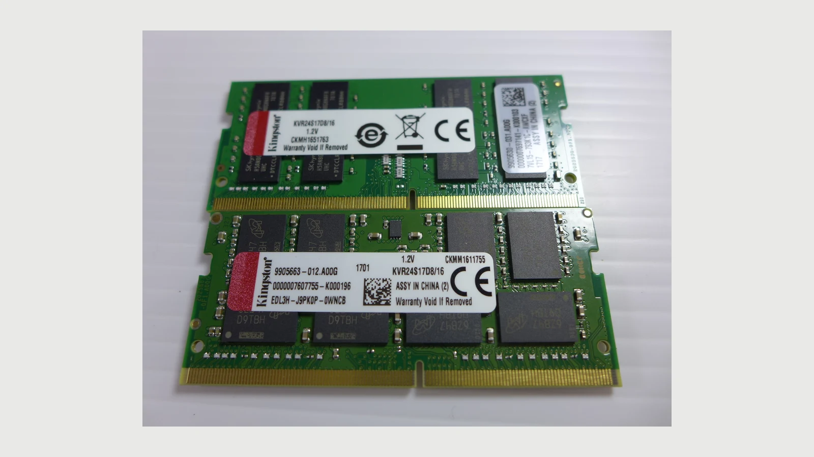

La primera vez que le pedí a Hermes que dijera hola, tardó **5 minutos y 18 segundos**. El modelo ya había superado pruebas de código y generaba texto a una velocidad que parecía aprovechable. ¿Dónde se estaba yendo el tiempo?

Quería hablar desde Telegram con un agente que funcionase en mi servidor de casa. Para llegar hasta ahí amplié la RAM, comparé modelos y probé herramientas. Cuando el bot respondió, escribí «ya contestó jeje». La conexión estaba resuelta; la utilidad cotidiana todavía había que comprobarla.

Esta vez la máquina era un HP ProDesk 400 G6 Mini, con **i5-10500T, seis núcleos y doce hilos**. Tenía gráfica integrada, pero estas pruebas se hicieron con el procesador, la CPU. Es otro equipo distinto al Ryzen con GTX 1080 Ti de mi [laboratorio anterior](/es/blog/local-ai-lab-old-pc/). Además, seguía manteniendo los servicios de casa: llenar la memoria para una respuesta corta tenía consecuencias para el resto.

## Qué hace Hermes que no haga el modelo

**Hermes Agent, de Nous Research, coordina un modelo, herramientas y una conversación.** El modelo genera texto o solicita una acción; Hermes ejecuta las herramientas disponibles y le devuelve sus resultados. Ese bucle permite que una petición requiera varias operaciones antes de contestar.

Por ejemplo, si pido resumir un archivo, el modelo puede solicitar su lectura. Hermes la ejecuta, incorpora el contenido a la conversación y vuelve a consultar al modelo. Entonces llega el resumen, o quizá otra petición de herramienta.

Decir «he leído el archivo» es fácil para un modelo. Comprobar que hubo una llamada real, que leyó el archivo correcto y que el resumen es fiel requiere mirar el trabajo del programa que lo rodea.

En mi montaje, **Ornith era el modelo**. **llama.cpp** hacía la inferencia, los cálculos necesarios para generar la respuesta. Su programa `llama-server` atendía peticiones y un router seleccionaba el modelo por nombre y lo cargaba bajo demanda. Hermes utilizaba esa API local y añadía sesiones, herramientas y el acceso desde Telegram.

La API tenía un formato compatible con OpenAI; las peticiones seguían dentro de este montaje local. La [documentación de herramientas de Hermes](https://hermes-agent.nousresearch.com/docs/user-guide/features/tools) explica cómo se agrupan las operaciones disponibles. Los permisos efectivos dependen también de dónde se ejecutan y de los archivos que se les dejan ver.

Había preguntado por sus diferencias con Claude Code, OpenCode y Oh My Pi. Con Hermes quería probar terminal y mensajería. Antes tenía que elegir un modelo que pudiese terminar tareas en esa CPU.

## Elegir algo que cupiese sin ocupar todo el servidor

Empecé con 16 GB de RAM en un solo módulo. Las primeras pruebas combinaron una medida de velocidad con un pequeño examen en español. El examen inicial de cuatro preguntas se quedó corto: varios modelos acertaban todo y aun así daban respuestas bastante distintas.

Lo ampliamos a siete tareas de lógica, JSON, resumen, español, código y recuperación de información con fechas contradictorias. Gemma-4-E4B hizo 6/7 en 78 segundos; Ling-3.0-tiny, 3/7 en 29. Uno respondía mejor en esa muestra; el otro tenía una ventaja clara de rapidez para trabajos sencillos.

También quise probar un modelo mayor con Colibri. Qwen3.6-35B superó las siete preguntas, pero producir 326 tokens llevó 549 segundos, unos 0,6 tokens/s efectivos. Para ese ensayo hubo que liberar recursos parando Minecraft. Había conseguido ejecutarlo, pero el coste de usarlo era difícil de encajar en un servidor compartido.

Un **token** es una unidad del tokenizador: puede ser una palabra, un fragmento o un signo. La velocidad en tokens/s describe cuánto texto genera un modelo según ese tokenizador. Para comparar experiencia de uso también hace falta cronometrar cuánto tarda en empezar y en terminar la tarea.

### Lo que cambió con el segundo módulo

Pregunté por añadir otros 16 GB frente a comprar dos módulos de 32. Me interesaba el rendimiento que ganaría y el margen para mis servicios.

Con la ampliación quedaron **32 GB en doble canal**, a unos 2667 MT/s. Además de capacidad, gané otro canal de acceso a memoria. En inferencia con CPU hay que mover muchos pesos del modelo; tener más hilos disponibles sirve de poco si esperan a esos datos.

La comparación antes/después conservaba modelo, cuantización y seis hilos de generación:

| Modelo | 16 GB, un canal | 32 GB, dos canales |
| --- | ---: | ---: |
| Gemma-4-E4B IQ4_XS | 6,48 tokens/s | 9,55 tokens/s |
| Ling-3.0-tiny IQ4_XS | 18,89 tokens/s | 27,67 tokens/s |

La mejora de generación rondó el 47 %. La lectura de entrada mejoró bastante menos: Gemma pasó aproximadamente de 48,8 a 50,1 tokens/s; Ling, de 125 a 134,1. Aumentar capacidad y activar el segundo canal formaban parte del mismo cambio, así que no aislé la contribución de cada uno.



*Foto de referencia, no de mis módulos: [Kenming Wang](https://commons.wikimedia.org/wiki/File:KVR24S17D8-16_x2_20170724.jpg), [CC BY-SA 2.0](https://creativecommons.org/licenses/by-sa/2.0/). Versión redimensionada con márgenes; misma licencia.*

## La cuantización que elegí no era la más rápida

Los pesos son los números aprendidos por el modelo. Se pueden guardar con distinta precisión. **Cuantizar** consiste en aproximarlos usando menos bits, lo que reduce el espacio necesario y puede cambiar la calidad de las respuestas.

Al hablar de cuatro bits, la idea es dedicar alrededor de cuatro bits por peso en lugar de, por ejemplo, dieciséis. Ese cálculo ideal reduciría a una cuarta parte el espacio de esos pesos. El archivo y la RAM total incluyen más cosas: metadatos por bloques, partes con otra precisión y memoria para procesar la conversación.

Los nombres `IQ4_XS` y `Q4_K_M` identifican esquemas distintos. Ni siquiera el «4» promete exactamente cuatro bits efectivos por cada peso del archivo. La [referencia de cuantizaciones GGUF](https://huggingface.co/docs/hub/gguf) permite consultar esas diferencias.

Con 32 GB comparamos varios formatos. Este es el contraste que más influyó en la decisión, medido con `llama-bench`, seis hilos y generación de 128 tokens:

| Modelo y cuantización | GGUF, GB | Generación, tokens/s | Pico residente, GiB |
| --- | ---: | ---: | ---: |
| Qwen3.6-35B-A3B IQ4_XS | 17,7 | 8,30 | 16,7 |
| Qwen3.6-35B-A3B Q4_K_M | 22,1 | 8,64 | 28,8 |
| Gemma-4-26B-A4B IQ4_XS | 13,6 | 6,91 | 16,8 |
| Gemma-4-26B-A4B Q4_K_M | 16,9 | 7,69 | 24,0 |

El pico residente, o RSS, es la memoria del proceso presente en RAM durante la prueba. Se expresa aquí en **GiB**; los tamaños de descarga, en **GB**. Un GiB son aproximadamente 1,074 GB. Son medidas distintas, y el pico observado tampoco es una reserva fija que valga para cualquier contexto.

En Qwen elegí IQ4_XS: ahorraba unos **12 GiB de memoria residente observada** a cambio de unas décimas de token por segundo. Ese margen importaba más que ganar la columna de velocidad. No repetimos toda la batería de calidad para cada cuantización, de modo que la tabla solo justifica ese intercambio de rendimiento y memoria.

También importaba la arquitectura. Qwen3.6-35B-A3B es un **MoE**, una mezcla de expertos: de sus parámetros totales activa una parte en cada paso. El modelo denso Qwen3.8-27B recorría sus capas sin esa selección de expertos y generaba alrededor de 1,3–1,8 tokens/s en las configuraciones base. Los parámetros activos afectan al trabajo por token; los pesos totales siguen necesitando almacenamiento y memoria.

## Cómo decidí cuáles conservar

La pregunta fue cambiando de «¿cuál saca más nota?» a «¿para qué tarea conservaría este?». Comprobamos conocimientos, matemáticas, instrucciones, código, herramientas y respuestas basadas en documentos. Estas son muestras del laboratorio, con subconjuntos y adaptaciones, no puntuaciones oficiales de los modelos:

| Modelo | Conocimientos | Instrucciones | Respuestas con documentos |
| --- | ---: | ---: | ---: |
| Qwen3.6 IQ4_XS | 166/200 | 19/20 | 51/60 |
| Gemma26 IQ4_XS | 163/200 | 19/20 | 53/60 |
| Ornith35 Q4_K_M | 157/200 | 16/20 | 54/60 |
| Ling IQ4_XS | 141/200 | 18/20 | 49/60 |

Ornith no ganó todas las columnas. Lo elegí para tareas y escritura por la combinación de resultados, una aplicación terminada y el estilo que preferí al leer las muestras. Gemma quedó para conversación, Qwen como alternativa y Ling para trabajos cortos. La clasificación de correo con datos reales seguía sin probarse.

Hubo una sola ejecución por configuración en muchas de estas pruebas. Sirvieron para seleccionar candidatos y detectar fallos grandes; diferencias de unas pocas respuestas no establecen una clasificación estadística.

### Mellum: 39 funciones correctas y ninguna aplicación

Un subconjunto de 40 ejercicios tipo HumanEval comprobaba funciones mediante tests. Qwen y Gemma26 hicieron 40/40; Ornith, 38/40; Mellum, 39/40.

Después pedimos una aplicación de tareas en HTML, CSS y JavaScript, sin librerías, dentro de un contenedor sin internet. El resultado debía superar 18 comprobaciones con jsdom, una herramienta que permite probar parte del comportamiento de la página sin abrir un navegador completo.

| Combinación | Comprobaciones | Tiempo | Peticiones |
| --- | ---: | ---: | ---: |
| Ornith35 + aider | 18/18 | 6 min | 3 |
| Ornith35 + OpenCode | 18/18 | 14 min | 7 |
| Gemma26 + OpenCode | 18/18 | 10 min | 6 |
| Qwen3.6 + aider | 16/18 | 8 min | 3 |
| Qwen3.6 + OpenCode | 16/18 | 14 min | 8 |
| Mellum + OpenCode | No terminó | 55 min | 345 |

Qwen falló el mismo texto del contador con ambas herramientas. Mellum generaba unos 18 tokens/s, pero acumuló 345 peticiones sin crear la aplicación. Resolver una función y coordinar archivos con herramientas eran trabajos diferentes.

Esta prueba cambió más mi selección que añadir otra pregunta de conocimientos. Tampoco convertía 18/18 en una aplicación lista para publicar: jsdom no revisaba todos los aspectos visuales ni de accesibilidad.

### Encontrar la evidencia y utilizarla son dos pruebas

**RAG**, generación aumentada con recuperación, añade una búsqueda antes de la respuesta: se recuperan fragmentos de documentos y se pasan al modelo. Así puedo preguntar sobre mis notas sin entrenarlo con ellas.

En la ronda de los seis candidatos adicionales se encontró el fragmento correcto en 59 de 60 consultas, pero los generadores acertaron entre 39 y 51 respuestas. El buscador había hecho casi todo su trabajo; quedaba comprobar si el modelo usaba bien la evidencia.

Comparamos BM25, que puntúa términos, con embeddings, vectores que permiten comparar similitud, y con una combinación de ambos. En el corpus preparado, BM25 competía bien con el híbrido y superaba a usar solo embeddings. Para otro corpus habría que repetir la prueba: nombres exactos y conceptos expresados con palabras distintas plantean problemas de búsqueda diferentes.

La batería de herramientas tenía ocho casos de calendario, correo, documentos y notas. Incluía una conversación que no debía llamar a ninguna herramienta y una instrucción maliciosa dentro de una fuente. Qwen, Gemma26 y Ornith35 hicieron 8/8; Ling, 6/8. Ahí comprobábamos selección de operaciones y argumentos, todavía lejos de demostrar que el agente pudiera administrar mis servicios.

## Qué optimizaciones ayudaron y cuáles empeoraron el resultado

Pedí revisar la primera respuesta, los parámetros y la calidad en tareas cotidianas. Resultó importante separar tres tiempos: cargar el modelo, leer la entrada y generar la salida.

El **repack** prepara internamente los pesos para el cálculo. En Ornith, desactivarlo redujo una carga observada de unos 38 a 19 segundos y la generación pasó de unos 9,7 a 11,1 tokens/s. Ajustar el margen de memoria y la caché de archivos ayudó también: la primera petición observada pasó de 90–124 segundos a unos 16 con los cambios combinados.

Con Ling, desactivar repack hizo caer la generación de unos 26,9 a 21,9 tokens/s. Lo conservamos para él. A partir de ahí, cada ajuste necesitaba comprobarse por modelo en vez de copiar la configuración del favorito.

También probamos **generación especulativa**: preparar candidatos para los siguientes tokens y hacer que el modelo objetivo los verifique. Solo compensa si acepta suficientes candidatos respecto al coste del borrador. Con Qwen3.8 y una cabeza MTP, predicción de varios tokens, una prueba de código pasó de unos 1,64 a 3,1 tokens/s. Seguía tardando 37 minutos en la aplicación de tareas. En Ornith, el borrador probado empeoró ligeramente la velocidad.

El razonamiento tenía otro coste. En 15 tareas, Ornith sin razonamiento a temperatura 0,3 hizo 15/15 en 184 segundos; con razonamiento y temperatura 0,6, 15/15 en 476. Ling pasó de 12/15 en unos 51 segundos a 15/15 en 235. La temperatura controla el muestreo del texto; el razonamiento añade trabajo antes de la respuesta. Esos ajustes se eligieron para usos concretos y con una muestra pequeña.

## Por qué el agente tardaba tanto en decir hola

Con el modelo elegido montamos Hermes en Docker, con configuración y sesiones persistentes. Su terminal trabajaba dentro del contenedor; no se le montó el socket de Docker del host. Para analizar el servidor le dimos instantáneas de solo lectura.

Aquella instalación rechazaba contextos menores de 64K, así que preparamos una ventana de **65.536 tokens**, frente a los 16K habituales de los modelos grandes. El **contexto** reúne instrucciones, historial, resultados de herramientas y espacio para responder. Mantener estados de atención en la caché KV ocupa memoria además de los pesos.

La ventana dice cuánto cabe. El **prefill** dice cuánto cuesta procesar la entrada antes de generar el primer token de respuesta.

Una microprueba envió el mismo texto largo a Ornith y Qwen, con un máximo de 120 tokens de salida:

| Modelo | Entrada | Tiempo total | Lectura de entrada |
| --- | ---: | ---: | ---: |
| Ornith | 13.958 tokens | 342 s | 43,9 tokens/s |
| Qwen | 13.958 tokens | 452 s | 34,2 tokens/s |

La cuenta ayuda a ver la escala: **13.958 / 43,9 ≈ 318 segundos**, unos cinco minutos leyendo antes de completar la salida. Ornith usó unos 22,18 GiB en esa prueba; Qwen, 13,33. Elegimos menos espera a cambio de más memoria.

El saludo inicial de Hermes llevó 5:18. Una tarea posterior que creaba y leía un archivo temporal registró 31 segundos dentro de Hermes y unos 42 para el comando completo. La caché de prefijo podía reutilizar cálculo en peticiones posteriores. Los tiempos pertenecen a tareas y cronómetros distintos, pero explican por qué el estado de la sesión cambiaba tanto la espera.

La [guía local de Hermes](https://hermes-agent.nousresearch.com/docs/guides/local-ollama-setup) también describe ese coste de entrada. Con herramientas aparecen nuevas vueltas al modelo; cada archivo leído puede hacer más grande la siguiente petición.

## La batería con datos del servidor

Pedí pruebas progresivas de disco, RAM, procesos y logs, sin modificar nada. Las ejecutamos secuencialmente sobre instantáneas y revisamos las salidas frente a los archivos. Los tiempos siguientes son de tarea completa:

| Encargo | Tiempo, min:s | Resultado de la revisión |
| --- | ---: | --- |
| Inventario de contenedores | 6:28 | Enumeró procesos, pero llamó sanos a algunos que solo constaban como arrancados |
| Disco y memoria | 4:02 | Distinguió memoria disponible y caché; no interpretó toda swap usada como emergencia |
| Ordenar CPU y RAM | 4:50 | Encontró parte de los dominantes, pero ordenó mal varios valores |
| Consultas y bloqueos DNS | 4:43 | Confundió frecuencias de un log de errores con las consultas de toda la red |
| Errores de varios servicios | 7:33 | No terminó tras entrar en compresión |
| Diagnóstico global | 29:31 | Mezcló observaciones útiles con riesgos que los datos no demostraban |

Había fallos verificables incluso en encargos sencillos. Un contenedor `Up` tiene el proceso arrancado; para hablar de salud hacen falta otras comprobaciones. Para clasificar consultas DNS necesitábamos el registro de consultas, pero solo habíamos obtenido errores. El agente debía reconocer esa ausencia.

El diagnóstico global llegó a deducir exposición pública por una referencia a DuckDNS. Una comprobación posterior contradijo la conclusión para el servicio señalado. Dar acceso a una fotografía parcial del sistema también exige que el agente sepa distinguir «no aparece aquí» de «no existe».

### Una comprobación pequeña que puedes repetir

Este ejemplo es didáctico, no forma parte de las puntuaciones anteriores. Permite comprobar ordenación numérica y límites de la evidencia sin entregar logs privados ni acceso al servidor:

```text
Datos ficticios:
servicio_a: RAM 288.8 MiB; estado Up
servicio_b: RAM 196.7 MiB; estado Up
servicio_c: RAM 27.6 MiB; estado Exited (0)

Ordena los tres por RAM de mayor a menor.
Después indica qué puedes concluir sobre la salud de cada servicio.
No ejecutes herramientas ni inventes un healthcheck.
```

La ordenación esperada es A, B, C. `Up` solo acredita el estado del proceso en esa muestra. `Exited (0)` indica que terminó con código cero; podría ser un trabajo que debía terminar. Sin conocer la función de cada servicio ni sus pruebas de salud, falta información para clasificarlo como sano o averiado.

Lo útil es fijar el criterio antes de leer una respuesta convincente. En nuestro ensayo, el resumen inicial había llamado correcta a la ordenación; la salida contenía errores. Hubo que volver a los números.

## La compresión se convirtió en otro trabajo largo

La tarea de varios logs llenó el contexto. Hermes intentó resumirlo para hacer sitio, pero ese resumen también necesitaba inferencia en CPU.

Probamos resumidores pequeños con texto repetido y un límite de 600 tokens de salida. Ling tardó unos 303 segundos y E4B, 481. Sus tokenizadores daban longitudes de entrada distintas y ambos alcanzaron el límite. La prueba justificaba seguir investigando Ling por tiempo, sin dar por validada la calidad de un resumen completo.

Lo configuramos como auxiliar, adelantamos el umbral de compresión y ampliamos los timeouts. Al repetir, **la petición siguió usando Ornith**. Un bloque de unos 52K tokens ocupó alrededor de 25 minutos de compresión; después todavía había que reconstruir contexto y continuar el encargo.

Cancelamos tras unos **46 minutos sin la respuesta esperada**. Quedó pendiente averiguar por qué no se utilizó el auxiliar. Aumentar el timeout alargaba la espera admitida, pero el trabajo pendiente seguía siendo el mismo.

## Telegram: conexión resuelta, permisos por decidir con cuidado

El [gateway de Hermes](https://hermes-agent.nousresearch.com/docs/user-guide/messaging/) conecta los mensajes de una plataforma con las sesiones del agente. Configuramos un bot, su credencial y el usuario permitido. El gateway consultaba a Telegram mediante **polling**, de modo que esta integración no necesitó un webhook público.

El mensaje llegaba al gateway, se incorporaba a una sesión y pasaba al modelo. Hermes podía ejecutar herramientas y reenviar sus resultados al modelo antes de devolver la respuesta por Telegram. Los avisos de «trabajando» aparecían mientras seguía procesando unos 13.300 tokens de entrada.

Finalmente llegó la respuesta y la confirmé en la conversación. El gateway seguía en marcha en una comprobación del día siguiente. Esa fue la puesta en funcionamiento que probamos; aún faltaba observar estabilidad durante el uso cotidiano.

Un bot convierte mensajes externos en una posible entrada a las herramientas. Por eso importaban el usuario permitido, los archivos montados y los permisos del contenedor. Una instrucción encontrada dentro de un documento también puede intentar dirigir al agente: es una **inyección de prompt**. Las instantáneas de solo lectura limitaron el daño posible en esta batería, pero no validaron acciones sobre el servidor real.

La inferencia ocurría en casa; los mensajes pasaban por Telegram. Si el requisito es que todo el contenido permanezca local, este canal cambia esa decisión. Lo mismo habría que revisar antes de añadir búsqueda web o un proveedor externo de respaldo.

## Mediciones complementarias

Estas rondas explican qué descartamos. Las dejo separadas para quien quiera comparar candidatos; los motivos principales de la elección son la memoria disponible, las tareas terminadas y los fallos observados con Hermes.

<details>
<summary>Primera selección con 16 GB: examen de siete tareas</summary>

| Modelo y cuantización | Generación, tokens/s | Aciertos | Tiempo del examen |
| --- | ---: | ---: | ---: |
| Gemma-4-E4B IQ4_XS | 6,5 | 6/7 | 78 s |
| Ling-3.0-tiny IQ4_XS | 18,9 | 3/7 | 29 s |
| Ministral-3-3B Q4_K_M | 8,5 | 5/7 | 64 s |
| Qwen3.5-4B IQ4_XS | 6,5 | 4/7 | 95 s |
| Gemma-4-E2B IQ4_XS | 12,4 | 4/7 | 72 s |
| Granite-4.2-3B Q4_K_M | 8,5 | 2/7 | 122 s |

Gemma mejoró el resultado de Qwen a velocidad parecida. Ministral y E2B no añadieron un uso suficientemente distinto entre el modelo más solvente y Ling, el rápido. En los primeros LFM aparecieron razonamiento difícil de desactivar, respuestas en inglés o una salida vacía en la prueba con documentos.

</details>

<details>
<summary>Ronda posterior: velocidad y calidad de los candidatos descartados</summary>

La velocidad de esta ronda es TG64: generación sintética de 64 tokens. La tabla de cuantizaciones del cuerpo usa TG128. Las columnas de calidad proceden de baterías separadas; GPT-OSS y los LFM indicados utilizaron razonamiento.

| Candidato y cuantización | TG64, tokens/s | Instrucciones /20 | Documentos /60 |
| --- | ---: | ---: | ---: |
| GPT-OSS-20B MXFP4 | 10,72 | 18 | 51 |
| Nemotron-3-Nano-30B-A3B IQ4_XS | 11,19 | 18 | 45 |
| LFM2.5-24B-A2B Q4_K_M | 18,44 | 19 | 50 |
| Qwen-AgentWorld-35B IQ4_XS | 8,31 | 16 | 45 |
| LFM2.5-8B-A1B Q4_K_M | 27,03 | 19 | 39 |
| Nemotron-3.5-Lightning-30B-A3B UD-IQ4_NL | 8,99 | 17 | 48 |

LFM2.5-8B tenía una velocidad cercana a Ling, con peor resultado en documentos. AgentWorld subía el examen de conocimientos hasta 169/200, pero bajaba a 45/60 en documentos. Otros candidatos eran rápidos sin aportar una ventaja suficiente en el conjunto de usos elegido. No conservé un modelo para cada columna ganadora.

Ternary-Bonsai-2-27B-PTQ1_0 utilizó un runtime separado, Prism. El archivo rondaba 5,95 GB, pero generaba unos 1,33 tokens/s en una prueba más corta. Se redujeron sus baterías por la espera: 13/20 en conocimientos con seis respuestas ausentes, y 6/10 en matemáticas con cuatro ausencias. Tardaron unas 2 h 47 min y 1 h 40 min. Su tamaño pequeño no resolvió la latencia.

Xing4.0-29B-A4B se descargó, pero no cargó con aquella versión de llama.cpp. No llegó a tener un resultado de calidad. Se retiraron esos candidatos y los duplicados de cuantización con mi autorización.

</details>

<details>
<summary>Cómo distinguir y repetir una medida de velocidad</summary>

En `llama-bench`, PP512 mide procesamiento de una entrada sintética de 512 tokens y TG128, generación de 128. No incluyen toda la espera de una aplicación. La [documentación de llama-bench](https://github.com/ggml-org/llama.cpp/blob/master/tools/llama-bench/README.md) describe opciones y repeticiones.

Si ya tienes el programa y un GGUF que cabe en tu máquina, este es un ejemplo adaptado para medir en CPU; no es una transcripción de mi ejecución histórica:

```bash
llama-bench -m ./modelo.gguf -t 6 -ngl 0 -p 512 -n 128 -r 3
```

Sustituye el archivo y adapta los hilos. Mantén la misma versión, modelo, cuantización y longitudes al comparar; evita otras inferencias simultáneas. Anota por separado la primera petición con el modelo descargado y una repetición con él cargado, memoria y tiempo total hasta completar el resultado. Las tres repeticiones de este ejemplo no describen el número de ensayos de todas mis baterías.

En las pruebas de calidad también importan el prompt, temperatura y límite de salida. Algunos ensayos de Ornith quedaron invalidados al cortarse las respuestas. Las matemáticas usaron 60 preguntas para unos candidatos y 40 para otros; Bonsai solo diez. Por eso una cifra sin condiciones y denominador sirve de poco para elegir.

</details>

## ¿Merece la pena con este hardware?

Con lo medido, los modelos locales sí daban trabajo útil en tareas delimitadas: funciones pequeñas, una aplicación sencilla o respuestas con documentos preparados. La ampliación de memoria y los ajustes mejoraron ese margen. El salto a un agente con mucha entrada introdujo esperas y errores que esas pruebas cortas no habían anticipado.

Para elegir en otra máquina miraría primero una tarea propia: ¿termina correctamente, cuánto tarda la primera respuesta y qué memoria deja libre? Si el objetivo es un chat inmediato, cinco minutos de entrada pueden descartar la configuración aunque genere deprisa después. Si admite tareas lentas, sigue siendo necesario comprobar el resultado antes de darle permisos de escritura.

En mi instalación quedó una respuesta real por Telegram y un problema de compresión abierto. La siguiente prueba será un solo encargo pequeño, con criterio de acierto previo, repetido varias veces; después, comprobar si el resumidor configurado llega a utilizarse. Eso permitiría decidir si mantener el bot para ese uso concreto.

*Foto de portada: [Alexandre Debiève en Unsplash](https://unsplash.com/photos/macro-photography-of-black-circuit-board-FO7JIlwjOtU), bajo la [licencia Unsplash](https://unsplash.com/license). Fotografía de archivo de hardware; no corresponde a mi servidor.*
