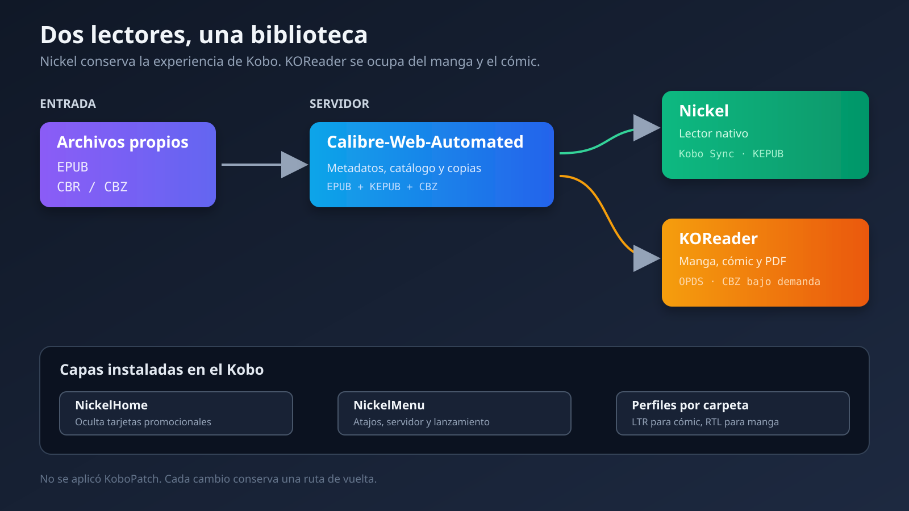

## Todo empezó por dos tarjetas que no quería ver

Mi Kobo funcionaba bien. Sincronizaba los libros de mi servidor, abría rápido y la batería duraba lo que se espera de un lector de tinta electrónica. El problema era mucho menos dramático: cada vez que volvía a Inicio me enseñaba recomendaciones de tienda, Kobo Plus y libros relacionados que no había pedido.

También tenía dos pestañas que no usaba, Libretas y Descubrir. Lo que yo quería parecía sencillo: una pantalla limpia, un acceso directo a mi biblioteca y alguna forma cómoda de leer manga y cómics sin llenar el dispositivo.

La lista creció mientras hablaba con Copilot sobre las opciones. Aparecieron NickelMenu, KOReader, perfiles de lectura, orientación, EPUB, KEPUB, CBR, CBZ, OPDS y KoboPatch. En cierto punto ya no estaba resolviendo dos tarjetas molestas. Estaba diseñando cómo quería que el Kobo encajase en mi servidor doméstico.

Había una condición que no estaba dispuesto a negociar: **todo tenía que ser reversible**. No quería sustituir el lector original, perder la sincronización que ya funcionaba ni aplicar un parche binario a ciegas porque una web reconociese el modelo.

El resultado final usa dos lectores en el mismo aparato. Nickel, el software original de Kobo, sigue llevando las novelas y el ensayo. KOReader se ocupa del contenido fijo basado en imágenes. El servidor sigue siendo la única biblioteca.



## La conversación era una pista, no una prueba

Copilot hizo una primera exploración útil. Identificó el dispositivo como un Kobo Libra Colour N428 con firmware `4.45.23792`, preparó copias iniciales, instaló un salvapantallas personalizado y ajustó la lectura nocturna. La fuente elegida fue STIX Two Text, el tamaño quedó en 29 y la luz frontal en 15. También explicó la diferencia general entre NickelMenu, KOReader y KoboPatch.

La conversación tenía además una cosa muy valiosa: mis dudas reales. No eran solo “cómo instalo esto”. Me preocupaba romper la sincronización con el servidor, perder la tienda oficial, llenar los 32 GB con una colección de cómics y acabar manteniendo un firmware modificado cada vez que Kobo publicase una actualización.

Exporté el chat completo a Markdown. Ese archivo se convirtió en la especificación del trabajo. Antes de tocar de nuevo el dispositivo revisé cada afirmación importante contra el estado real del Kobo, la configuración del servidor y los proyectos oficiales.

La distinción importa. Un asistente puede proponer una combinación razonable de herramientas y equivocarse en una versión, una ruta o el alcance de una opción experimental. La frase “esto es reversible” tampoco vale mucho si no existe una copia comprobada y una secuencia concreta para volver atrás.

Las fuentes que sobrevivieron a esa revisión fueron:

- [NickelMenu](https://pgaskin.net/NickelMenu/), que añade acciones y menús sin parchear directamente los archivos del sistema.
- [NickelHome](https://github.com/nicoverbruggen/NickelHome), que oculta widgets concretos de la pantalla de Inicio.
- [KOReader](https://github.com/koreader/koreader), que mantiene un paquete específico para Kobo y documenta su instalación en estos dispositivos.
- [Calibre-Web-Automated](https://github.com/crocodilestick/Calibre-Web-Automated), que ya gestionaba mi biblioteca, la ingesta y Kobo Sync.

KoboPatch salió de la primera fase. No encontré un conjunto de parches que declarase soporte exacto para aquel firmware. La interfaz web de una herramienta puede reconocer un lector y aun así no disponer de parches preparados para sus binarios. Preferí conseguir el resultado con componentes separables.

## Una copia no cuenta hasta que se verifica

El Kobo aparece en Linux como una unidad FAT. Copiarla con `rsync` era la parte fácil. Lo importante era saber que la copia contenía lo mismo que el dispositivo y que su base de datos podía abrirse.

El procedimiento equivalente fue este, con rutas genéricas:

```bash
rsync -a --info=progress2 '<KOBO_MOUNT>/' '<BACKUP_DIR>/'

find '<BACKUP_DIR>' -type f -print0 \
  | sort -z \
  | xargs -0 sha256sum > '<BACKUP_MANIFEST>'

sha256sum --check '<BACKUP_MANIFEST>'
sqlite3 '<BACKUP_DIR>/.kobo/KoboReader.sqlite' 'PRAGMA quick_check;'
```

La copia nueva contenía 270 archivos y ocupaba unos 138 MB. Todos los SHA-256 coincidieron y SQLite devolvió `ok`.

Hay un detalle fácil de pasar por alto. Al abrir una base SQLite pueden aparecer archivos temporales `-wal` y `-shm`. No pertenecían al origen, así que esperé a cerrar la conexión y los retiré de la copia. El inventario volvió a quedarse en los mismos 270 archivos.

Esto parece una obsesión hasta que llega el día de restaurar. Un directorio llamado `backup` no demuestra que sus ficheros estén completos. Un manifiesto comprobado y un `quick_check` sí dan una base bastante mejor.

## Tres herramientas, tres trabajos distintos

La solución dejó de parecer un “mod de Kobo” cuando separé las responsabilidades.

**NickelMenu** es el lanzador. Añade accesos al menú original: abrir la biblioteca web, cambiar el Wi-Fi, girar la pantalla, dormir, reiniciar, ir a Mis libros o arrancar KOReader. No sustituye Nickel y no convierte formatos.

**NickelHome** toca la composición de Inicio. Su trabajo consiste en ocultar las tarjetas promocionales que NickelMenu no controla.

**KOReader** es otro lector. Se abre cuando quiero manga, cómic o PDF y se cierra cuando quiero volver a Kobo. Tiene navegador OPDS, recorte, zoom y perfiles por carpeta.

La barra inferior terminó así:

```text
Inicio · Libros · Actividad · Utilidad
```

Dentro de Utilidad dejé accesos a la biblioteca del servidor, KOReader, libros, colecciones, estadísticas, Wi-Fi, orientación, reposo y reinicio. Dos acciones adicionales permiten restaurar las tarjetas y las pestañas sin desinstalar nada.

La parte relevante de NickelHome es pequeña:

```text
nhm_enabled:1
hide_home_row1col2_enabled:1
hide_home_row2col2_enabled:1
hide_home_row3_enabled:1
```

Estas posiciones dependen de la versión de la interfaz. Por eso no las copié y me olvidé. Reinicié, reconecté el Kobo y revisé el log de NickelHome. El propio mod confirmó que había cargado en `4.45.23792` y que ocultó las tres zonas esperadas. Después comprobé la pantalla con el dispositivo en la mano.

## Preparar el paquete antes de preparar el susto

Descargué versiones concretas y conservé los archivos fuente junto a un manifiesto:

- NickelMenu 0.6.0.
- NickelHome 0.6.
- KOReader 2026.07.1.

El paquete de Kobo de KOReader 2026.07.1 figura en las [releases oficiales](https://github.com/koreader/koreader/releases/tag/v2026.07.1). La documentación de [instalación en Kobo](https://github.com/koreader/koreader/wiki/Installation-on-Kobo-devices) también advierte de que Nickel puede intentar indexar directorios ocultos desde firmware 4.17.

Para evitarlo añadí esto a la sección `[FeatureSettings]` de la configuración del Kobo:

```ini
ExcludeSyncFolders=(\.(?!kobo|adobe).+|([^.][^/]*/)+\..+)
```

NickelMenu y NickelHome traían cada uno un `KoboRoot.tgz`. Inspeccioné ambos, fusioné su contenido y generé un solo paquete de actualización. KOReader se copió en `.adds/koreader`. No había ningún binario de KoboPatch dentro.

El despliegue siguió el mecanismo normal de actualización del lector:

```bash
cp '<MERGED_KOBOROOT>' '<KOBO_MOUNT>/.kobo/KoboRoot.tgz'
rsync -a '<PAYLOAD>/.adds/' '<KOBO_MOUNT>/.adds/'
sync
udisksctl unmount -b '<KOBO_DEVICE>'
udisksctl power-off -b '<KOBO_DEVICE>'
```

Al reconectarlo, `KoboRoot.tgz` ya no estaba. Eso era lo esperado: el actualizador lo había consumido. Conté los archivos de KOReader, comprobé las configuraciones y leí el log de NickelHome. Solo entonces di la instalación por hecha.

## EPUB, KEPUB, CBR y CBZ sin la sopa de siglas

Esta parte produjo más confusión que la instalación, en parte porque los nombres parecen pertenecer a la misma familia y no es así.

Un **EPUB** contiene texto adaptable. Si aumento la letra, los párrafos vuelven a componerse. Es el archivo normal que descargo y subo al servidor.

Un **KEPUB** sigue siendo ese libro, preparado para el motor de Kobo. Mejora la integración con capítulos, estadísticas, tiempo restante y otras funciones del lector. CWA conserva el EPUB y genera una copia KEPUB. Kobo Sync ofrece esa copia al lector nativo.

Un **CBR** suele ser un RAR lleno de imágenes. Un **CBZ** suele ser un ZIP lleno de imágenes. Cada imagen es una página. Cambiar el tamaño de la letra no tiene sentido porque la letra forma parte del dibujo.

Y **CWA** no es un formato. Son las siglas de Calibre-Web-Automated, el servicio que vive en el servidor.

Mi flujo normal quedó intacto:

```text
Windows -> almacenamiento portátil -> portátil -> CWA recibe EPUB
                                             -> conserva EPUB
                                             -> genera KEPUB
                                             -> Kobo Sync
                                             -> Nickel
```

Para manga y cómics añadí otro:

```text
RAR o CBR -> validar -> CBZ -> CWA -> OPDS -> KOReader
```

No quise convertir manga a KEPUB. El CBZ conserva las páginas, es fácil de inspeccionar y KOReader puede recortarlo y ajustar su dirección.

## Los CBR que no eran CBR

La primera prueba real llegó en dos RAR. Uno contenía una colección de cómics y el otro tres tomos de manga. Entre ambos había 124 archivos interiores.

`7z` pudo leer casi todo, pero informó de un método no soportado en 17 elementos del paquete grande. No instalé otro descompresor en el sistema por una tarea puntual. Extraje un paquete de `unrar` dentro del workspace y ejecuté su binario desde allí.

Primero probé los archivos exteriores sin extraerlos:

```bash
'<LOCAL_UNRAR>' t '<COLLECTION_ARCHIVE>.rar'
'<LOCAL_UNRAR>' t '<MANGA_ARCHIVE>.rar'
```

Los dos pasaron. Después validé cada archivo interior. Ahí apareció el detalle divertido: 95 eran RAR reales, pero 29 eran ZIP con extensión `.cbr`. Renombrar extensiones a ciegas habría producido una colección con nombres bonitos y formatos mentirosos.

La firma del archivo decidió qué extractor usar. También eliminé un acceso directo publicitario `.url` que venía dentro del paquete. Los RAR originales quedaron sin tocar.

Escribí un script para normalizar cada libro. El proceso fue:

1. Detectar RAR o ZIP por el contenido.
2. Extraer solo imágenes.
3. Ordenarlas de forma natural.
4. Abrir cada una con Pillow para comprobar que era válida.
5. Renombrarlas como `0001.jpg`, `0002.jpg` y así sucesivamente.
6. Crear un CBZ con `ZIP_STORED`.
7. Añadir `ComicInfo.xml` con serie, número, autor, editorial, idioma y sentido de lectura.

Usé `ZIP_STORED` porque JPEG y PNG ya están comprimidos. Volver a comprimirlos dentro del ZIP apenas ahorra espacio y consume tiempo. Tampoco redimensioné ni recodifiqué las imágenes. La prioridad era conservar el material recibido y dejar cualquier ajuste visual al lector.

El resultado fueron 124 CBZ, 4.618 páginas y unos 3 GB. Había 4.568 JPEG, 50 PNG y 196 páginas apaisadas. Estas últimas importan porque incluyen dobles páginas.

Inspeccioné visualmente muestras de ambas series, generé un manifiesto SHA-256 y comprobé los 124 archivos antes de enviarlos al servidor.

## CWA necesitaba una regla nueva, no otro servidor

La biblioteca ya funcionaba con CWA, así que montar Kavita u otro servicio solo para cómics habría duplicado cuentas, copias y mantenimiento. CWA ya admite CBZ y CBR. El problema era su conversión automática: el destino configurado era EPUB.

Antes de cambiarlo hice copias consistentes de `cwa.db`, `app.db` y `metadata.db` mediante la API de backup de SQLite. Copiar un `.db` mientras otro proceso escribe puede producir una fotografía incoherente; `Connection.backup()` evita ese riesgo.

La única preferencia modificada fue la lista de formatos que no deben convertirse:

```text
auto_convert = 1
auto_convert_target_format = epub
auto_convert_ignored_formats = cbz,cbr
```

Los libros normales continúan entrando como EPUB y generando KEPUB. Los cómics se incorporan como CBZ o CBR.

Subí primero todo a un directorio de staging. El patrón de transferencia y verificación fue:

```bash
rsync -a --info=progress2 '<READY_DIR>/' '<SERVER>:<STAGING_DIR>/'
scp '<SHA256_MANIFEST>' '<SERVER>:<STAGING_DIR>/SHA256SUMS'
ssh '<SERVER>' "cd '<STAGING_DIR>' && sha256sum --check SHA256SUMS"
```

El servidor confirmó 124 archivos y 3 GB. Aun así no los envié todos a la ingesta. Copié un cómic y un manga, observé los logs y consulté `metadata.db`. CWA escribió que el formato estaba excluido de conversión y añadió ambos como `CBZ`.

Solo entonces entraron los otros 122. Durante el proceso conté dos cosas cada 15 segundos: filas CBZ dentro de Calibre y ficheros pendientes en la carpeta de ingesta. El contador terminó en `CBZ=124` y `PENDING=0`, con el contenedor saludable.

## Los metadatos demostraron por qué existe el piloto

El contenido se importó bien, pero CWA no entendió `ComicInfo.xml` como yo esperaba. El primer cómic apareció con autor desconocido y el primer manga interpretó “Tomo 01” como si fuese el autor.

Hice otra copia de `metadata.db` y preparé un script con dos modos. Sin argumentos solo construía el plan y exigía 124 correspondencias únicas. Con `--apply` llamaba a `calibredb set_metadata` para cada libro.

No escribí a mano las tablas de relaciones de Calibre. Usé su interfaz oficial:

```bash
docker exec calibre-web-automated \
  calibredb set_metadata \
  --with-library=/calibre-library '<BOOK_ID>' \
  --field 'title:<TITLE>' \
  --field 'authors:<AUTHOR>' \
  --field 'series:<SERIES>' \
  --field 'series_index:<INDEX>' \
  --field 'tags:<Manga-or-Comics>' \
  --field 'languages:spa' \
  --field 'publisher:<PUBLISHER>'
```

Calibre terminó con 121 libros dentro de la serie de cómic y 3 dentro de la serie de manga. Las etiquetas `Comics` y `Manga` hacen de carpetas virtuales en CWA y OPDS. En disco Calibre sigue organizando por autor y título, que es su modelo normal.

## Verificar la envoltura no bastaba

CWA reescribió los ZIP al aplicar sus servicios y metadatos. Por eso el SHA-256 de cada CBZ completo cambió. Un hash diferente podía significar una modificación legítima de `ComicInfo.xml` o una página dañada.

Abrí los 124 CBZ del servidor, ejecuté la prueba CRC del ZIP y calculé el SHA-256 de cada imagen interna. Luego comparé cada página con su fuente normalizada.

```text
ARCHIVES_OK=124
PAGES_IDENTICAL=4618
QUICK_CHECK=ok
```

Las 4.618 páginas eran idénticas byte a byte. Habían cambiado la envoltura ZIP y los metadatos, no las imágenes.

Hice un snapshot final de las tres bases y volví a ejecutar `PRAGMA quick_check`. CWA seguía saludable.

## Dos perfiles y un catálogo OPDS

Copié al Kobo solo dos archivos piloto, uno de manga y otro de cómic. Juntos ocupaban unos 170 MB. No tenía sentido copiar los 3 GB por USB después de construir un flujo bajo demanda.

KOReader recibió dos perfiles automáticos:

| Ajuste | Comics | Manga |
| --- | --- | --- |
| Dirección | Izquierda a derecha | Derecha a izquierda |
| Reflujo | Desactivado | Desactivado |
| Recorte | Automático | Automático |
| Ajuste | Contenido completo | Contenido completo |
| Vista | Una página | Una página |
| Pie | Oculto | Oculto |

El plugin de perfiles permite ejecutar una configuración al abrir un documento cuya ruta contiene un texto determinado. Los libros bajo `/Comics/` reciben el primer perfil y los que están bajo `/Manga/` reciben el segundo.

No añadí rotación automática de dobles páginas. Había 196 imágenes apaisadas, pero una regla que gire cualquier página ancha puede acertar con una doble página y molestar con una portada o una composición especial. Dejé un acceso de orientación para decidirlo al leer.

El catálogo OPDS de CWA quedó precargado en KOReader sin contraseña. El usuario la introduce en el dispositivo la primera vez. Desde el diálogo de descarga puede elegir la carpeta local y bajar un CBZ.

“Bajo demanda” necesita aquí una aclaración: se descarga el tomo completo que selecciono. No se transmite una página cada vez y tampoco baja la colección entera. Para mí ese punto intermedio es el correcto.

## El aviso que no arreglé porque no hacía falta

Durante la ingesta CWA intentó guardar checksums para sincronización de progreso de KOReader y registró `no such table: book_format_checksums`.

La función de progreso entre varios dispositivos estaba desactivada. El código de CWA crea esa tabla al activar la función, pero el procesador de ingesta intentaba calcular el checksum igualmente. No afectó al archivo, OPDS, Kobo Sync ni la importación.

Podía haber creado la tabla a mano para silenciar el log. Habría sido una mala corrección: introduciría un esquema que la aplicación espera gestionar cuando se active la función. Documenté el aviso y lo dejé como está. Si algún día necesito sincronización de progreso entre dos instalaciones de KOReader, la activaré desde CWA y dejaré que haga su migración.

## Cómo queda ahora

El Kobo sigue siendo un Kobo. Las novelas aparecen en la biblioteca nativa, usan KEPUB y conservan la integración de siempre. Inicio ya no parece el escaparate de una tienda. La pestaña Utilidad concentra lo que antes estaba repartido por menús.

Cuando quiero manga, abro KOReader. Elijo un tomo desde OPDS, lo guardo bajo `/Manga/` y el perfil cambia el sentido de lectura. Para un cómic occidental uso `/Comics/` y el avance vuelve a izquierda a derecha.

Hay una copia completa del dispositivo, tres puntos de restauración de las bases del servidor, los paquetes originales, los hashes, el staging y los scripts de normalización. Los RAR originales siguen intactos.

La parte más útil no fue instalar tres herramientas. Fue dar a cada una un trabajo limitado y comprobar cada frontera: firmware, archivo, base de datos, red y dispositivo. Si una actualización rompe NickelHome, puedo retirarlo sin perder KOReader. Si KOReader deja de interesarme, Nickel y Kobo Sync siguen ahí. Si CWA interpreta mal otro paquete, el piloto lo mostrará antes de que entren cien archivos.

Eso era lo que quería decir con reversible. No que nada pueda fallar, sino que cada fallo tenga una salida conocida.
