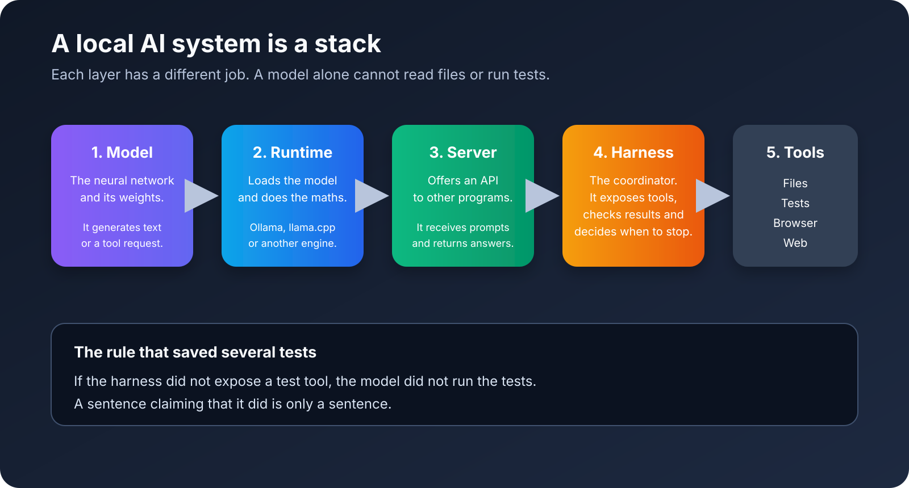
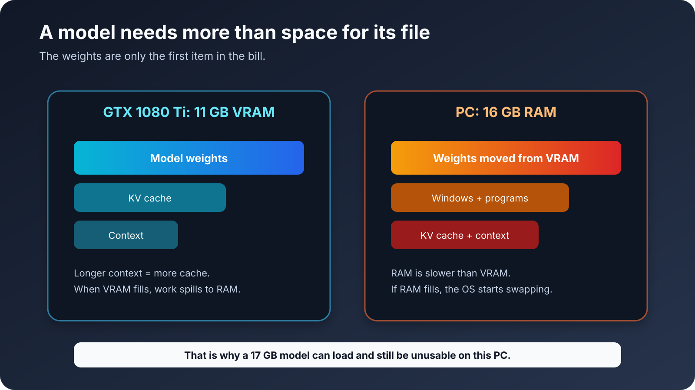
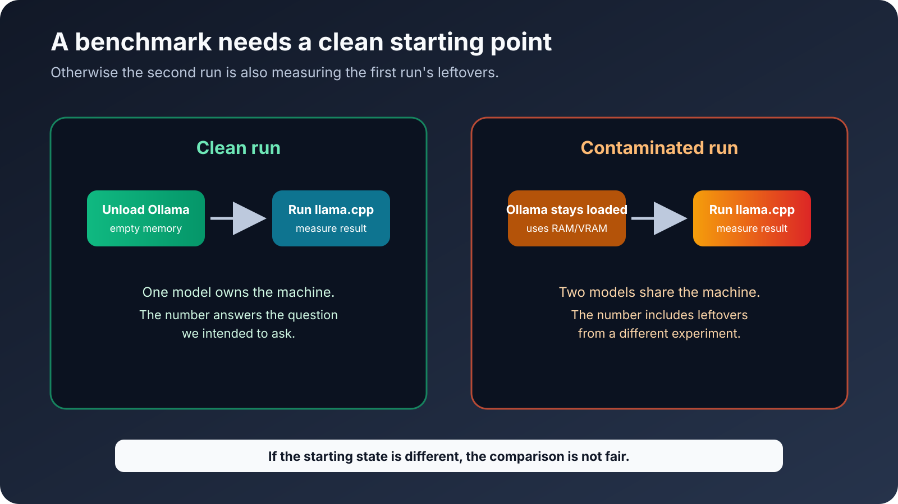
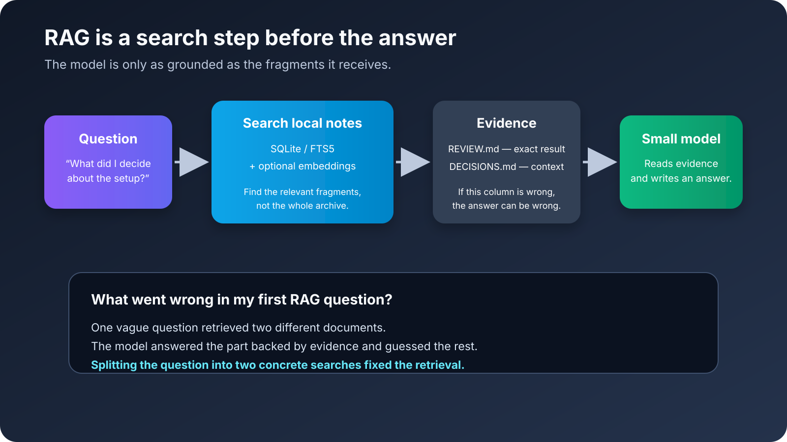

## Introducción

Quería ejecutar IA de forma local en mi propio ordenador.

No porque pensase que un PC de casa iba a ganar a los mejores modelos de la nube. Eso sería una forma bastante optimista de mirar una GTX 1080 Ti en 2026. Lo quería por privacidad, por tener un modelo que funcionase sin internet, por poder lanzar tareas baratas en segundo plano, por probar RAG sobre mis propias notas y por entender qué hacen realmente las nuevas herramientas de agentes en vez de tratarlas como cajas mágicas.

El ordenador no es precisamente nuevo:

- Ryzen 5 5600, 6 núcleos y 12 hilos.
- GTX 1080 Ti con 11 GB de VRAM.
- 16 GB de RAM.
- Windows 11 IoT Enterprise LTSC.

Este post es el resultado de varios días probando cosas, rompiéndolas, arreglándolas, volviendo a probarlas y descubriendo después que un campo `success` en verde no siempre significaba que hubiese ocurrido algo útil.

La versión corta sería esta: la IA local es muy útil en esta máquina, pero solo después de dejar de pedirle que fuese un agente de la nube con un presupuesto mucho más pequeño.

## 1. Qué quería construir realmente

Al principio tenía varios objetivos mezclados:

- Un modelo diario para conversar en español e inglés.
- Un modelo de código para cambios pequeños y scripts.
- Un modelo más grande para investigación larga y lenta sin conexión.
- RAG sobre notas Markdown y documentos locales.
- Un clasificador privado para correo y otros datos estructurados.
- Un agente que usase herramientas, escribiese archivos y trabajase por la noche sin que yo estuviera delante.
- Una interfaz web local, sobre todo Open WebUI encima de Ollama.

Ahí ya estaba el primer problema. Eso no es una sola tarea. Son tareas diferentes y cada una tiene cuellos de botella distintos.

Un modelo agradable para conversar no es automáticamente bueno escribiendo un JSON válido. Un modelo que escribe código rápido no es automáticamente bueno investigando. Un modelo capaz de leer mucho contexto no es automáticamente bueno recordando el documento correcto. Y una API compatible con OpenAI no es un agente por sí misma. Es solo una forma de hablar con un servidor de modelos.

Antes de seguir, este es el mapa que me habría gustado dibujar el primer día:

El modelo es la red neuronal. Sus pesos son el archivo grande que contiene lo que aprendió durante el entrenamiento. El modelo puede generar texto, JSON o una petición estructurada del tipo “llama a la herramienta de tests con estos argumentos”. No tiene acceso automático a mis archivos ni a un terminal.

El runtime, también llamado runner o backend, carga esos pesos y hace las cuentas necesarias para generar el siguiente token. [Ollama](https://ollama.com/) y [llama.cpp](https://github.com/ggml-org/llama.cpp) son ejemplos. No son el modelo. Son los programas que hacen que el modelo funcione en CPU y GPU.

El servidor es la puerta por la que otro programa habla con el runtime. Recibe un prompt mediante una API y devuelve la respuesta del modelo. Que una API sea compatible con OpenAI solo significa que esa puerta tiene una forma conocida. No significa que detrás haya herramientas, memoria, permisos o un agente.

El harness es el coordinador que rodea al modelo. Decide qué herramientas existen, valida las peticiones del modelo, ejecuta las operaciones aprobadas, devuelve los resultados, comprueba la salida y decide si la tarea ha terminado. También se usa “agente” para hablar de un modelo más este bucle. En mis pruebas la batería la dirigía mi propio harness Python, no OpenCode, aunque uno de los experimentos usase una interfaz con forma de agente.

La última capa son las herramientas: leer un archivo, escribirlo, ejecutar un test, abrir un navegador o consultar una URL permitida. Esos permisos tienen que estar implementados en algún sitio. Si el modelo dice `he ejecutado los tests` pero nadie le ha dado al harness una herramienta de tests, los tests no se han ejecutado. Esa frase es solo texto.

Yo estaba tratando toda la pila como si fuese un único producto. No lo es. Separar las capas hizo que casi todos los fallos posteriores fueran más fáciles de entender.

Después de escribirlo parece obvio. Mientras ves a un modelo anunciar con toda tranquilidad un resultado que no podía haber verificado, no tanto.

## 2. El primer error: elegir por tamaño

Mi primer instinto fue el habitual. Buscar el modelo más grande que pudiera entrar de alguna manera, cuantizarlo agresivamente, darle mucho contexto y esperar que sus parámetros extra compensasen todo lo demás.

Eso me llevó a Qwen3.8 en una versión tipo Q4. El archivo rondaba los 17 GB. La tarjeta gráfica tenía 11 GB de VRAM y el ordenador 16 GB de RAM. Las cuentas no eran muy alentadoras, pero lo probé igualmente porque la palabra “offload” suena más mágica que “meter una parte enorme del modelo en una memoria que ya está casi llena”.

El resultado era técnicamente un modelo que cargaba, pero no era un modelo usable. Era desesperadamente lento, a veces tardaba más de dos minutos sin producir nada útil y empujaba la máquina a una presión de memoria en la que el resto de las pruebas dejaban de tener sentido.

Aquí hay tres números distintos que se confunden con facilidad:

- El tamaño del archivo del modelo en el disco.
- La cantidad de VRAM de la tarjeta gráfica.
- La cantidad de RAM disponible para Windows y el resto de programas.

Están relacionados, pero no son intercambiables. La VRAM es la memoria rápida que está junto a la GPU. La RAM es la memoria principal del ordenador. Si el modelo no cabe en VRAM, el runtime puede mover algunas capas a la RAM. Eso puede permitir que cargue, pero cada viaje entre RAM y VRAM cuesta tiempo. Si la RAM se llena, Windows empieza a mover partes al disco. Entonces el ordenador puede parecer bloqueado aunque el proceso no se haya caído.

También hay que separar parámetros y pesos. “27B” significa aproximadamente 27.000 millones de parámetros aprendidos. Sirve para describir el modelo, pero no promete cuántos gigabytes ocupará. El tamaño depende de cómo se guarden esos parámetros.

Ahí entra la cuantización. Cuantizar es guardar los pesos con menos bits. Una versión Q4 usa aproximadamente cuatro bits por peso, además de información auxiliar por bloques. Una IQ2 comprime todavía más. Ocupa menos y normalmente funciona mejor en una GPU pequeña, pero pierde precisión numérica. Es un intercambio, no una mejora gratis: IQ2 ayudó a que este experimento cupiera y funcionara, pero no hizo al modelo más inteligente.

La pregunta práctica dejó de ser “¿cuál es el modelo más grande que puedo descargar?” y pasó a ser “¿qué modelo, precisión, contexto y runtime pueden terminar una tarea real sin secuestrar el ordenador?”

La primera lección no fue “los modelos grandes son malos”. Fue “un modelo que cabe sobre el papel puede no caber en un flujo de trabajo”.

También saqué una conclusión falsa sobre el soporte de GPU. Una primera build de llama.cpp no encontraba ningún dispositivo, así que apunté que esta ruta funcionaba solo con CPU en mi máquina. Más tarde descubrí que el paquete estaba incompleto. Una build CUDA más nueva detectó correctamente la GTX 1080 Ti. El problema había sido la instalación, no la GPU.

Este tipo de fallo puede mandar a cualquiera por el camino equivocado durante todo un fin de semana. Antes de comparar modelos debería haber validado el runtime nativo con una petición pequeña y conocida y haber comprobado que la GPU estaba trabajando de verdad.

El repositorio oficial de [llama.cpp](https://github.com/ggml-org/llama.cpp) resulta útil precisamente porque deja clara la capa del runtime. No es solamente un descargador de modelos. Es un motor de inferencia con distintas opciones de compilación y aceleración, y esas opciones cambian el experimento.

## 3. Cómo probé las cosas en vez de fiarme de la primera respuesta

Monté una batería con workspaces aislados y tareas repetibles. Las pruebas cubrían tres áreas principales:

- Investigación con corpus cerrado, donde la respuesta tenía que salir del material proporcionado.
- Generación de código, incluyendo comprobaciones estáticas y una prueba real en el navegador.
- RAG sobre una base de conocimiento local pequeña.

Lo importante fue definir qué significaba que una prueba pasase. Un benchmark es simplemente una prueba repetible con mediciones. En mi caso medía el tiempo de finalización, los tokens generados por segundo, la RAM, la VRAM, la temperatura de la GPU y si el resultado obligatorio era realmente correcto.

Al principio el harness consideraba que una ejecución había tenido éxito cuando el proceso terminaba, existía el archivo esperado y la respuesta parecía válida a nivel estructural. No era suficiente. Un archivo puede existir y seguir teniendo basura. Un proyecto web puede pasar una comprobación estática y renderizar una página en blanco. Un modelo puede producir un JSON perfectamente válido con las etiquetas equivocadas.

Así que añadí más comprobaciones:

- Los archivos obligatorios tenían que existir.
- El harness tenía que volver a leerlos en vez de fiarse del resumen del modelo.
- El JSON tenía que ser válido y contener los IDs esperados.
- El código generado tenía que pasar comprobaciones estáticas.
- Los proyectos web tenían que abrirse en un navegador.
- Las respuestas de investigación tenían que contrastarse con la evidencia proporcionada.
- Los logs tenían que indicar qué herramientas estaban disponibles de verdad.
- Temperatura, contexto, salida máxima y carga del modelo tenían que mantenerse controlados.

También había una regla más aburrida pero muy importante: si Ollama y llama.cpp estaban reteniendo modelos en memoria a la vez, descartaba la medición. Si no, no sabría qué proceso estaba usando la RAM o la VRAM, ni por qué el segundo modelo iba más lento. Eso es un benchmark contaminado: el número puede ser real, pero la prueba ya no mide lo que yo creía estar midiendo. Reiniciaba el estado de la máquina y repetía la prueba en vez de quedarme con un número bonito.

La batería acabó teniendo 24 combinaciones, además de pruebas específicas de RAG y de correo. Ejecuté los modelos de forma secuencial en lugar de intentar meter varios en la GPU al mismo tiempo. La máquina necesitaba descargar un modelo antes de cargar el siguiente y el watchdog detenía los procesos cuando la GPU se acercaba a una zona peligrosa o la RAM libre bajaba demasiado.

El watchdog medía la temperatura física del ordenador, no un parámetro del modelo. Unos 85 °C significan que la GPU estaba caliente. Eso es distinto de otro parámetro llamado `temperature`, que controla si el modelo elige palabras de forma más predecible o más aleatoria. Cambiaba la temperatura del hardware porque no quería asar la tarjeta; cambiaría la temperatura del modelo porque quisiera otro estilo de respuesta. Misma palabra, cosas distintas.

Por eso algunas cifras del cuaderno no son perfectamente comparables. Las primeras pruebas eran exploratorias. La batería posterior es la que más confianza me da porque aislaba mejor las variables.

## 4. La historia de Qwen3.8: de Q4 inutilizable a IQ2 viable

El experimento más interesante no fue una victoria limpia. Fue el proceso de convertir Qwen3.8 de “esto aquí no es práctico” a “esto puede hacer un trabajo muy concreto”.

Probé distintos runtimes y cuantizaciones. La versión Q4 con Ollama estaba a punto de agotar la máquina. La versión IQ2 era de unos 7,8 GB y perdía precisión frente a Q4, pero dejaba suficiente espacio para que el runtime respirase.

La configuración funcional con llama.cpp utilizaba varios ajustes que es fácil copiar sin entender. Esto significa cada uno en lenguaje normal.

### Offload CUDA de todas las capas disponibles

Un modelo está formado por capas, bloques repetidos de cálculos de la red neuronal. `-ngl all` le dice a llama.cpp que coloque en la GPU CUDA tantas capas como sea posible. Hacer más trabajo en la GPU suele ser más rápido que hacerlo en la CPU, pero “todas” no significa “ignora el tamaño de la tarjeta”. Si no hay VRAM suficiente, el runtime deja parte en RAM o no consigue cargar el modelo.

En mi primer paquete de llama.cpp la GPU no se detectaba. El modelo funcionaba a unos 2,2–2,3 tokens por segundo y eso me llevó a culpar al soporte de Pascal. La build CUDA posterior detectó la GTX 1080 Ti y produjo unos 11 tokens por segundo. La lección importante fue comprobar primero que la GPU se detecta antes de sacar conclusiones sobre el hardware.

### Flash Attention

Attention es la parte del modelo que compara el token actual con los tokens que ya están en el contexto. El cálculo directo necesita bastante memoria temporal. Flash Attention es una forma más eficiente de hacer esas cuentas. No añade conocimientos al modelo ni agranda la ventana de contexto. Puede reducir el uso de memoria y mejorar la velocidad cuando la GPU y la build lo soportan.

### La caché KV a 8 bits

Mientras lee el prompt, el modelo crea información intermedia sobre los tokens que ya ha visto. El runtime guarda esa información en una caché de claves y valores, normalmente llamada caché KV, para no recalcular toda la conversación al generar cada token nuevo. Cuanto más contexto, más grande es esa caché.

Usé `q8_0` para esa caché. Guarda la caché en un formato de 8 bits en vez de usar una precisión mayor. Eso ahorra memoria, especialmente con un contexto de 16K. No es lo mismo que convertir el modelo en IQ2: IQ2 cambia los pesos del modelo, mientras que la cuantización KV cambia la memoria temporal de trabajo de la conversación.

### Lectura directa

El modo de lectura directa le dice al cargador que lea el archivo del modelo sin depender tanto de la caché normal del sistema operativo. Ayuda a que la carga sea más predecible y evita llenar la RAM con otra copia de un archivo enorme. No convierte un disco lento en una GPU rápida ni reduce los cálculos que hacen falta para generar texto.

### Una secuencia y contexto controlado

Usé una secuencia, es decir, una conversación activa cada vez. Varias conversaciones simultáneas necesitan varias cachés KV. El contexto es el presupuesto máximo de tokens para el prompt, los mensajes anteriores, los resultados de herramientas y la respuesta nueva juntos. No es “lo que el modelo recuerda gratis”.

La mejora no fue un milagro dentro del modelo. Fue un encaje mejor entre los pesos, el runtime y el hardware.

El proyecto oficial de [Qwen3.8](https://github.com/QwenLM/Qwen3.8) documenta un contexto teórico mucho mayor del que yo podía usar cómodamente. Esta diferencia es importante. Un modelo puede anunciar una ventana de contexto enorme mientras que el ordenador local solo te da una ventana práctica más pequeña después de que los pesos, la KV cache, el sistema operativo y la aplicación hayan cogido su parte.

Probé el contexto por etapas:

| Contexto | Qué ocurrió |
| --- | --- |
| 4K | Completaba casi toda la batería de investigación, pero fallaba una comprobación. |
| 8K | Completó la batería de corpus cerrado en la ejecución posterior. |
| 16K | Fue el punto de trabajo recomendado. En una prueba de estrés recordó unos 14K tokens a aproximadamente 11 tok/s. |
| 32K | Cargaba, pero no lo consideré validado para trabajo real. |

Con 16K la GPU llegó a unos 79 grados durante la ejecución más pesada. La generación rondó los 11,27 tokens por segundo en una de las mediciones. Un token es un trozo pequeño de texto, no siempre una palabra entera. Los tokens por segundo son por tanto una medida aproximada, pero sirven para comparar ejecuciones hechas con la misma configuración. Es lento comparado con los modelos pequeños, pero aceptable para una tarea nocturna de síntesis si tiene checkpoints y un contrato claro de salida.

El modelo también falló de varias formas muy instructivas antes de que mejorase el harness:

1. El contexto era demasiado pequeño y la respuesta se truncaba.
2. Una respuesta JSON se cortaba a mitad.
3. El modelo respondía en el chat en vez de crear el archivo obligatorio.
4. El manejo de Unicode provocaba un problema al escribir el archivo.
5. Después cambié el harness para validar UTF-8, archivos obligatorios, IDs, lista de herramientas y artefactos.

Cuando esos contratos quedaron impuestos, la tarea funcionó. La mejora principal vino del runtime y del harness, no de descubrir de repente que Qwen se había convertido en un razonador mucho mejor.

Esa es la conclusión honesta. Qwen3.8 IQ2 es viable en este ordenador para síntesis lenta y razonamiento arquitectónico. No es el modelo que quiero escribiendo cada archivo pequeño de un repositorio mientras estoy fuera.

## 5. Los modelos pequeños ganaron los trabajos que les di

Los modelos pequeños eran menos espectaculares y bastante más útiles.

### Ornith para código rápido y tareas estructuradas

[Ornith 1.5 9B](https://huggingface.co/ornith-ai/Ornith-1.5-9B-GGUF) en Q4_K_M fue la opción orientada a código más rápida en las pruebas finales. Produjo unos 32-33 tokens por segundo, usó aproximadamente 7 GB de RAM y 7,2 GB de VRAM y se mantuvo alrededor de los 80 y pico grados en las ejecuciones más exigentes.

En la batería de código estático completó 18 de 19 comprobaciones. Lo más importante es que la validación en navegador mostró que el proyecto generado funcionaba de verdad. Un fallo temprano no era realmente un fallo del modelo: el harness mencionaba una herramienta `run_project_command` en el prompt, pero no la había expuesto. Después de corregir el banco de herramientas el comportamiento fue distinto.

Este fallo merece aparecer en el artículo porque es muy fácil culpar al modelo de un experimento roto. El prompt decía una cosa, las herramientas disponibles decían otra y el modelo era juzgado por esa contradicción.

Ahora Ornith es mi primer candidato para:

- Componentes pequeños y scripts.
- Clasificación y extracción.
- Primeros borradores rápidos.
- Tareas donde un validador determinista pueda encontrar los errores.

Sigue necesitando tests. “Rápido” no significa “seguro”.

### Gemma para código diario fiable

La variante de Gemma era más lenta, alrededor de 25-29 tokens por segundo en la batería, pero alcanzó 19 de 19 comprobaciones estáticas y pasó la prueba real en el navegador. Fue el mejor resultado general de código cuando combiné cumplimiento y funcionalidad.

Es un recordatorio útil de que tokens por segundo no significa lo mismo que trabajo útil por segundo. Si el modelo rápido necesita tres rondas de reparación y el lento funciona a la primera, el lento puede ser la opción rápida en la vida real.

### Qwen14 como punto intermedio

El modelo agente de 14B era más lento que los modelos pequeños, normalmente entre 15 y 22 tokens por segundo según el runner y la tarea. Era sólido para código acotado y tareas con herramientas, pero no justificaba ser el modelo por defecto para todo.

### Qwen3.5 4B para RAG y JSON

El modelo de 4B me sorprendió. En el control de evidencia exacta de RAG alcanzó 7 de 7 comprobaciones en unos 18 segundos y generó unos 57 tokens por segundo en esa ejecución. No era el modelo más potente de la sala, pero funcionaba bien para ese trabajo concreto cuando el contexto contenía la evidencia correcta.

Es el modelo que usaría para extracción local, respuestas cortas sobre notas recuperadas y JSON estructurado. Es suficientemente barato para ejecutarlo muchas veces y suficientemente pequeño para que la máquina no se vuelva inutilizable mientras trabaja.

### Nomic embeddings no es un chatbot

El modelo de embeddings tenía un trabajo: convertir texto en vectores para recuperar información. Lo hizo. Al principio traté los embeddings como un detalle secundario, pero la calidad de la recuperación acabó importando más que el tamaño del modelo en varias pruebas.

Cuando el recuperador traía el documento equivocado, un generador más grande no recuperaba mágicamente la evidencia que faltaba. Simplemente redactaba una respuesta más convincente a partir de la evidencia equivocada.

## 6. La prueba del navegador cambió el ranking

Una comprobación estática lee los archivos generados y busca errores conocidos sin utilizar la aplicación. La prueba de navegador arranca el proyecto, abre la página, hace clic o escribe como un usuario y observa lo que aparece en pantalla y en la consola de JavaScript. Es más lenta, pero encuentra conexiones rotas entre HTML, CSS y JavaScript.

La puntuación del código estático contaba una historia distinta a la del navegador.

Qwen3.8 produjo algo que parecía suficientemente cercano en el informe estático, pero el navegador real mostraba cero notas. Su JavaScript escribía en un elemento llamado `#cards` que no existía en el HTML. La consola lanzaba un TypeError, que aquí simplemente significa que el código intentó usar algo que no existía. El resultado estaba roto.

El experimento de planificar con Qwen3.8 y ejecutar con Ornith tuvo otro tipo de fallo. Ornith produjo un proyecto funcional, pero Qwen3.8 nunca creó el `PLAN.md` esperado. Ornith inventó entonces un contrato diferente en vez de seguir un plan compartido, así que la cadena estaba viva técnicamente pero desconectada semánticamente.

Aquí es donde muchas demos de agentes esconden la parte difícil. Un modelo puede producir mucho texto y muchos archivos y aun así fallar en la interfaz entre dos pasos. El traspaso necesita un esquema, un artefacto obligatorio y un validador. Si no, el segundo modelo no está implementando el plan del primero. Está adivinando lo que el primero quería decir.

Cuando digo “contrato” me refiero a un acuerdo pequeño y explícito entre fases: el primer modelo tiene que crear `PLAN.md` con secciones concretas, el segundo tiene que leerlo y el validador tiene que comprobar que existen esas secciones y esos archivos. Se parece más al contrato de una API que a una instrucción amable dentro de un prompt.

Mi ranking final para código quedó así:

1. Gemma por el mejor equilibrio entre cumplimiento y funcionamiento en navegador.
2. Ornith por velocidad, con tests y reparación disponibles.
3. Qwen14 para trabajo acotado y sólido.
4. Qwen3.8 para arquitectura, revisión y síntesis lenta, no para la implementación rutinaria.

## 7. RAG: la recuperación es todo el partido

RAG significa Retrieval-Augmented Generation, o generación aumentada con recuperación. Dicho normal: primero busco en mis notas, después le paso al modelo los fragmentos relevantes y le pido que responda usando esos fragmentos. No es entrenamiento adicional ni una memoria mágica. Es un paso de búsqueda seguido de generación de texto.

Para la memoria mantuve la fuente de verdad en Markdown, con SQLite y FTS5 alrededor para indexarla. Utilicé [Basic Memory](https://github.com/basicmachines-co/basic-memory) y su camino de embeddings locales, y también probé la recuperación por palabras clave con [SQLite FTS5](https://www.sqlite.org/fts5.html). Un embedding es una representación numérica de un texto. Los significados parecidos deberían quedar cerca, así que puede encontrar una paráfrasis aunque no utilice exactamente las mismas palabras. FTS5 es la búsqueda por palabras más sencilla: es muy rápida cuando la consulta comparte palabras con el documento.

La configuración era deliberadamente aburrida. Markdown se puede leer sin el sistema de IA. SQLite se puede inspeccionar. FTS5 proporciona búsqueda léxica rápida. Los embeddings ayudan con las paráfrasis. Ninguna capa debe convertirse en una memoria opaca que no pueda revisar y reparar.

El benchmark pequeño mostró el intercambio:

- FTS5 era extremadamente rápido y perfecto en coincidencias exactas, pero peor con paráfrasis.
- La búsqueda híbrida de palabras clave más embeddings mejoraba las paráfrasis, a cambio de tardar varios segundos en vez de milisegundos.
- Una caché de embeddings multilingüe que probé era peor en este corpus pequeño, así que la eliminé en vez de mantenerla solo porque sonaba más sofisticada.

La prueba de RAG más importante fue la que falló por una razón muy buena. Hice una pregunta ambigua. La primera recuperación devolvió el documento equivocado. Dividir la pregunta en dos consultas concretas encontró la review correcta, pero una tercera consulta todavía devolvía un README en vez de la evidencia exacta que hacía falta.

Las puntuaciones lo reflejaron:

- Sin RAG: 2 de 7.
- Una recuperación: 4 de 7.
- Varias consultas de recuperación: 5 de 7.
- Control de evidencia exacta con el modelo Qwen pequeño: 7 de 7.

La lección no es “usa más consultas siempre”. La lección es que hay que inspeccionar la recuperación. El generador no puede responder a partir de un documento que nunca recibió. Un modelo más grande puede hacer que la recuperación equivocada parezca más pulida, lo cual es peor que un fallo evidente.

Para RAG local haría ahora esto:

1. Buscar con más de una formulación cuando la pregunta sea ambigua.
2. Mostrar al usuario o al validador los títulos y las evidencias recuperadas.
3. Exigir citas o fragmentos exactos para las afirmaciones importantes.
4. Pedir al modelo que se abstenga cuando falte la evidencia.
5. Mantener la fuente Markdown fuera del modelo para poder inspeccionarla y repararla.

Por eso tampoco construí primero un “agente de memoria gigante”. Quería una base de datos que pudiera consultar antes que un agente que afirmase recordarlo todo.

## 8. El experimento del correo: cobertura no es precisión

También probé la clasificación local de correos. Los datos se mantuvieron en local y no se reproducen aquí. La prueba utilizó 99 mensajes reales sin un conjunto de verdad etiquetado por una persona y 9 mensajes sintéticos con etiquetas conocidas.

La diferencia importa. Que un clasificador diga que ha procesado 99 de 99 mensajes solo demuestra cobertura. No demuestra que las 99 clasificaciones sean correctas.

Ornith procesó los 99 mensajes reales y acertó 8 de 9 etiquetas sintéticas. Gemma consiguió llevar 74 de 99 mensajes reales por el flujo completo y también acertó 8 de 9 etiquetas sintéticas. Otros modelos pequeños eran más rápidos, pero peores en el conjunto sintético.

Los dos modelos mejores cometieron el mismo error interesante con una introducción comercial ambigua: la clasificaron como promoción cuando la prueba esperaba review. No era una razón para elegir el modelo que sonase más seguro. Era una razón para crear un camino `REVIEW`.

También dejé de tratar el campo de confianza que escribe el propio modelo como una confianza real. Pedirle a un LLM que escriba `confidence: 0.93` no calibra el número. El diseño ahora separa:

- La predicción.
- La evidencia utilizada.
- La decisión de escalar el caso.

Para un clasificador serio usaría márgenes de log-probabilidad cuando el runtime los exponga, comprobaciones de evidencia exacta, reglas de negocio deterministas y un conjunto de calibración etiquetado de unos cientos de mensajes. Los casos ambiguos, incompletos, inválidos o importantes para el negocio van a `REVIEW`.

El sistema no debe mover, borrar, responder ni enviar nada automáticamente. Que algo sea local no significa que sea inofensivo. Un error privado sigue siendo un error, solo que con menos testigos.

## 9. Los experimentos con agentes y harnesses

Esta fue la parte en la que instalé y evalué demasiadas opciones, que probablemente es como deben salir estas investigaciones.

### Mi propio harness restringido

El primer harness práctico fue una pequeña capa Python alrededor del modelo local. Exponía un conjunto limitado de operaciones:

- Listar archivos dentro del workspace.
- Leer archivos aprobados.
- Escribir archivos aprobados.
- Verificar artefactos obligatorios.
- Buscar o consultar una lista explícita de URLs públicas cuando el experimento lo permitía.

No había shell arbitrario, ni herramienta de borrado, ni acceso a directorios personales y tampoco se suponía que una herramienta mencionada en un prompt existiera automáticamente. Era menos emocionante que darle un terminal al modelo, pero hacía que los fallos se pudieran entender.

El harness también imponía un máximo de turnos, tokens máximos, timeouts, archivos obligatorios, UTF-8, trazas JSONL y checkpoints. No son funcionalidades muy glamurosas. Son la diferencia entre un experimento y un proceso que se come el ordenador durante la noche sin que nadie se entere.

### DeepSeek Harness

Probé [DeepSeek Harness](https://github.com/deepseek-ai/deepseek-harness), que se describe como un harness de agentes open source basado en plugins y que todavía está en developer preview. La idea es interesante porque el runtime, las herramientas y las integraciones se tratan como piezas separadas.

Mis smoke tests locales fueron prometedores para arrancar, leer un archivo conocido y pasar por un wrapper restringido. Desactivé deliberadamente PowerShell, acceso web, subagentes y las funciones de orquestación más experimentales. La versión que probé seguía cambiando muy rápido y tenía problemas de dependencias alrededor de algunas capacidades ambiciosas.

Por eso no lo convertí en la base del laboratorio. Conservé el experimento como referencia y preferí un harness más pequeño cuyos permisos pudiera explicar línea por línea.

### Qwen Code, OpenCode, Pi, Hermes, Aider y Goose

Miré varias herramientas porque cada una resuelve un problema distinto:

- [Qwen Code](https://qwenlm.github.io/qwen-code-docs/en/) tiene un flujo interesante basado en herramientas y documentación para proveedores locales, pero la calidad del agente sigue dependiendo del modelo y de los límites de permisos.
- [OpenCode](https://opencode.ai/docs/) es una interfaz interesante para programar, especialmente si estás dispuesto a usar WSL en Windows, pero adoptar otro runtime completo de agentes habría añadido complejidad antes de estabilizar el enrutado de modelos.
- [Pi](https://pi.dev/docs/latest/models) tiene una documentación clara sobre modelos y seguridad. Me gustó que fuese explícita, pero no necesitaba otro agente general con shell para este experimento.
- [Hermes](https://github.com/NousResearch/hermes-agent/blob/main/website/docs/reference/faq.md) soporta endpoints locales compatibles con OpenAI, incluyendo Ollama y llama.cpp, y documenta memoria y configuración de proveedores locales. Eso lo hace relevante, pero su valor normal está en ofrecer una superficie de agente bastante amplia. En este PC preferí empezar con menos herramientas.
- El ciclo de lint y tests de [Aider](https://aider.chat/docs/usage/lint-test.html) representa un principio muy bueno: el código generado debe comprobarse con herramientas reales en vez de aceptarse porque el modelo diga que ha terminado.
- [Goose](https://block.github.io/goose/) y [Graphify](https://github.com/Graphify-Labs/graphify) eran nombres interesantes para mantener en el mapa, pero ninguno solucionaba el cuello de botella principal de esta configuración, que era ejecutar de forma fiable en local con memoria limitada.

La decisión no fue que estos proyectos fueran malos. Fue que instalar otro agente no resolvía el problema que estaba midiendo.

### AirLLM

[AirLLM](https://github.com/lyogavin/airllm) resultaba especialmente tentador porque su proyecto presenta como objetivo ejecutar modelos 70B en una GPU de 4 GB. No lo instalé en la configuración final.

La respuesta corta a “¿fue porque solo funcionaba en Linux?” es: en parte, pero no es toda la historia. La ruta de instalación que estaba mirando era mucho más cómoda en un entorno Python de estilo Linux. Dependía de PyTorch, Transformers, archivos de modelos de Hugging Face y, para algunas rutas de compresión, paquetes relacionados con CUDA. Windows no era una imposibilidad absoluta, pero añadía otro problema de compatibilidad antes siquiera de probar el modelo.

El bloqueo más importante era el formato del modelo. Mi Qwen3.8 funcional era un GGUF IQ2 cargado con llama.cpp. La ruta documentada de AirLLM usaba pesos originales de estilo Transformers, como safetensors, y dividía el modelo en capas. No era una forma directa de cargar el GGUF que ya había validado. Habría tenido que descargar otra copia del modelo, montar otra pila de Python/PyTorch y medir un runtime distinto.

También estaba la pregunta del rendimiento. AirLLM mantiene solo una parte del modelo en la GPU y va moviendo capas por la memoria mientras trabaja. Eso puede hacer que un modelo enorme arranque en una tarjeta pequeña, pero el disco y el tráfico CPU↔GPU pasan a formar parte de cada respuesta. En un PC con 16 GB de RAM es un intercambio muy distinto a mantener un archivo IQ2 de 7,8 GB en un perfil de llama.cpp que ya producía unos 11 tok/s.

Así que la decisión no fue “AirLLM es malo” ni “Windows nunca puede ejecutar AirLLM”. Fue “esto sería un segundo experimento de PyTorch, bastante orientado a Linux, que no usa ni el formato ni el runtime que ya he conseguido hacer fiables”. Ya tenía un modelo más pequeño funcionando con un runtime validado y una tarea que terminaba antes de que el ordenador se convirtiese en una estufa.

Hay un detalle que merece quedar escrito porque el software cambia rápido: el repositorio actual de AirLLM ya lista soporte para versiones de Qwen más nuevas que la documentación que utilicé al tomar esta decisión. Eso puede hacer razonable una prueba futura. No cambia lo que yo probé y tampoco convierte AirLLM automáticamente en un reemplazo de GGUF/llama.cpp.

## 10. La cadena fija de tres modelos que abandoné

Uno de los diseños más atractivos era:

1. Qwythos lee y resume las fuentes.
2. Qwen3.8 crea la arquitectura y toma las decisiones.
3. Ornith escribe el código y la presentación final.

Funcionaba lo suficiente como para parecer una arquitectura seria. No era consistentemente mejor que usar un modelo adecuado para cada tarea.

En la batería de investigación, Qwythos producía un resumen y Qwen3.8 razonaba sobre él, pero la ejecución combinada tardaba unos cuatro minutos y no mejoraba a Qwen3.8 trabajando directamente sobre el conjunto de fuentes. La cadena solo tenía sentido si el resumen se iba a reutilizar, si el corpus era grande o sucio o si esa primera pasada tenía valor por sí misma.

El peor resultado llegó al usar Ornith como fase final de presentación después de una salida correcta de Qwen. Generó miles de tokens, devolvió un HTTP 500, que es un error del servidor, y no dejó un `index.html` válido. La cadena completa sacó 1 de 9 en esa fase final. Un modelo pequeño colocado al final puede destruir una salida correcta.

La lección fue dolorosa pero útil: un orquestador debe validar los contratos entre fases. Un modelo no puede ser tratado como juez de su propia salida. Para el trabajo normal el router ahora es más sencillo:

| Trabajo | Ruta local preferida |
| --- | --- |
| Notas locales y RAG corto | Qwen3.5 4B más recuperación y citas |
| Código y extracción rápidos | Ornith más tests estáticos y de navegador |
| Código diario | Gemma, con tests |
| Trabajo acotado con herramientas | Qwen14 |
| Síntesis larga sin conexión | Qwen3.8 IQ2 a 8K o 16K |
| Digestión de fuentes reutilizable | Qwythos, solo cuando merezca la pena guardar el resumen |
| Revisión importante | Codex, Claude o una persona |

La última fila no es una derrota. Es un límite. El PC local es un trabajador privado, no un sustituto de todas las demás herramientas.

## 11. Qué optimicé

El rendimiento final no salió de una flag mágica. Salió de un grupo de decisiones pequeñas.

### Runtime y memoria

- Usar una build CUDA de llama.cpp y verificar primero que detecta la GPU.
- Usar Flash Attention cuando el modelo y la build lo soportan.
- Usar una KV cache a 8 bits para hacer posibles contextos más largos.
- Mantener cargado un solo modelo grande cada vez.
- Descargar los modelos antes del siguiente benchmark.
- Parar cerca de los límites térmicos y de RAM en vez de esperar a que el sistema se vuelva inestable.
- Medir la tarea completa, no solo la generación de tokens.

### Contexto

- Tratar el número de contexto como un presupuesto, no como una promesa.
- Contar el prompt, el historial, las herramientas, sus salidas y la respuesta generada.
- Dividir la investigación larga en fases.
- Guardar `summary.md`, `task.md` y artefactos en vez de mantener un chat infinito.
- Usar 8K para trabajos Qwen3.8 más seguros y 16K cuando la tarea justifique el calor y el tiempo.

### Diseño del harness

- Hacer que la lista de herramientas sea real y visible.
- Exigir archivos de salida en vez de aceptar una respuesta de chat.
- Volver a leer los archivos después de generarlos.
- Validar IDs, JSON, encoding y estructura esperada.
- Usar comprobaciones deterministas siempre que sea posible.
- Guardar lo suficiente para reproducir un fallo sin registrar contenido privado.
- Dar al modelo un workspace pequeño en vez de todo el ordenador.

### RAG

- Mantener Markdown como fuente de verdad.
- Usar FTS5 para recuperar coincidencias exactas rápidamente.
- Añadir embeddings para las paráfrasis, no para sustituir la inspección.
- Recuperar con varias formulaciones cuando la pregunta sea imprecisa.
- Incluir evidencia y citas en el contrato de respuesta.
- Permitir que el modelo se abstenga.

### Seguridad

Los servicios locales se quedaron en loopback. No expuse la API del modelo a internet. Los agentes trabajaban en workspaces dedicados y con permisos mínimos. El clasificador de correo no tenía ninguna acción de borrar, mover o enviar. El acceso web estaba desactivado o limitado a una lista explícita de URLs públicas.

El laboratorio también tenía un watchdog alrededor de los 88 grados y detenía las ejecuciones antes de que el ordenador llegase al punto en el que el sistema operativo empezaba a pelearse con el experimento. Esto es un PC doméstico, no un data centre con alguien cobrando por vigilar el rack.

## 12. Qué mantendría hoy

Si tuviera que reconstruir la configuración desde cero, lo haría en este orden:

1. Verificar el runtime CUDA con un modelo pequeño y una comprobación conocida de GPU.
2. Instalar un modelo pequeño y hacer que pase una prueba de escritura de archivos y validación.
3. Añadir memoria Markdown más SQLite/FTS5.
4. Añadir embeddings locales y compararlos con la recuperación por palabras clave usando un mini-dataset real.
5. Añadir validación de navegador para las tareas de código.
6. Añadir un modelo de código intermedio.
7. Probar el modelo IQ2 grande solo cuando exista un trabajo que realmente lo necesite.
8. Mantener todas las acciones autónomas detrás de una aprobación explícita.

No empezaría con un modelo 70B, una promesa de 1M de tokens, tres agentes encadenados, un shell general o un buzón con permisos para borrar. Todo eso puede ser interesante más adelante. Son malos cimientos para descubrir si el sistema local funciona.

## Conclusiones

El resultado más importante no fue una cifra de tokens por segundo. Fue encontrar el límite entre la IA local útil y el wishful thinking.

La GTX 1080 Ti puede ejecutar una pila privada sorprendentemente capaz cuando los trabajos se dividen bien. Los modelos pequeños se encargan de extracción rápida, código, clasificación y RAG local. Un modelo IQ2 más grande puede hacer síntesis lenta si se controla el contexto y la tarea tiene checkpoints. Importa el runtime. Importa el harness. Importa la calidad de la recuperación. Importa el validador.

Las cosas que fallaron también me enseñaron más que las demos limpias:

- Un modelo Q4 grande puede cargar y aun así encajar fatal en la máquina.
- Una build CUDA ausente puede parecer una limitación del hardware.
- Un modelo no puede usar una herramienta que el harness no ha expuesto.
- Las comprobaciones estáticas pueden no detectar un contrato roto en el navegador.
- Un modelo puede escribir una respuesta segura de sí misma a partir del documento equivocado.
- Una cifra de confianza escrita por el propio modelo no es calibración.
- Una cadena de modelos puede empeorar un resultado bueno.
- La privacidad local no sustituye a los permisos ni a la validación.

Así que la respuesta final no es “la IA local sustituye a la IA de la nube”. En este ordenador la respuesta útil es más concreta:

La IA local es una capa privada, barata y asíncrona excelente. Puede preparar datos, clasificar cosas, recuperar notas, preparar cambios pequeños y trabajar durante la noche. Es mucho menos convincente como sustituto sin supervisión de Codex o Claude en un repositorio complejo.

Es un resultado que sí puedo utilizar.

## Documentación y lecturas adicionales

Estas son las referencias públicas que utilicé para entender las herramientas y tecnologías implicadas. Las cifras del benchmark y las decisiones de este post salen de mis propias ejecuciones locales.

- [Repositorio oficial de Qwen3.8](https://github.com/QwenLM/Qwen3.8)
- [llama.cpp](https://github.com/ggml-org/llama.cpp)
- [Documentación de contexto de Ollama](https://docs.ollama.com/context-length)
- [FAQ de Ollama](https://docs.ollama.com/faq)
- [Model card de Ornith 1.5 9B GGUF](https://huggingface.co/ornith-ai/Ornith-1.5-9B-GGUF)
- [Basic Memory](https://github.com/basicmachines-co/basic-memory)
- [Documentación de búsqueda semántica de Basic Memory](https://github.com/basicmachines-co/basic-memory/blob/main/docs/semantic-search.md)
- [Documentación de SQLite FTS5](https://www.sqlite.org/fts5.html)
- [DeepSeek Harness](https://github.com/deepseek-ai/deepseek-harness)
- [FAQ de Hermes Agent y proveedores locales](https://github.com/NousResearch/hermes-agent/blob/main/website/docs/reference/faq.md)
- [AirLLM](https://github.com/lyogavin/airllm)
- [Documentación de Qwen Code](https://qwenlm.github.io/qwen-code-docs/en/)
- [Documentación de OpenCode](https://opencode.ai/docs/)
- [Documentación de modelos de Pi](https://pi.dev/docs/latest/models)
- [Documentación de seguridad de Pi](https://pi.dev/docs/latest/security)
- [Ciclo de lint y tests de Aider](https://aider.chat/docs/usage/lint-test.html)
- [Goose](https://block.github.io/goose/)
- [Graphify](https://github.com/Graphify-Labs/graphify)
- Imagen principal: [foto de la tarjeta gráfica por Trần Chính en Pexels](https://www.pexels.com/photo/a-computer-graphics-card-lying-on-a-desk-next-to-a-keyboard-and-a-mouse-20391484/)
