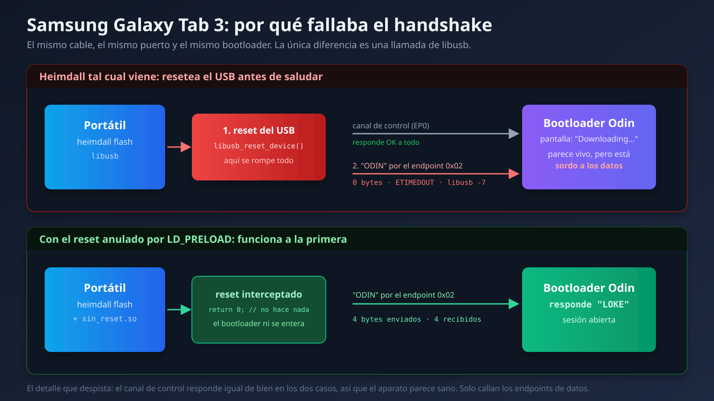

Mi padre usa una Samsung Galaxy Tab 3 de 7 pulgadas como pantalla del coche. Le tiene puesto Torque Pro para leer la centralita por OBD2, RealDash, HERE Maps descargado para ir sin datos, un avisador de radares y un launcher de esos con botones enormes. Funciona. Va lenta, pero funciona.

La tablet es de 2013 y tiene Android 4.4.2. Yo llevaba tiempo con la idea de meterle una ROM moderna, básicamente porque acababa de hacerlo con mi Mi A2 y me había quedado con ganas de más. Encontré en XDA un hilo con una LineageOS 14.1 para el modelo exacto, me descargué todo, y me puse.

Spoiler: acabé restaurando el Android original de Samsung. Y creo que es el final bueno de la historia, aunque no fuera el que buscaba.

## Un handshake que no llegaba nunca

El primer muro apareció enseguida. Para flashear una Samsung desde Linux se usa Heimdall, que es la alternativa libre a Odin. Pones la tablet en Modo Descarga, la conectas, y Heimdall habla con el bootloader. Eso es la teoría.

Lo que yo tenía era esto, una y otra vez:

```
Initialising protocol...
Resetting device...
ERROR: Failed to send handshake!
ERROR: Protocol initialisation failed!
```

`libusb error -7`, que significa timeout. Cero bytes transferidos.

Y aquí es donde empieza la parte de la que no estoy orgulloso. En una sesión anterior había llegado a la conclusión de que el problema era el USB del portátil. Mi ThinkBook solo tiene controladoras xHCI, o sea USB 3.0, y hay bastante gente por ahí diciendo que los bootloaders viejos de Samsung se llevan mal con eso. La solución que circula es meter un hub USB 2.0 por el medio, para que el aparato viejo no hable directamente con la controladora moderna.

Me compré el hub. Seis euros. Llegó, lo conecté, la tablet enumeró perfectamente a 480 Mbps a través de él.

Y falló exactamente igual.

## Bajando un nivel

Cuando una teoría que parecía sólida se cae, lo peor que puedes hacer es buscar otra teoría igual de plausible y volver a probar a ciegas. Yo llevaba ya: el cable, dos puertos distintos, parar ModemManager por si acaparaba el puerto serie, probar con `sudo`, y el hub. Cinco intentos, cinco fallos, y ninguna medida real.

Así que decidí dejar de adivinar y mirar qué pasaba de verdad en el USB. Escribí un programa en C de cien líneas que habla directamente con `usbfs`, el interfaz del kernel de Linux para dispositivos USB. Sin Heimdall y sin libusb por el medio, solo `ioctl` a pelo sobre `/dev/bus/usb/003/104`.

La idea era sencilla: el protocolo Odin empieza mandando cuatro bytes, `ODIN`, y esperando otros cuatro de vuelta, `LOKE`. Si consigo hacer eso yo mismo, el problema está en Heimdall. Si no lo consigo, el problema está en la tablet.

Lo que salió fue mucho más interesante de lo que esperaba:

```
[claim if1] ok
[set DTR/RTS if0] ok
[clear_halt 0x02] ok
[clear_halt 0x81] ok
GET_STATUS(ep 0x02) = 00 00
GET_STATUS(ep 0x81) = 00 00
[escribe ODIN ep 0x02] r=-1 Connection timed out
```

Léelo despacio, porque la contradicción es lo bonito del asunto. Puedo reclamar el interfaz. Puedo mandar peticiones de control y me contesta que sí a todas. Puedo preguntarle a los dos endpoints de datos por su estado y me responden `00 00`, que significa "estoy perfectamente, no estoy bloqueado".

Y luego les mando cuatro bytes y no pasa absolutamente nada. Ni un byte, en ninguna dirección, con esperas de hasta quince segundos.

Un USB tiene dos tipos de canal. El de control, que es el que usa el sistema para preguntarle al aparato quién es y configurarlo, y los de datos, que son por donde va la información de verdad. Aquí el de control iba como un reloj y los de datos estaban muertos. Eso descarta el cable, el puerto, la controladora y el hub de golpe, porque todos van por los mismos hilos. Si el control funciona, el hardware funciona.

O sea que el problema era la tablet. El bootloader enumeraba el USB, pintaba la pantalla de "Downloading...", y no atendía sus propios endpoints de datos.

## El culpable estaba en la primera línea del log

Con eso ya podía hacer la pregunta correcta: ¿qué hace Heimdall justo antes del handshake?

Lo pone en su propia salida y yo lo había leído veinte veces sin verlo:

```
Resetting device...
ERROR: Failed to send handshake!
```

Heimdall resetea el USB antes de saludar. Y no es un descuido, es un parche deliberado: hay una corrección conocida en el proyecto, de Jesse Chan, que añade ese reset porque arregla el flasheo en un montón de móviles modernos. Está en el fork de Grimler, que es el que trae Ubuntu.



Lo que resulta es que a este bootloader de 2013 el reset lo deja frito. Se queda enumerado y con la pantalla puesta, pero deja de escuchar por los endpoints de datos hasta que le quitas la batería del todo.

Mi programa en C funcionaba precisamente porque yo no había implementado el reset. No por listo, sino porque me pareció un paso innecesario y no lo puse.

Un parche que arregla el 95% de los dispositivos y rompe el 5% restante. No hay ningún error en el código de nadie.

## Doce líneas de arreglo

Aquí tenía dos opciones. Compilar Heimdall desde fuente quitando esa llamada, que implica instalar dependencias de desarrollo, o algo bastante más elegante.

`libusb_reset_device` se resuelve en tiempo de ejecución. Lo comprobé:

```bash
$ objdump -T /usr/bin/heimdall | grep reset_device
0000000000000000  DF *UND*  0000000000000000  libusb_reset_device
```

`*UND*` significa que el símbolo está sin definir en el binario y se busca al arrancar en la biblioteca. Y eso quiere decir que puedo colarme por delante con `LD_PRELOAD` y darle mi propia versión.

```c
// sin_reset.c
int libusb_reset_device(void *dev_handle)
{
    (void) dev_handle;
    return 0;   // LIBUSB_SUCCESS, sin hacer nada
}
```

```bash
gcc -shared -fPIC -O2 -o sin_reset.so sin_reset.c
LD_PRELOAD=./sin_reset.so heimdall flash --RECOVERY twrp.img --no-reboot
```

Heimdall cree que ha reseteado el aparato, sigue con toda su lógica de protocolo intacta, y el bootloader ni se entera. A la primera:

```
Resetting device...
>>> [sin_reset] libusb_reset_device interceptado y omitido
Protocol initialisation successful.
Session begun.
PIT file download successful.
RECOVERY upload successful
```

Semanas de bloqueo resueltas sin recompilar nada y sin ser root. Es de las cosas que más satisfacción me han dado en mucho tiempo.

## Y entonces instalé la ROM

TWRP dentro, copia de seguridad de todo, y a instalar la LineageOS 14.1 que llevaba semanas esperando en la carpeta de descargas.

Primer tropiezo, menor: el instalador abortó con `ERROR: 7`. Su script comprueba que el dispositivo se llame `lt02wifi`, pero TWRP se identifica como `lt02` a secas. Es el mismo aparato, es solo que la build de TWRP es genérica para toda la familia. Se arregla añadiendo dos líneas al `updater-script` y volviendo a empaquetar el zip.

Instaló bien. Arrancó. Y lo primero que hice fue mirar qué se había instalado exactamente:

```
ro.build.display.id = cm_lt02wifi-userdebug 4.4.4 KTU84Q
ro.build.version.release = 4.4.4
ro.build.version.sdk = 19
ro.modversion = 11-20150107-UNOFFICIAL-lt02wifi
ro.build.date = Tue Jan 6 2015
```

CyanogenMod 11. Android 4.4.4. De enero de 2015.

El fichero se llamaba `lineage OS20231007wifi07it.zip`. El hilo de XDA hablaba de LineageOS. Y dentro había CyanogenMod, que es el proyecto del que salió LineageOS, pero cuatro versiones grandes de Android por detrás.

La tablet venía de fábrica con 4.4.2. Después de todo aquello, había subido a 4.4.4. Dos décimas.

## Rayas en la pantalla

Por si el chasco fuera poco, la pantalla salía con franjas de rayas por el medio. Mi padre me lo describió como "se ve como si se estuviese muriendo", que es una descripción bastante buena.

Lo primero es descartar lo obvio: el panel estaba bien. Se veía perfecto en TWRP, en el Modo Descarga y en el Android de Samsung. Si tres entornos distintos pintan bien y solo falla uno, el hardware no es.

El kernel reporta `panel_id=0x00000004` en la línea de arranque. La Tab 3 se fabricó con varios paneles distintos según el lote, y el kernel de CyanogenMod para este modelo no lleva bien esa variante. Es un fallo conocido, con gente reportándolo en XDA desde hace años, y el hilo de desarrollo de CM11 para este modelo está marcado como abandonado.

Podría haberme puesto a buscar un kernel alternativo. Pero paré a pensar qué estaba ganando exactamente: un Android 4.4.4 en lugar de un 4.4.2, sin las apps de Samsung, y con la pantalla rota. Todo eso a cambio de meterme en compilar kernels para un chip que nadie mantiene desde 2015.

## Buscando en serio si existía algo mejor

Antes de rendirme quise saber si de verdad existía una LineageOS para este aparato, o si me había inventado la expectativa.

No existe. La tablet lleva un Marvell PXA988, que no es Qualcomm ni Exynos. Marvell abandonó ese chip pronto, no publicó lo necesario, y el consenso de la comunidad es que el modelo no pasa de KitKat. Hay código de kernel abierto en GitHub, con diecisiete commits y cinco estrellas, que da una idea bastante clara del nivel de actividad.

Lo que circula por los foros con nombre de LineageOS para este modelo es, casi siempre, esto mismo que me había pasado a mí.

## Volver atrás, que también es una decisión

A mi padre no le gustó. Y con razón: la pantalla se veía mal y la tablet no hacía nada nuevo.

Restaurar fue lo más fácil de todo el proyecto, precisamente porque el bloqueo del principio ya estaba resuelto. Descargué el firmware oficial exacto que traía, `T210XXBOB1`, y lo flasheé con Heimdall.

Aquí hay un detalle que sí me parece importante: **no flasheé los gestores de arranque**. El firmware trae `PBL.bin` y los dos `loke_*.bin`, que son el arranque primario y secundario. Son las únicas particiones que, si se corrompen a medias, te dejan un ladrillo irrecuperable. Y como nunca las había tocado, seguían intactas. Escribí solo kernel, recovery, sistema, caché y las preinstaladas.

La comprobación que me dejó tranquilo del todo: antes de empezar todo esto había volcado las particiones de la tablet a mi PC. El `boot.img` del firmware descargado y los primeros 7.770.368 bytes de mi volcado tienen el mismo MD5. Byte a byte, era exactamente su software.

## Lo que sí mereció la pena

Con la tablet ya de vuelta en su Android de siempre, quedaba lo que en realidad quería mi padre: que fuera más rápida.

Una Samsung de 2013 viene con una cantidad de relleno considerable. Conté 226 paquetes instalados de fábrica. Ahí dentro había ocho paquetes solo de la nube de Samsung, cinco de AllShare para compartir por DLNA, ChatON, que es una mensajería que Samsung cerró en 2015, GameHub, VideoHub, HelpHub, Dropbox preinstalado, Flipboard, widgets de Yahoo con sus demonios corriendo en segundo plano, ocho paquetes de impresión y varios modos de fábrica.

Todo eso en un aparato con 832 MB de RAM que se usa para ver un mapa mientras se conduce.

Primero probé el atajo, desactivar paquetes por ADB sin root. En este Samsung no funciona: `pm disable` no solo falla, sino que dispara un volcado de diagnóstico de 7,6 MB en lugar de decirte que no tienes permiso.

Pero resulta que tampoco hace falta root. Con TWRP puesto puedes montar `/system` en escritura y borrar los APK directamente, que es más limpio que instalar un gestor de superusuario que luego se queda ahí para siempre. Copié cada fichero a mi PC antes de borrarlo, para poder deshacerlo, y quité 126 ficheros contando los `.odex`.

Dejé a propósito el teclado de Samsung, los Ajustes, la interfaz del sistema, el launcher, Play Store y los servicios de Google. Quitar el teclado habría sido un final tonto para la tarde.

Los números, medidos en la tablet antes y después:

| | Antes | Después |
| --- | --- | --- |
| Paquetes instalados | 226 | 126 |
| Espacio usado en `/system` | 1,29 GB | 1,06 GB |
| RAM libre con la tablet en reposo | 16 MB | 122 MB |

El de la RAM es el que importa. Dieciséis megas libres en un aparato de 832 significa que estaba tirando de swap constantemente para poder abrir cualquier cosa. Ahora hay margen de verdad.

Y un regalo inesperado: el `system.img` oficial de Samsung no incluye `install-recovery.sh`, que es el script que reinstala el recovery de fábrica en cada arranque. El sistema que traía la tablet sí lo tenía, pero el del firmware descargado no. Así que TWRP se queda puesto indefinidamente, y puedo volver a entrar cuando quiera sin reflashear nada.

## Lo que me llevo

**El nombre de un fichero no es información.** Yo me fié de que un zip se llamara "lineage OS" y de que un hilo de foro dijera lo mismo. Comprobar el `build.prop` dentro del zip son diez segundos y me habría ahorrado el proyecto entero. Es exactamente el mismo error que cometí con el Mi A2, cuando di por hecho que tenía una versión de LineageOS más nueva de la que realmente tenía. Dos veces el mismo fallo, en seis meses.

**Una custom ROM no es automáticamente mejor.** Esta es la que más me ha costado tragar, porque yo venía de una experiencia buenísima con el Mi A2. Pero en el Mi A2 saltaba de Android 10 a Android 12, con un chip de Qualcomm bien soportado y una comunidad activa. Aquí el salto era de 4.4.2 a 4.4.4 con un chip que nadie mantiene. La ROM de la comunidad no era mejor que la de Samsung: tenía menos relleno, sí, pero también un kernel que no sabía pintar la pantalla. Y el relleno se puede quitar sin cambiar de sistema, que es justo lo que acabé haciendo.

**Cuando una teoría se cae, baja un nivel en lugar de buscar otra teoría.** Yo gasté seis euros y varios días en la hipótesis del USB porque sonaba razonable y había gente en internet respaldándola. El programa en C que me dio la respuesta lo escribí en veinte minutos. Debería haber sido lo primero, no lo último. Medir es casi siempre más rápido que suponer, aunque parezca más trabajo.

**Guarda todo antes de tocar nada, y no toques el bootloader.** Las copias que hice al principio son las que me permitieron volver atrás con calma en lugar de con prisa. Y dejar los gestores de arranque en paz convirtió cada intento fallido en un contratiempo en vez de en una tablet muerta. Durante todo el proceso nunca hubo un momento en el que no supiera cómo volver.

**A veces el objetivo correcto no es el que te marcaste.** Yo quería Android 7 en una tablet de 2013. Eso no existía. Lo que sí existía era quitarle cien paquetes de basura al Android que ya tenía y devolverle 106 MB de RAM. Menos épico, mucho más útil, y mi padre la nota más rápida.

La tablet sigue en el coche. Con el mismo Android que salió de fábrica en 2015, sin la nube de Samsung, sin ChatON y sin los widgets de Yahoo. Y yo aprendí más con el proyecto que fracasó que con el que salió bien.

---

*Si has peleado con Heimdall y una Samsung antigua, o quieres contarme tu experiencia, escríbeme por [LinkedIn](https://linkedin.com/in/raul-casado) o [GitHub](https://github.com/RaulCasado).*
