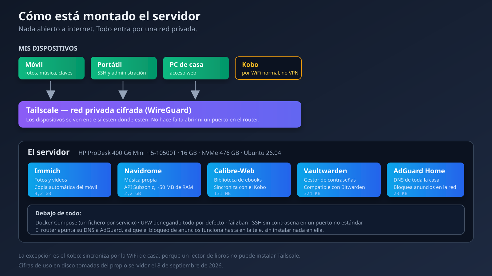
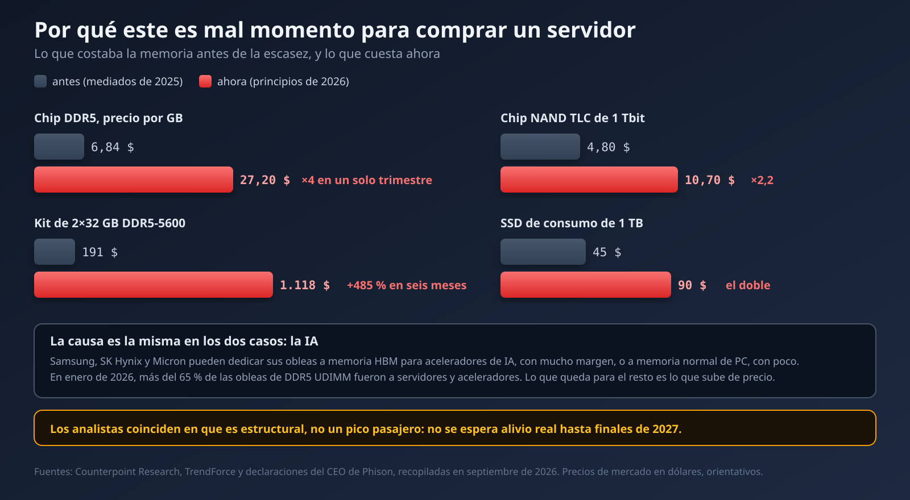

## De qué va esto

Tengo un mini PC encendido en un rincón de casa. Lleva ocho días seguidos funcionando sin que yo lo toque, y ahora mismo guarda mis fotos, mi música, mis libros y mis contraseñas. Ninguna de esas cosas pasa ya por Google.

Este post cuenta cómo llegué ahí: qué es un servidor cuando lo miras de cerca, qué alternativas me planteé en cada decisión y por qué elegí las que elegí. También cuenta lo que **no** funciona tan bien como parece cuando lo lees en un tutorial entusiasta, porque hay contras reales y prefiero decirlos.

Y al final hablo de dinero, porque justo ahora hay un factor que cambia bastante el consejo que le daría a alguien que quiera copiarme.

> **Actualización de septiembre**: cincuenta días después me senté a auditar el bloqueador de anuncios con los datos en la mano, y encontré tres cosas rotas que el panel no enseñaba. Está al final del post, con los comandos, las configuraciones que cambié y las dos veces que me equivoqué de diagnóstico.

## Primero: ¿qué es un servidor?

Un servidor no es un tipo de ordenador. Es un **papel** que un ordenador desempeña.

Tu portátil está pensado para que tú te sientes delante: tiene pantalla, teclado, y se apaga cuando cierras la tapa. Un servidor es un ordenador al que nunca te sientas delante. Está encendido siempre, sin pantalla ni teclado conectados, esperando a que otros aparatos le pidan cosas por la red. Tú hablas con él desde el móvil o desde el portátil, y él responde.

Eso es literalmente todo. Cuando abres Instagram, tu móvil le pide fotos a un servidor de Meta. Cuando yo abro mi galería, mi móvil se las pide a una caja que tengo a cuatro metros. La diferencia no es técnica: es de quién es la caja.

"Servidor" tampoco significa un armario con luces parpadeando. El mío es un mini PC de oficina reacondicionado, del tamaño de un libro grueso, que consume menos que una bombilla vieja.

## El hardware: un PC de oficina de segunda mano

Compré un **HP ProDesk 400 G6 Mini**. Esto es lo que lleva:

- Intel Core i5-10500T, 6 núcleos y 12 hilos
- 16 GB de RAM DDR4
- Un SSD NVMe de 476 GB
- Gráfica integrada Intel UHD 630, sin tarjeta dedicada
- Ubuntu 26.04 LTS

¿Por qué un mini PC de oficina y no otra cosa? Me planteé tres opciones.

Una **Raspberry Pi** es lo que todo el mundo recomienda para empezar, y es una buena recomendación: barata, diminuta, consume nada. La descarté porque quería que este trasto hiciera cosas exigentes —procesar fotos, quizá modelos de IA— y una Pi se queda corta en cuanto le pides algo más que servir ficheros. Además el almacenamiento por tarjeta SD es un punto de fallo conocido.

Un **NAS comercial** (un Synology, por ejemplo) es la opción cómoda: viene con su sistema, sus apps, su interfaz bonita. Lo estuve mirando en serio, y llegué a comparar modelos y discos. Lo descarté por dos razones: cuesta bastante más por la potencia que te da, y te ata a su ecosistema. Si un día quiero instalar algo que a Synology no le gusta, tengo un problema que en un Ubuntu normal no existe.

Un **VPS en la nube** habría sido más fiable en cuanto a disponibilidad, pero rompe la premisa entera. Si el objetivo es que mis fotos no estén en el ordenador de otro, alquilar el ordenador de otro no lo resuelve.

El mini PC de oficina reacondicionado gana porque es el punto dulce: potencia de PC real, precio de segunda mano, consumo bajo, y encima es hardware pensado para estar años encendido en una oficina. Estos equipos salen al mercado de segunda mano por miles cuando las empresas renuevan.

## La decisión que lo condiciona todo: no abrir ningún puerto

Antes de instalar nada hay que responder a una pregunta: **¿cómo llego al servidor desde fuera de casa?**

La respuesta clásica es abrir puertos en el router. Le dices al router "lo que llegue al puerto 443, mándalo al servidor", y ya puedes entrar desde cualquier sitio. Es lo que hace todo el mundo, y funciona.

También significa que tu servidor queda expuesto a internet entero. Y "internet entero" incluye a los bots que escanean direcciones IP las 24 horas buscando cosas mal configuradas. No es paranoia: es que si abres un puerto, en cuestión de horas alguien lo está probando.

La alternativa que elegí es **Tailscale**, que monta una red privada virtual entre mis dispositivos usando WireGuard. Mi móvil, mi portátil, mi PC y el servidor se ven entre sí como si estuvieran en la misma habitación, aunque yo esté en la otra punta del país. Y desde fuera de esa red, el servidor **no existe**. No hay puerto que escanear.



¿Contras? Dos, y son reales.

El primero: **todo el que quiera acceder tiene que instalar Tailscale**. Si quiero enseñarle las fotos a mi padre en su móvil, no le puedo pasar un enlace y ya. Eso es fricción de verdad.

El segundo: dependo de un servicio de terceros para la coordinación. Tailscale no ve mi tráfico —eso va cifrado de extremo a extremo— pero sí gestiona quién puede conectarse con quién. Existe [Headscale](https://github.com/juanfont/headscale), que es un servidor de coordinación autoalojado, y sería lo coherente del todo. No lo he montado porque añade una pieza más que mantener, y he preferido elegir mis batallas.

## Las fotos: lo que más me costaba dejar

Google Photos era lo más difícil de sustituir. No por las fotos en sí, sino por todo lo que hay alrededor: la copia automática, el buscador que encuentra "playa" sin que nadie haya etiquetado nada, las caras agrupadas.

Comparé seis opciones. Las tres que llegaron lejos:

**PhotoPrism** está más maduro y tiene fama de no romper nada entre versiones. Pero no tiene aplicación móvil oficial. Y la copia automática desde el móvil era justo el requisito central, así que quedó fuera por lo único que no podía ceder.

**Ente** me pareció técnicamente elegante: cifrado de extremo a extremo, y el reconocimiento facial corre **en el móvil**, no en el servidor, así que el servidor casi no trabaja. Sigue siendo mi plan B si algún día el mío se queda corto. Perdió porque su comunidad de autoalojamiento es mucho más pequeña, y eso importa a las tres de la mañana cuando algo falla y estás buscando a alguien que haya tenido tu mismo error.

**Immich** ganó. Es prácticamente un clon funcional de Google Photos: app nativa, copia automática en segundo plano, búsqueda semántica, reconocimiento facial. Y una comunidad enorme.

Ahora, el contra que no me voy a saltar: **Immich rompe cosas entre versiones mayores**. Alcanzó su versión estable en octubre de 2025, y en julio de 2026 la 3.0 ya trajo una migración obligatoria del motor de búsqueda vectorial. El propio proyecto recomienda no depender de él como copia única. Yo actualizo leyendo las notas de versión, nunca a ciegas.

Ocupa 9,2 GB con lo que le he metido hasta ahora.

## La música: donde el contra es más gordo

Aquí monté **Navidrome**, y la decisión fue fácil. Me planteé Jellyfin (que también hace vídeo, pero pide entre 2 y 4 GB de RAM) y Funkwhale (pensado para una red federada, que no es lo que necesito). Navidrome funciona con unos 50 MB de RAM y habla la API Subsonic, que es el estándar de facto: eso significa que puedo elegir entre docenas de aplicaciones de móvil en vez de estar atado a una.

Pero aquí está el contra más serio de todo el montaje, y quiero decirlo claro porque es el que más se nota en el día a día.

**Cuando tu música vive en un servidor, necesitas conexión para escucharla.** Si me meto en el metro y pierdo cobertura, la música se corta. Si tuviera los archivos en el móvil, no. Spotify tiene el mismo problema y lo resuelve con descarga offline; aquí también existe —Tempo, la app que uso, sincroniza para escuchar sin conexión— pero es un paso manual que tienes que acordarte de hacer, no algo que pasa solo.

Es un intercambio honesto: gano una biblioteca que es mía de verdad, que nadie puede retirar del catálogo, y que suena a la calidad que yo decida. Pierdo la comodidad de que simplemente funcione siempre.

Un detalle práctico que me costó una tarde: **AIMP, el reproductor que usaba en Android, no soporta Subsonic**. Solo existe un plugin para la versión de escritorio. Tuve que cambiar a [Tempo](https://github.com/CappielloAntonio/tempo), que es software libre y además funciona con Android Auto.

## Los libros: mi propia biblioteca, y el Kobo respirando

Esta es la parte que más satisfacción me ha dado, y la que menos esperaba.

Tengo un Kobo. Los lectores de libros electrónicos tienen poco espacio, así que acabas haciendo limpieza cada cierto tiempo, decidiendo qué borras. Con un servidor eso se acaba: **la biblioteca entera vive en el servidor y el Kobo solo lleva lo que estoy leyendo ahora**. Cuando termino, lo quito y bajo otro. El espacio deja de ser un problema.

Comparé seis opciones otra vez. La pelea real fue entre dos.

**Kavita** es objetivamente mejor gestionando bibliotecas enormes, y su desarrollo es más constante. Si tuviera decenas de miles de cómics, sería mi elección sin dudar.

**Calibre-Web-Automated** ganó por una razón muy concreta: **sincroniza de forma nativa con el Kobo por WiFi**. Con Kavita tendría que instalar KOReader en el lector para acceder por OPDS. Eso es toquetear el Kobo, y no me apetecía. Además, CWA tiene una carpeta de "ingesta": sueltas ahí un EPUB y él solo le arregla los metadatos, le busca portada y lo coloca. Yo partía de un montón de ficheros sueltos sin ordenar, así que eso me ahorró horas.

Aquí hay una excepción arquitectónica que merece explicación: **el Kobo es el único aparato que no entra por Tailscale**. No puede: es un lector de libros, no puedes instalarle una VPN. Así que este servicio sí está abierto a la red local de casa. Es una concesión consciente, no un despiste: la superficie expuesta es mi WiFi, no internet.

## Las contraseñas: lo más práctico de todo

**Vaultwarden** es una reimplementación de Bitwarden hecha en Rust. Habla el mismo protocolo, así que funcionan las aplicaciones oficiales de Bitwarden, pero consume una fracción de los recursos. Ocupa 324 KB en disco.

De todos los servicios, este es el que más me ha cambiado el día a día. Contraseñas distintas y largas en todas partes, autocompletado en el móvil y en el navegador, y la base de datos en mi casa.

Un detalle técnico bonito: el gestor de contraseñas **exige HTTPS de verdad**, aunque vaya por una red privada. El motivo es que la web usa la Web Crypto API del navegador, que solo funciona en "contexto seguro". Sin HTTPS la página carga pero el cifrado falla en silencio, que es la peor forma posible de fallar.

Lo resolví sin montar un proxy inverso, que era lo que esperaba tener que hacer: Tailscale puede emitir un certificado real de Let's Encrypt para el nombre del servidor dentro de mi red privada y hacer de proxy él mismo. Un contenedor entero que me ahorré.

## Los anuncios: el servicio que agradece toda la casa

**AdGuard Home** hace de servidor DNS para toda la red. Cuando cualquier dispositivo de casa pregunta "¿dónde está anuncios.ejemplo.com?", responde que no existe. El anuncio no se bloquea: **no llega a descargarse**.

Lo bueno de hacerlo a nivel de red es que funciona en aparatos donde no puedes instalar un bloqueador: la tele, la consola, el móvil de una visita.

Me planteé **Pi-hole**, que es el más conocido. Perdió por un motivo concreto: para cifrar las consultas DNS necesita una pieza auxiliar aparte, y el método que usaba media comunidad —`cloudflared` en modo proxy— dejó de funcionar en febrero de 2026 por un cambio de Cloudflare. AdGuard Home lleva eso integrado. También miré **Technitium**, que es técnicamente superior gestionando zonas DNS, pero eso resuelve un problema que yo no tengo todavía. Meter un servidor DNS autoritativo completo para bloquear anuncios es matar moscas a cañonazos.

*Cincuenta días después fui a comprobar si esto hacía de verdad lo que yo creía. La respuesta corta es que sí, pero con tres agujeros que no se veían desde el panel: lo cuento entero en la [actualización del final](#actualización-13-de-septiembre-de-2026--50-días-de-datos-y-tres-cosas-rotas-que-no-sabía), con las cifras reales y los comandos para sacarlas.*

## Lo que decidí no montar: el correo

Me hacía ilusión tener mi propio correo en mi propio dominio. Lo investigué y lo descarté, y creo que es la decisión más útil de todo el proyecto.

El problema no es montarlo. Existen soluciones que levantan un servidor de correo completo en una tarde. El problema es que **funcione**:

**Reputación de IP.** Un servidor de correo nuevo empieza con cero reputación. Gmail y Outlook tratan por defecto como sospechosa cualquier IP que no conocen. Sin SPF, DKIM y DMARC bien afinados durante meses, tus correos van a spam o rebotan sin avisarte. Eso no es una tarea, es un mantenimiento indefinido.

**Y el que me remató: mi operador bloquea el puerto 25 saliente** y no deja configurar el DNS inverso de la IP de casa. Sin eso, ni con la configuración perfecta se puede enviar correo fiable desde aquí. No es una limitación que yo pueda arreglar.

Así que el correo sigue en un proveedor gestionado. A veces la respuesta correcta es no autoalojar algo, y me parece más honesto contarlo que fingir que todo se puede.

## El otro uso: un sitio donde probar cosas

Más allá de los servicios, el servidor es **un sitio donde romper cosas sin consecuencias**.

Antes, cuando quería probar una base de datos, un contenedor raro o un panel web, lo instalaba en el portátil y acababa con el sistema lleno de porquería a medio desinstalar. Ahora lo levanto en el servidor, lo pruebo, y si no me convence borro el contenedor y no queda rastro.

Ahí caben los paneles personales: un tablero con el estado de mis cosas, un cron que me recopila algo cada mañana, una API pequeña para un proyecto. Cosas que en un servicio gestionado costarían una suscripción mensual cada una, y que aquí son un fichero de configuración más.

## Juntarlo con la IA local

Hace unas semanas escribí sobre [montar IA local en un PC antiguo](/es/blog/local-ai-lab-old-pc). Aquel experimento fue en otra máquina, con una gráfica dedicada, y la conclusión principal fue que **los modelos pequeños y especializados ganaron a los grandes** en casi todas las tareas reales que les puse.

Eso encaja con este servidor mejor de lo que parece. Un modelo pequeño de 4B parámetros dedicado a una sola cosa —clasificar, extraer datos estructurados, responder sobre mis notas— no necesita una gráfica de gama alta. Y aquí ya tengo la parte difícil montada: los datos.

Lo que tiene sentido montar aquí:

- **RAG sobre mis propias notas**: buscar en mis documentos y que un modelo responda citando los fragmentos. En aquel experimento aprendí que lo determinante no es el modelo, es la recuperación: sin RAG acertaba 2 de 7 preguntas, con varias consultas de recuperación subía a 5 de 7.
- **Un asistente pequeño** para tareas concretas y repetitivas, corriendo por la noche sin que nadie mire.
- **Paneles que se alimentan de mis propios datos**, sin mandar nada a una API externa.

Pero hay un límite honesto: **este servidor no tiene gráfica dedicada**. La UHD 630 integrada no sirve para inferencia. Todo iría por CPU, que funciona para modelos pequeños pero no da para nada ambicioso. Y hay un cuello de botella peor, que cuento ahora.

## Los límites reales de esta máquina

Tres cosas que se llevaron una sorpresa cuando audité el equipo:

**La RAM va en canal único.** Los 16 GB son un solo módulo, con el segundo zócalo vacío. Eso deja el ancho de banda de memoria a la mitad de lo que podría ser. Para servir fotos da igual, pero es exactamente el cuello de botella que más duele en inferencia de modelos por CPU. Arreglarlo es meter un segundo módulo idéntico.

**La red negocia a 100 Mb/s.** La tarjeta del servidor soporta Gigabit; lo que no lo soporta es el puerto del router donde está enchufado. Eso limita las transferencias a unos 12 MB/s, que se nota subiendo un lote grande de fotos. No es culpa del servidor, y se arregla con un cable mejor o un switch.

**Sin gráfica dedicada**, ya comentado.

De los tres, el único que me planteo tocar de verdad es la RAM. Y ahí viene el problema.

## Por qué ahora es mal momento para comprar

Si has leído hasta aquí pensando en montarte uno, este es el aviso importante.

**Los precios de la memoria y el almacenamiento se han disparado.**



Los números, recopilados en septiembre de 2026:

- El chip DDR5 pasó de **6,84 $ por GB** en septiembre de 2025 a **27,20 $ por GB** en diciembre. Casi cuatro veces más en un trimestre.
- Un kit de 2×32 GB DDR5-5600 que costaba unos **191 $** en agosto de 2025 ronda ahora los **1.118 $**. Un **+485 %**.
- La memoria NAND de los SSD ha doblado su precio en seis meses, de **4,80 $** a **10,70 $** por chip.
- Un SSD de consumo de 1 TB ha pasado de unos **45 $** a casi **90 $**.

La causa es la misma en ambos casos: la IA. Samsung, SK Hynix y Micron pueden dedicar sus obleas a memoria HBM para aceleradores de IA, con márgenes altos, o a memoria normal de PC, con márgenes bajos. Están eligiendo lo primero. En enero de 2026, más del 65 % de las obleas de DDR5 UDIMM fueron a servidores y aceleradores.

Y no parece un pico pasajero. Los analistas coinciden en que las causas son estructurales y no se espera alivio real **hasta finales de 2027**.

¿Qué significa esto en la práctica?

Si ya tienes hardware, es buen momento para **exprimirlo**. Yo tengo 405 GB libres de 466: espacio no me falta ni de lejos.

Si estabas pensando en comprar, **espera si puedes**. Y si no puedes esperar, mira el mercado de segunda mano y reacondicionado, que es justo de donde salió el mío y donde estos precios pegan menos.

Mi ampliación de RAM, esos 30-40 € que costaba un módulo hace un año, ahora mismo no sale a cuenta. Se queda en la lista para más adelante.

Con lo del NAS pasa igual. Lo tengo estudiado —comparé modelos, discos, capacidades— y la conclusión honesta fue que **no me hace falta todavía**. Con 405 GB libres, gastarme 300 € o más en almacenamiento que no necesito, en el peor momento de precios de la década, sería comprar por el gusto de comprar.

## Pros y contras, en corto

**Lo que gano:**

- Mis fotos, mi música, mis libros y mis contraseñas están en mi casa, en un disco que puedo tocar.
- Sin suscripciones. El coste es la luz, unos pocos euros al mes.
- Sin límites artificiales de espacio ni de calidad.
- Nadie retira algo de mi biblioteca porque venció una licencia.
- Un sitio donde probar cosas sin ensuciar el portátil.
- Bloqueo de anuncios en toda la casa, incluida la tele.

**Lo que pierdo:**

- **Yo soy el soporte técnico.** Si algo se cae un domingo, se arregla solo si lo arreglo yo.
- **La música necesita conexión**, salvo que sincronices offline a mano.
- **Compartir con gente de fuera es incómodo**, porque tienen que instalar Tailscale.
- **Las copias de seguridad son mi problema.** Un servidor no es una copia de seguridad: si se muere el disco, se muere todo. Esto es lo que menos resuelto tengo y lo digo sin adornos.
- **Hay que mantenerlo.** Actualizaciones, notas de versión, revisar que todo siga vivo.
- **Correo, no.** Hay cosas que no compensa autoalojar.

## Conclusión

Lo que más me sorprendió no fue la parte técnica. Fue darme cuenta de cuántas de las cosas por las que pagamos suscripción son, por debajo, bastante sencillas: un sitio donde guardar archivos y una aplicación decente para verlos. Lo que pagas casi siempre es la comodidad de que otro se ocupe.

Esa comodidad tiene valor real, no lo minimizo. Hay días que agradecería que Google se ocupara. Pero cuando el precio es que tus fotos, tu música y tus contraseñas vivan en el ordenador de otro, con sus reglas y sus cambios de condiciones, a mí me sale a cuenta ocuparme yo.

Si te lo estás planteando, mi consejo es empezar por **un solo servicio**. Monta el gestor de contraseñas, o el bloqueador de anuncios, y vive con él un mes. Cuando eso funcione y confíes en ello, añade el siguiente. Intentar montarlo todo a la vez es la forma más rápida de acabar con cinco cosas a medias y ninguna funcionando.

Y si es el hardware lo que te frena: mira el mercado reacondicionado, que ahora mismo es donde está el sentido común.


---

## Actualización: 13 de septiembre de 2026 — 50 días de datos, y tres cosas rotas que no sabía

Escribí este post cuando el servidor llevaba ocho días encendido. Cincuenta días después me senté a mirar si el bloqueador de anuncios estaba haciendo lo que yo creía que hacía.

No del todo. Y lo más llamativo es que **nada de lo que encontré se veía en el panel**: hubo que bajar al registro en crudo. Cuento el proceso entero, incluidas las dos veces que me equivoqué de diagnóstico, porque son las que más enseñan.

### Lo primero: el panel no podía responderme

Quería una cifra simple: *¿cuánto lleva bloqueado desde que lo puse?*

AdGuard Home guarda estadísticas **24 horas** por defecto. No hay histórico. La pregunta no se podía contestar desde la interfaz.

Lo que sí hay es `querylog.json`, un fichero donde apunta cada consulta, una por línea en JSON. En mi caso, **626 MB y 1.667.107 consultas** en 50 días. El fichero es de `root`, pero el contenedor también corre como `root`, así que se lee sin tocar nada ni pedir `sudo`:

```bash
docker exec adguardhome cat /opt/adguardhome/work/data/querylog.json | wc -l
docker exec adguardhome cat /opt/adguardhome/work/data/querylog.json | grep -c '"IsFiltered":true'
```

1.667.107 consultas. 445.011 bloqueadas.

### La cifra que yo tenía en la cabeza era otra cosa

En mis notas del despliegue ponía **"97-100% de bloqueo"**. La cifra real es **26,7%**.

Las dos son correctas, y la diferencia importa más de lo que parece:

- El **97%** salía de un test sintético: coges una lista de dominios de anuncios conocidos, los consultas todos y cuentas cuántos caen. Eso mide **la calidad de tus listas**.
- El **26,7%** es la proporción de mi tráfico real que resultó ser basura. Eso mide **cuánta porquería genera mi casa**.

Un bloqueador perfecto con listas perfectas **no** te da un 97% de tráfico bloqueado, porque la mayoría de lo que pide tu red son cosas legítimas. Confundir las dos cifras hace que te creas mucho mejor protegido de lo que estás. Anoté la corrección en mis notas, porque leídas juntas en la misma página inducían al error.

Con toda la casa conectada y en régimen normal, lo mío se mueve **entre el 26% y el 40%, con media en torno al 32%**.

### Cómo leer 50 días de DNS cuando no hay panel

Todo lo que viene después salió de una sola pasada de `awk`. Cada línea del registro lleva la fecha en `"T"`, el dominio en `"QH"`, el cliente en `"IP"` y, si se bloqueó, `"IsFiltered":true`:

```bash
docker exec adguardhome cat /opt/adguardhome/work/data/querylog.json | awk '
{
  b = index($0, "\"IsFiltered\":true")
  if (match($0, /"IP":"[^"]*"/)) ip = substr($0, RSTART+6, RLENGTH-7); else next
  total[ip]++; if (b) blocked[ip]++
}
END {
  for (i in total)
    printf "%-16s %7d %7d %5.1f%%\n", i, total[i], blocked[i], blocked[i]*100/total[i]
}' | sort -k2 -rn
```

Un detalle de método: la primera vez copié el fichero a `/tmp` del servidor para trabajar más cómodo. 626 MB escritos en una máquina que se suponía que estaba auditando **sin tocar nada**. Lo borré al terminar, pero la forma correcta es la de arriba — todo por tubería, sin escribir en disco.

Y lo primero que salió de ahí ya fue interesante: **el filtro no rinde igual para todos**. El Fire TV Stick bloqueaba el **55,7%** de todo lo que pedía. Mi portátil de trabajo, el **6,8%**, porque su tráfico es GitHub y registros de contenedores, no publicidad. El aparato que más agradece un bloqueador es siempre **el que no puedes controlar por dentro**.

### Hallazgo 1: el resolver tenía un solo teléfono y ninguna centralita de reserva

Un bloqueador DNS hace dos cosas: mira su lista negra y, para lo que no está en la lista, le pregunta a un servidor DNS de verdad ahí fuera. A ese servidor se le llama **upstream**.

El mío tenía **un solo upstream** y el campo de reserva (*fallback*) **vacío**. Y ese upstream estaba fallando:

```bash
docker logs adguardhome --since 12h 2>&1 | grep -c "exchange failed"
# 131
```

131 fallos en 12 horas, todos `unexpected EOF`: el proveedor cortando la conexión HTTPS a media consulta. Y los dominios afectados no eran anuncios, eran cosas que uso a diario:

```bash
docker logs adguardhome --since 12h 2>&1 | grep "exchange failed" \
  | grep -oE 'question=";[^\\]+' | sort | uniq -c | sort -rn | head
```

El gestor de contraseñas. GitHub. La validación de certificados de Apple. La sincronización de VS Code. Las miniaturas de imágenes de Google.

**Y aquí está la parte fea, que es la que de verdad importa.** Cuando el upstream falla, el bloqueador responde `SERVFAIL`. El aparato que preguntaba no se rinde: el router le había dado **dos** servidores DNS, y el segundo era el DNS público de Google. Así que reintenta ahí. Y Google responde a todo, **incluidos los anuncios**.

O sea: el mismo fallo que rompe la navegación **abre un agujero en el filtro**, y lo hace en silencio, unas 260 veces al día. Si solo miras "¿va internet?", nunca lo detectas.

### De regalo: estaba usando la variante equivocada del proveedor

Al abrir la configuración vi que el upstream era `dns10.quad9.net`. Quad9 tiene dos ramas y se diferencian en un número:

| Servidor | Qué hace |
|---|---|
| `dns.quad9.net` | Bloquea dominios de malware y **valida DNSSEC** |
| `dns10.quad9.net` | Ni lo uno ni lo otro |

Yo llevaba la segunda. Y a la vez tenía `enable_dnssec` activado en AdGuard — es decir, pidiendo el sello de autenticidad a un servidor que no lo comprueba. El sello puesto y nadie mirándolo.

No fue mala suerte: es de las dos que más circulan en tutoriales, y el número pequeño no grita "esta es la versión sin protecciones".

### El arreglo

Cuatro campos en *Ajustes → Ajustes del DNS*, sin reiniciar nada:

**Proveedores DNS** — dos, de redes distintas para que no se caigan a la vez:

```
https://dns.quad9.net/dns-query
https://cloudflare-dns.com/dns-query
```

**Servidores DNS alternativos** — estaba vacío, y es la reserva de verdad. Lo importante: esta reserva **sigue pasando por el filtro**, porque el bloqueador consulta su lista negra *antes* de salir a preguntar. Los dominios bloqueados nunca llegan al upstream. Es la diferencia clave con el DNS de respaldo del router, que no filtra nada:

```
9.9.9.9
149.112.112.112
```

**Servidores de arranque** — los que resuelven el nombre del propio proveedor cifrado al levantar el servicio. Los tenía apuntando a la variante vieja; los cambié a la buena.

**Modo de resolución: lo dejé en `load_balance`, no en `parallel`.** `parallel` manda cada consulta a **todos** los proveedores y se queda con la primera respuesta. Es más resistente, sí, pero también le regala a cada proveedor una copia completa de todo lo que hace tu casa. Con la reserva bien puesta, `load_balance` ya cubre el fallo sin ese peaje.

Y de paso subí la retención de estadísticas de 24 horas a **90 días**, que es lo que me había obligado a bajar al registro en crudo.

### Verificar de verdad: la caché te miente

Cambiar los campos y ver que "sigue habiendo internet" no demuestra nada, porque la caché responde sin salir a preguntar. Para comprobar que estaba usando los dos proveedores nuevos hice 200 consultas a nombres **inventados**, que por definición no podían estar cacheados:

```bash
for i in $(seq 1 200); do
  dig +short @<IP-DEL-SERVIDOR> "test-$RANDOM-$i.ejemplo.org" A >/dev/null
done
```

Y luego conté por proveedor en el registro:

```bash
docker exec adguardhome cat /opt/adguardhome/work/data/querylog.json \
  | grep -o '"Upstream":"[^"]*"' | sort | uniq -c | sort -rn
```

Reparto real entre los dos nuevos, y el viejo con dos consultas residuales de justo antes del cambio. **Eso** sí es una verificación.

Un paso más que merece la pena: AdGuard trae un botón para probar proveedores antes de guardarlos (`POST /control/test_upstream_dns` si vas por API). Los cuatro en verde **antes** de aplicar, no después.

Y la comprobación final, la de toda la vida:

```bash
getent hosts doubleclick.net   # -> :: o 0.0.0.0  (bloqueado)
getent hosts github.com        # -> una IP normal (resuelve)
```

Si el primero da ceros y el segundo una dirección de verdad, filtra **y** resuelve. Las dos cosas, porque un filtro que bloquea todo también "bloquea anuncios".

### Lección: el formulario no es el estado

Esta me la llevé en directo, y es la **tercera vez** que me pasa lo mismo con tres sistemas distintos.

Pegué los proveedores nuevos en el panel. Los vi ahí, en su caja de texto, tan tranquilo. Al leer la configuración **efectiva** por la API seguía estando solo el upstream viejo: no le había dado a *Guardar*.

Las otras dos veces:

- **SSH.** Endurecí `sshd_config` y el login por contraseña seguía funcionando. Resulta que OpenSSH se queda con el **primer** valor que encuentra, no con el último, y un fichero de `cloud-init` que se leía antes lo reactivaba. El fichero decía una cosa y el servicio hacía otra.
- **El router.** Después de que me lo cambiaran, el panel mostraba mi servidor como DNS principal. El DHCP seguía repartiendo los del operador. El formulario decía una cosa y el router hacía otra.

**La regla que saqué**: después de tocar cualquier configuración, no mires el sitio donde la escribiste. **Pregúntale al sistema qué está usando.**

```bash
sudo sshd -T | grep passwordauthentication        # config efectiva de SSH
nmcli -f all dev show <interfaz> | grep IP4.DNS   # DNS que reparte el router de verdad
getent hosts doubleclick.net                      # ¿filtra de verdad?
```

### Hallazgo 2, y primera metedura de pata: "el Fire TV Stick se salta el filtro"

Miré qué aparatos habían pasado por el bloqueador desde que me cambiaron el router, y el Fire TV Stick no estaba. Ni una consulta. Tres dominios que ese aparato consulta sin parar sumaban **101.152 consultas históricas y cero** desde el cambio.

Conclusión evidente: se está saltando el filtro. La escribí en el informe y todo, marcada como crítica.

**Era falso.** Al comprobarlo en vivo, el aparato sí había preguntado al bloqueador ese mismo día. Una vez. Nadie había encendido la tele.

Cero consultas no significa "esquiva el filtro". Significa **"apagado"**. Y la forma de distinguirlo es mirar si el aparato ha hecho *alguna* consulta, no si faltan las de siempre.

Me gusta esta equivocación porque el dato era correcto y el razonamiento parecía sólido. Lo que faltó fue buscar una hipótesis alternativa igual de simple antes de dar la mía por buena.

### Hallazgo 3: cinco aparatos hablando con Google por detrás

Este sí era real, y es el más interesante de detectar.

Muchos móviles y navegadores traen una opción de **"DNS privado"** o **"DNS seguro"** que manda las consultas cifradas a un servidor concreto —normalmente Google o Cloudflare— **saltándose el DNS de tu red**. Si está activada, ese aparato no pasa por tu filtro y tú no te enteras: no sale como "no bloqueado", simplemente **no sale**.

Pero deja un rastro. Para hablar con `dns.google` primero hay que **averiguar dónde está** `dns.google`. Y esa pregunta sí te la hacen a ti:

```bash
docker exec adguardhome cat /opt/adguardhome/work/data/querylog.json \
  | grep '"QH":"dns.google"' | grep -o '"IP":"[^"]*"' | sort | uniq -c | sort -rn
```

**15.782 consultas desde cinco aparatos distintos.** Y otras 9.596 a `mask.apple-dns.net`, que es la firma del *Private Relay* de Apple, desde otros dos.

Merece la pena mirar también estos, que son las firmas del resto de proveedores: `cloudflare-dns.com`, `one.one.one.one`, `dns.nextdns.io`, `doh.opendns.com` y `use-application-dns.net`.

### Cómo supe qué aparato era cada uno

Aquí viene la parte divertida. Entre medias me habían cambiado el router, así que **todas las IP de la red eran distintas** a las de mis notas. Tenía cinco culpables y ningún nombre.

La solución fue identificarlos **por lo que preguntan**. Los aparatos consultan dominios de su fabricante constantemente, y eso es una huella bastante fiable:

```bash
docker exec adguardhome cat /opt/adguardhome/work/data/querylog.json | awk '
{
  if (match($0, /"IP":"[^"]*"/)) ip = substr($0, RSTART+6, RLENGTH-7); else next
  if (match($0, /"QH":"[^"]*"/)) qh = substr($0, RSTART+6, RLENGTH-7); else next
  if      (qh ~ /xiaomi|miui|micloud/)    v[ip "|Xiaomi"]++
  else if (qh ~ /huawei|hicloud/)         v[ip "|Huawei"]++
  else if (qh ~ /apple|icloud/)           v[ip "|Apple"]++
  else if (qh ~ /samsung/)                v[ip "|Samsung"]++
  else if (qh ~ /microsoft|windows/)      v[ip "|Windows"]++
  else if (qh ~ /a2z\.com|firetv/)        v[ip "|Amazon"]++
}
END { for (k in v) print v[k], k }' | sort -rn
```

Salieron solos: un móvil Xiaomi, otro Huawei, un iPad, el PC de sobremesa y un portátil de trabajo. Ese último tiene el DNS impuesto por el departamento de IT de la empresa, así que ni puedo ni debo tocarlo.

Y de propina apareció **un aparato que ni siquiera estaba en mi inventario**: uno que pedía dominios de Samsung y del asistente Bixby. Estaba pasando por el filtro perfectamente, pero yo no sabía que existía. Un inventario de red se queda viejo en cuanto alguien enciende algo nuevo.

### El mío era Brave, y no lo habría buscado ahí

El PC de sobremesa salía en la lista y me chocó, porque en ese equipo yo no uso Chrome.

Da igual: **Brave es Chromium por dentro** y arrastra exactamente el mismo ajuste de DNS seguro, solo que en otra ruta. Si vas buscando "el ajuste de Chrome", no lo encuentras y descartas el navegador como sospechoso.

```
brave://settings/security   →   "Usar DNS seguro"   →   desactivar
```

En Chrome es `chrome://settings/security` y en Edge `edge://settings/privacy`. Mismo motor, mismo ajuste, tres rutas distintas. Si lo desactivas y **sigue** apareciendo, entonces es el sistema operativo: Windows 11 tiene su propio DNS-over-HTTPS en *Configuración → Red e Internet → [tu conexión] → Asignación de servidor DNS*.

**La verificación:** `dns.google` pasó de 32 consultas en una hora a **cero**, con el PC en uso activo. Aunque aquí toca ser honesto: la última consulta cayó unos minutos antes de tocar el ajuste, así que la correlación es buena pero no es una prueba limpia. Lo apunté así en mis notas en vez de venderlo como confirmado.

### Detective extra: dos direcciones, una sola máquina

Durante el análisis apareció un cliente con 128.180 consultas que no cuadraba con ningún aparato de mi inventario. Candidato perfecto a intruso.

No lo era. Era **el mismo PC de sobremesa**, contado dos veces.

La explicación: los equipos que tienen la VPN de malla instalada mandan el DNS por la interfaz de la VPN, no por la red local. En el registro aparecen con una dirección distinta. Un mismo aparato puede salir con dos identidades según por dónde salga la consulta en ese momento.

Lo confirmé con dos pruebas independientes:

1. **Su huella**: Steam, Discord, telemetría de Brave, ChatGPT, YouTube. Un PC de juegos con Brave. Encajaba con uno solo de mis equipos.
2. **Nunca coinciden en el tiempo.** Troceé tres días en tramos de diez minutos y conté en cuántos aparecía cada dirección. Resultado: **cero tramos** con solo la dirección local, veintidós con solo la de la VPN, y dos con las dos a la vez. Si fueran dos máquinas distintas, habría ratos con la local en solitario.

Esa segunda prueba me gusta porque no depende de reconocer dominios: es pura correlación temporal, y funciona aunque no tengas ni idea de qué es el aparato.

### Hallazgo 4, que resultó no ser un hallazgo

Los dos dominios **más consultados de toda mi red** en cincuenta días no eran Google ni YouTube. Era el propio servidor preguntando por uno de sus propios contenedores: **146.624 consultas**, el 8,8% de todo el tráfico DNS de la casa.

La causa tiene su lógica: esos contenedores comparten la red del anfitrión, así que el DNS interno de Docker no existe para ellos. El servidor llamaba a su contenedor vecino por su nombre, la pregunta salía al bloqueador, el bloqueador respondía que ese nombre no existe (no es un dominio de internet), y el sistema lo reintentaba añadiéndole el sufijo de la VPN. Dos preguntas inútiles por cada intento.

Iba a ponerlo como tarea pendiente. Antes miré **cuándo** había pasado:

| Día | Consultas |
|---|---|
| 28 de julio | 99.784 |
| 29 de julio | 40.054 |
| 30 de julio | 6.786 |
| A partir del 31 | **0** |

Fueron tres días de julio, la ventana en la que importé la fototeca entera. No ha vuelto a pasar. Y el reconocimiento de imágenes funciona: lo comprobé contando en la base de datos las fotos procesadas y las caras detectadas, y estaban todas.

**No había nada que arreglar.** La lección es de método: antes de apuntar algo como tarea pendiente, mira si sigue pasando. Un total grande de un fichero de 50 días puede ser un incendio de hace mes y medio que ya se apagó solo.

Lo único que queda de eso es estadístico: esos tres días explican por sí solos el 75% del tráfico del 28 de julio, y por eso ese día sale con una tasa de bloqueo ridícula. Si alguna vez recalculo el histórico, hay que descontarlos.

### La pregunta del millón: ¿pongo listas más agresivas?

Es la pregunta que todo el mundo se hace a los dos meses. Yo tenía cuatro listas y **899.911 reglas**, y la tentación de subir un escalón.

El registro permite contestarla con una medida en vez de con una opinión, porque el bloqueador apunta **qué lista** atrapó cada bloqueo. Y como evalúa las listas en orden y se queda con la primera que casa, lo que cada lista se lleva es **lo que las anteriores no cubrían**: su aportación marginal, literalmente.

```bash
docker exec adguardhome cat /opt/adguardhome/work/data/querylog.json \
  | grep -o '"FilterListID":[0-9]*' | sort | uniq -c | sort -rn
```

| Lista | Reglas | % de bloqueos |
|---|---|---|
| Lista base del propio AdGuard | 160.688 | 49,4% |
| Lista "Pro" | 222.602 | 31,4% |
| Lista "Normal" | 181.395 | 18,0% |
| **La más grande de las cuatro** | **335.226** | **1,3%** |

Ahí está la respuesta. **La lista con más reglas de todas aporta el 1,3%**, porque para cuando le llega el turno las otras tres ya han atrapado casi todo. Una quinta lista, más agresiva, aportaría todavía menos: solo puede pillar lo que cuatro catálogos de casi un millón de reglas han dejado pasar **a propósito**.

Y hay un segundo dato que remata el asunto. De los doce dominios más bloqueados de mi red, **solo uno es publicidad de display clásica**. El resto son registros de una plataforma de streaming, analítica de la app de mi banco, reporte de errores, telemetría de un cliente de mensajería, de un navegador, de un fabricante de móviles. El trabajo pesado del filtro hoy no es tapar anuncios: es **cortar chivatazos**.

¿Y los anuncios que sigo viendo? Las plataformas grandes de vídeo cosen el anuncio **dentro del propio stream**, desde el mismo dominio que la película. Ninguna lista, a ningún nivel de agresividad, puede tocar eso sin romper la plataforma entera.

El coste, en cambio, es muy concreto. En cincuenta días **no he tenido que escribir ni una sola excepción**. Ese cero es exactamente el presupuesto que se gastaría al subir de nivel — y ya tengo bloqueados, con las listas actuales, la telemetría de WhatsApp, la analítica de la app del banco y la configuración remota de Firebase. Si un escalón más muerde algo de eso, quien se queda sin app es mi familia, el síntoma es difuso ("va lenta", "no carga") y el único que puede arreglarlo soy yo.

**Decisión: no endurecer.** Beneficio marginal de alrededor del 1%, sobre telemetría y no sobre anuncios visibles; coste, falsos positivos que sufren cuatro personas que no van a sospechar del DNS.

### ¿Y meter un Pi-hole además?

La otra pregunta recurrente. Dos formas de plantearlo, y conviene separarlas.

**En cascada, uno detrás del otro: es peor, no mejor.** No añade cobertura —mismo mecanismo, mismas listas, así que el segundo solo puede pillar ese ~1%— y cuesta tres cosas: latencia encima de la que ya hay; disponibilidad que **se multiplica hacia abajo**, porque dos piezas en serie tienen que estar las dos vivas; y, la peor, **destruye la atribución por cliente**. El filtro de atrás vería una única dirección, la del de delante, en lugar de los cuarenta aparatos reales. Todo lo que acabas de leer —que el Fire TV Stick bloquea el 55,7%, que cinco aparatos se escapan, que el ruido venía del propio servidor— sería invisible.

**En paralelo, como redundancia: problema real, herramienta equivocada.** El punto único de fallo existe. Pero en la misma máquina no es redundancia (mismo disco, mismo Docker, mismos reinicios), y en otra máquina tienes **dos juegos de listas divergiendo**, dos paneles y el fallo más desesperante que existe: *"funciona a veces"*, según a cuál le tocó contestar. Además Pi-hole no lleva DNS cifrado nativo, que es justo el motivo por el que no lo elegí al principio.

**Si algún día quiero redundancia de verdad: un segundo AdGuard, no un Pi-hole.** Mismo motor, mismas listas, y una herramienta de sincronización que replica la configuración desde una única fuente de verdad.

### Lo que sigue abierto: el DNS de respaldo del router

Queda el agujero del hallazgo 1, y es una decisión más interesante de lo que parece.

Cuando monté esto puse el DNS público de Google como segundo servidor en el router, pensando: *"si el servidor se cae, que al menos haya internet"*. Suena sensato. El problema es lo que hace en la práctica:

- **Con él**: el servidor se cae, hay internet **sin filtrar**, y nadie se entera durante días.
- **Sin él**: el DNS se rompe de forma visible, alguien te lo dice en cinco minutos y lo arreglas.

Yo ya he vivido la primera versión: cuando me cambiaron el router se perdió el filtrado de toda la casa y **nadie lo notó** hasta que me puse a mirar. Ese es exactamente el fallo silencioso.

Así que toca cambiarlo por la dirección de mi propio servidor. Pero **en este orden**: primero la reserva dentro del bloqueador (que sí filtra), y solo cuando lleve unos días estable, cerrar la puerta del router. Al revés, un corte del proveedor deja a toda la casa sin internet.

### Resumen de comandos

```bash
# Cuántas consultas y cuántas bloqueadas, en total
docker exec adguardhome cat /opt/adguardhome/work/data/querylog.json | wc -l
docker exec adguardhome cat /opt/adguardhome/work/data/querylog.json | grep -c '"IsFiltered":true'

# Errores del upstream, y contra qué dominios
docker logs adguardhome --since 12h 2>&1 | grep -c "exchange failed"
docker logs adguardhome --since 12h 2>&1 | grep "exchange failed" | tail -5

# Qué proveedor está respondiendo de verdad
docker exec adguardhome cat .../querylog.json | grep -o '"Upstream":"[^"]*"' | sort | uniq -c | sort -rn

# Qué lista atrapa cada bloqueo (aportación marginal de cada una)
docker exec adguardhome cat .../querylog.json | grep -o '"FilterListID":[0-9]*' | sort | uniq -c | sort -rn

# Quién intenta saltarse el filtro
docker exec adguardhome cat .../querylog.json | grep '"QH":"dns.google"' \
  | grep -o '"IP":"[^"]*"' | sort | uniq -c | sort -rn

# Consumo y salud del contenedor
docker stats --no-stream adguardhome
docker inspect adguardhome --format '{{.RestartCount}}'

# Comprobar el estado EFECTIVO, no el formulario
sudo sshd -T | grep passwordauthentication
nmcli -f all dev show <interfaz> | grep IP4.DNS
getent hosts doubleclick.net    # :: o 0.0.0.0 = filtrando
getent hosts github.com         # IP normal = resolviendo
```

### Lo que me llevo de estos 50 días

**El bloqueador funciona y cuesta nada.** 445.011 conexiones de publicidad y telemetría cortadas, 235 MiB de RAM, cero reinicios, cero mantenimiento. La respuesta a un dominio bloqueado tarda 0,28 ms frente a los 51 ms de salir a preguntar fuera: el filtro, además, **acelera** lo que corta.

**Pero medir no es lo mismo que mirar el panel.** Las tres cosas rotas llevaban semanas ahí y ninguna se veía desde la interfaz. Si montas algo así, ponte una fecha en el calendario para ir a mirar los datos en crudo.

**Y las dos veces que me equivoqué fueron por lo mismo**: tenía un dato correcto, construí encima una historia plausible, y no busqué una explicación alternativa igual de simple. "No aparece" era "está apagado". "146.000 consultas" era "hace mes y medio". El dato nunca estuvo mal; la prisa por interpretarlo, sí.

---

*Si montas el tuyo o tienes dudas sobre alguna de estas decisiones, escríbeme por [LinkedIn](https://linkedin.com/in/raul-casado) o [GitHub](https://github.com/RaulCasado).*
