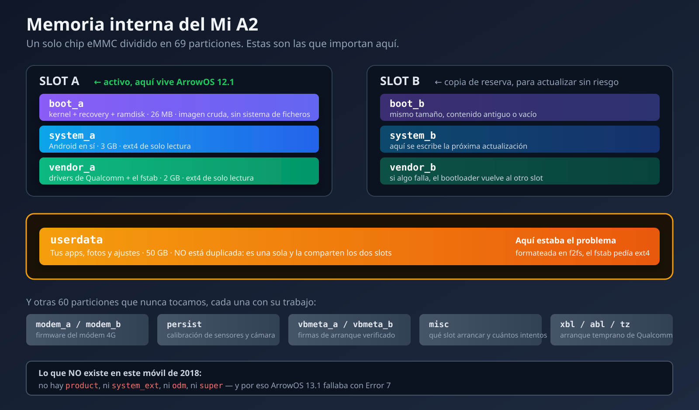

## Actualización: 7 de septiembre de 2026

Este post lo escribí en febrero. Siete meses después decidí actualizar el teléfono, y lo que iba a ser una tarde tranquila se convirtió en dos días peleándome con un móvil que se negaba a arrancar. Al final resultó ser **una sola línea de un fichero de configuración**, pero para llegar ahí tuve que descartar media docena de teorías equivocadas.

Dejo el post original íntegro más abajo. Esto es lo que pasó después.

### El punto de partida

Seguía con LineageOS 18.1, una build no oficial de diciembre de 2023. Android 11. Funcionaba bien, pero llevaba dos años sin un parche de seguridad y empezaba a notarse.

Primera lección, y me la llevé antes de tocar nada: **comprueba qué tienes instalado de verdad**. Yo daba por hecho que tenía una versión más nueva. Un `getprop ro.build.display.id` me sacó de dudas en un segundo. Llevaba meses equivocado sobre mi propio teléfono.

Después de comparar opciones me decidí por **ArrowOS**: seguía teniendo builds oficiales para `jasmine_sprout` y las críticas eran buenas.

### Antes de seguir: qué es una partición, y por qué esto lo explica todo

Aquí conviene parar, porque todo lo que viene después depende de entender esto, y en el post
original lo pasé por encima.

La memoria interna de un móvil **no es un disco con carpetas**, como el de un ordenador. Es un
único chip de memoria (una eMMC, en este caso de 64 GB) que viene **dividido de fábrica en trozos
de tamaño fijo llamados particiones**. Cada trozo tiene un trabajo concreto y el reparto no se
puede cambiar sin reescribir la tabla de particiones, que es una operación con muchas papeletas
de dejarte el móvil muerto para siempre. En el Mi A2 hay **69 particiones**. La mayoría no las
toca nadie nunca.



Las cuatro que importan para esta historia:

- **`boot`** — lleva el kernel de Linux y el ramdisk inicial. En este móvil también lleva dentro
  el recovery, y ahora veremos por qué eso es raro.
- **`system`** — Android en sí: el framework, las apps del sistema, las bibliotecas. Se monta en
  **solo lectura**, y por eso una app normal no puede modificar el sistema.
- **`vendor`** — todo lo específico del fabricante y del chip: los drivers de Qualcomm, el firmware
  del WiFi, y —esto será importante— **el fichero `fstab` que dice cómo hay que montar cada
  partición**.
- **`userdata`** — tus datos: apps instaladas, fotos, ajustes, cuentas. Es con diferencia la más
  grande, unos 50 GB de los 64.

Y luego están las que ni sabía que existían hasta que me puse a mirar: `modem` (el firmware del
módem 4G), `persist` (calibración de sensores y cámara, que si se borra te quedas sin
autorrotación), `vbmeta` (firmas del arranque verificado), `misc` (donde el bootloader anota qué
slot arrancar), y una docena de particiones del arranque temprano de Qualcomm con nombres
crípticos: `xbl`, `abl`, `tz`, `hyp`, `rpm`.

### Partición y sistema de ficheros no son lo mismo

Esta distinción es exactamente donde se me escapó el problema durante dos días, así que la explico
despacio.

Una **partición** es el espacio reservado: "desde este byte hasta este otro, esto se llama
userdata". Es un contenedor vacío.

Un **sistema de ficheros** es cómo se organizan los datos *dentro* de ese contenedor: dónde está
el índice, cómo se apuntan los directorios, cómo se marca el espacio libre. Es un formato, igual
que un `.pdf` y un `.docx` son formas distintas de guardar un documento.

Una partición puede tener cualquier sistema de ficheros dentro, pero **quien la vaya a leer tiene
que saber cuál es**. Es como una cinta VHS y un DVD: los dos son "una película", pero si metes el
DVD en el vídeo no pasa nada. No está roto ninguno de los dos. Simplemente el aparato no sabe leer
ese formato.

Los dos que aparecen en esta historia:

- **ext4** — el sistema de ficheros estándar de Linux desde 2008. Maduro, fiable, aburrido en el
  buen sentido. Es lo que usan la mayoría de ROMs de Android para `system`, `vendor` y `userdata`.
- **f2fs** — *Flash-Friendly File System*, creado por Samsung en 2012 específicamente para memoria
  flash. En teoría rinde mejor en móviles, porque está diseñado alrededor de cómo funciona
  físicamente la memoria NAND. Algunas ROMs lo prefieren para `userdata`.

Ninguno es "el bueno". Lo que importa es que **coincida lo que hay dentro de la partición con lo
que el sistema espera encontrar**.

### Y ahora sí: qué son las particiones A/B

El Mi A2 es un dispositivo **A/B**, también llamado *seamless updates*. Google lo introdujo con
Android 7 y es obligatorio en los móviles del programa Android One.

La idea: en vez de tener una `system`, tienes **dos copias completas** — `system_a` y `system_b`.
Lo mismo con `boot` y `vendor`. El móvil arranca desde uno de los dos juegos (el *slot activo*)
mientras el otro queda de reserva.

Cuando llega una actualización, no se instala encima del sistema que estás usando: **se escribe
en el slot inactivo**, en segundo plano, mientras tú sigues usando el móvil con normalidad. Al
reiniciar, el bootloader cambia el slot activo y arrancas ya actualizado. Si la actualización
está rota y no arranca, el bootloader **vuelve solo al slot anterior**, que sigue intacto.

Es un diseño elegante y tiene tres consecuencias prácticas que me afectaron directamente:

1. **No hay partición de recovery.** Como ya hay dos copias de todo, meter dos recovery más era
   demasiado espacio. Así que el recovery vive **dentro de `boot`**. Por eso más adelante flasheo
   TWRP a `boot`, y por eso puedo arrancarlo en RAM con `fastboot boot` sin instalar nada.
2. **`userdata` NO está duplicada.** Solo hay una, compartida por los dos slots. Tiene sentido: no
   querrías que actualizar el sistema te dejara con las fotos de la semana pasada. Pero significa
   que **si `userdata` está mal, da igual el slot al que vayas: el problema te sigue**. Esto es
   exactamente lo que me pasó, y explica por qué reflashear el sistema una y otra vez no arreglaba
   nada.
3. **El bootloader lleva un contador de intentos por slot.** Si un slot falla varias veces
   seguidas, se declara no arrancable y salta al otro. Volveré a esto, porque me costó horas.

### Error 7, o cuando la ROM pide particiones que no existen

Descargué ArrowOS 13.1, verifiqué el checksum, hice backup, y al hacer el sideload:

```
Error 7 (kInstallDeviceOpenError)
```

Probé con el Lineage Recovery. Mismo error. Flasheé un TWRP nuevo. Mismo error.

En vez de seguir dando palos de ciego, extraje el `payload.bin` del zip con `payload_dumper` y miré qué particiones esperaba encontrar. Ahí estaba:

```
boot, system, vendor, product, system_ext, odm
```

Y las que mi teléfono tiene físicamente:

```
boot, system, vendor
```

`product`, `system_ext` y `odm` **no existen en el Mi A2**. Es un móvil de 2018, salió con Android 8.1, antes de que esas particiones fueran estándar. Y tampoco soporta particiones dinámicas, así que no se pueden crear sobre la marcha. `update_engine` intentaba abrir tres dispositivos de bloque inexistentes y se rendía.

Lo comprobé listando `/dev/block/bootdevice/by-name/` entero. Otros usuarios reportaban lo mismo en XDA, con la coletilla de "con la 12.1 no pasa". Un fallo de empaquetado de esa build concreta.

### Segundo intento: ArrowOS 12.1

Esta vez miré el manifiesto **antes** de flashear nada. Solo `boot`, `system` y `vendor`, con tamaños que cuadraban. Build limpia para este hardware.

La instalación fue impecable. "Step 1/2, Step 2/2, Done processing script file". Sin un solo error.

Reinicié. Logo de ArrowOS. Y ahí se quedó.

### El desvío tonto: a fastboot le faltaba un binario

Antes de eso hice un `fastboot -w` para limpiar userdata, y me encontré con esto:

```
Erasing 'userdata'   OKAY
mke2fs failed with status 1
```

El borrado funcionaba, pero la reconstrucción del sistema de ficheros no. Resulta que **al paquete `fastboot` de Debian/Ubuntu le falta el binario `mke2fs`** que debería traer empaquetado en `/usr/lib/android-sdk/platform-tools/`. No es culpa del móvil ni de la ROM: es un bug de empaquetado de la distro.

Lo resolví construyendo a mano una imagen ext4 del tamaño exacto de la partición con el `mke2fs` del sistema y flasheándola con `fastboot flash userdata`. Media hora perdida en algo que no tenía nada que ver con el problema real.

### El contador de reintentos que no sabía que existía

En algún momento el teléfono empezó a mostrarme pantallas contradictorias: "Can't load Android system", y a veces decía que el slot activo era el B cuando yo había instalado todo en el A.

Esto me tuvo dando vueltas un buen rato hasta que miré:

```bash
fastboot getvar slot-retry-count:a
# slot-retry-count:a: 0
```

En un dispositivo A/B, el bootloader te da un número limitado de intentos de arranque por slot. Cuando se agotan, **cambia solo al otro slot**, que en mi caso no tenía ningún sistema. De ahí las pantallas raras: yo creía estar depurando ArrowOS y el teléfono estaba intentando arrancar una partición vacía.

El arreglo es de una línea, y es de esas cosas que si no las sabes te pueden costar horas:

```bash
fastboot set_active a   # además de fijar el slot, resetea el contador a 7
```

Si estás depurando un arranque que falla, resetea ese contador **antes** de sacar conclusiones sobre la ROM. Yo llegué a descartar builds que probablemente estaban bien.

### 768 MB, el límite del que nadie te avisa

Para descartar que quedaran restos mezclados de la 13.1, extraje `boot.img`, `system.img` y `vendor.img` del payload de la 12.1 y los flasheé directamente por fastboot, saltándome el instalador.

`boot` y `vendor` fueron bien. `system` (3 GB) se quedó colgado. Sin error, sin timeout, sin nada. El comando simplemente no terminaba nunca.

```bash
fastboot getvar max-download-size
# max-download-size: 805306368   → 768 MB
```

El bootloader no puede recibir más de 768 MB de una tacada. La solución es convertir la imagen a formato *sparse*, que trocea el envío:

```bash
sudo apt install android-sdk-libsparse-utils
img2simg system.img system_sparse.img
fastboot flash system system_sparse.img
```

Lo que me molesta de este caso no es el límite, es que **fastboot no diga nada**. Se queda esperando en silencio y tú asumes que va lento.

### Logs que descartaban todo menos lo importante

Con las particiones ya limpias y verificadas, el contador a 7, y userdata reformateada: seguía sin arrancar. Diez minutos en el logo. Veinte. Nada.

Necesitaba logs. El problema es que en un móvil que no arranca no puedes usar `adb` normal, y el logcat vive solo en la RAM de esa sesión, así que reiniciar a TWRP para investigar te borra justo lo que quieres ver.

Lo único que sobrevive a un reinicio es el log del kernel, en `pstore`. Para leerlo usé un truco que me pareció elegante:

```bash
fastboot boot twrp.img   # arranca TWRP en RAM, sin flashear nada
adb pull /sys/fs/pstore/console-ramoops-0
```

El log se cortaba limpiamente sobre el segundo 17. Sin panic. Sin error. Sin nada.

Lo repetí con el cable USB desconectado durante el arranque, por si el controlador USB se colgaba al hablar con el PC. Idéntico.

Eso me dejó dos datos: **el kernel arranca perfectamente**, y el cuelgue ocurre después, ya en la inicialización de Android, que no queda registrada ahí. Mientras tanto `adb devices` mostraba el teléfono como `unauthorized` de forma estable, sin desconexiones. Es decir: `adbd` estaba corriendo. El arranque llegaba lejos y se paraba.

### La causa real era un sistema de ficheros

Al día siguiente, con el teléfono en TWRP, intenté montar `/data` para escribir manualmente la clave de ADB y poder sacar un logcat en vivo. Y me salió esto:

```
mount: '/dev/block/bootdevice/by-name/userdata'->'/data': No such device
```

"No such device" suena a partición corrupta. No lo era. Miré el superbloque en crudo:

```bash
blkid /dev/block/mmcblk0p69
# TYPE="f2fs"
```

Y luego monté la partición `vendor` en solo lectura para leer el fstab de la propia ROM instalada:

```bash
mount -o ro /dev/block/bootdevice/by-name/vendor_a /vendor
cat /vendor/etc/fstab.qcom
```

```
/dev/block/bootdevice/by-name/userdata  /data  ext4  ...  wait,check,formattable,fileencryption=ice
```

**ext4.** La partición estaba en **f2fs**.

Ese era todo el problema. `init` intentaba montar `/data` como ext4, no podía, y sin `/data` no hay Zygote, ni SystemServer, ni launcher. El kernel arrancaba perfecto (por eso el log limpio), `adbd` levantaba desde el ramdisk (por eso el `unauthorized`), y ahí se quedaba para siempre.

El f2fs venía heredado de LineageOS 18.1. Y aquí está el detalle que hizo que sobreviviera a todo: **los "format data" y los factory reset reformatean manteniendo el tipo de sistema de ficheros existente**. Da igual cuántas veces resetees. Nunca lo iba a arreglar.

Y el motivo de que el error fuera tan poco informativo: el kernel del TWRP oficial para este dispositivo **no lleva soporte f2fs compilado**. Se ve en un segundo:

```bash
cat /proc/filesystems
# ext3, ext2, ext4, vfat, msdos... y ni rastro de f2fs
```

Cuando el kernel no conoce un sistema de ficheros, `mount` devuelve `ENODEV`, que se imprime como "No such device". No significa que el dispositivo no exista. Significa que no sabe qué hacer con él.

### El arreglo, después de dos días

```bash
adb shell "mke2fs -F -t ext4 -b 4096 -L data -M /data /dev/block/mmcblk0p69"
adb shell "e2fsck -fp /dev/block/mmcblk0p69"
fastboot set_active a
fastboot reboot
```

Usé el `mke2fs` que trae el propio TWRP, porque su perfil de `/etc/mke2fs.conf` es el conservador de Android: sin `64bit` ni `metadata_csum`, que es justo lo que espera un kernel de Android 12 en hardware de 2018.

Cuatro minutos de primer arranque —normal después de formatear `/data`, porque hay que crear toda la estructura y aplicar el cifrado— y apareció el asistente de bienvenida.

```
ro.arrow.version = Arrow-v12.1-jasmine_sprout-OFFICIAL-20221119-VANILLA
sys.boot_completed = 1
/dev/block/mmcblk0p69 on /data type ext4
```

### Cómo supe que ext4 era lo correcto, y no al revés

Un matiz que merece la pena, porque tenía dos formas de resolver el desajuste y solo una era
válida.

El conflicto era: la partición en f2fs, el fstab pidiendo ext4. En principio se arregla cambiando
cualquiera de los dos lados. Podría haber editado el fstab para que pidiera f2fs, y dejar la
partición como estaba.

No se puede, por tres razones:

1. **`vendor` se monta en solo lectura**, y no por capricho: forma parte de la imagen que la ROM
   verifica al arrancar. Tocarla es meterse en el terreno del arranque verificado.
2. Aunque lograra escribir ahí, **el siguiente cambio de ROM me lo pisaría**, y volvería el mismo
   problema sin recordar por qué.
3. Y la razón de fondo: el fstab **no es una preferencia, es una declaración de lo que esa ROM
   sabe manejar**. Si ArrowOS 12.1 dice ext4, es que se compiló con soporte ext4 para `userdata`.
   Nada garantiza que su kernel lleve f2fs compilado. Obligarla a montar algo que quizá no sabe
   leer es cambiar un fallo conocido por uno desconocido.

Así que la partición se adapta a la ROM, no al revés. **El fstab de la ROM instalada es la fuente
de la verdad**, y esa es la regla que me llevo.

### Lo que no hice, y por qué

Documentar los caminos descartados me parece tan útil como documentar el que funcionó, porque
cuando estás atascado la mitad del trabajo es decidir qué **no** vas a intentar.

**No escribí la clave de ADB a mano en `/data/misc/adb/adb_keys`.** Era mi plan estrella para
sacar un logcat en vivo: si pre-autorizo el PC, en cuanto arranque `adbd` puedo conectarme aunque
el sistema se cuelgue después. Buena idea, imposible de ejecutar: para escribir en `/data` hay que
montarla, y no montaba. La idea moría en el primer paso. Lo gracioso es que el motivo por el que
no podía montarla **era exactamente el problema que buscaba diagnosticar**.

**No reparticioné para crear `product`, `system_ext` y `odm`.** Habría permitido instalar ArrowOS
13.1. Reescribir la tabla de particiones GPT de la eMMC es posible, pero no hay espacio libre
donde meterlas —habría que robárselo a otra partición— y un error ahí es de los pocos que dejan
un móvil muerto sin vuelta atrás. El premio era pasar de Android 12 a Android 13. No compensa
ni de lejos.

**No convertí el móvil en Mi 6X.** Es hardware idéntico y abre la puerta a más ROMs. Pero implica
flashear MIUI y firmware de otro dispositivo, con el anti-rollback de por medio: si saltas de
versión sin querer, el bootloader se queda como 6X permanentemente. Además, investigando descubrí
que muchas ROMs para este teléfono son builds unificadas para `jasmine_sprout` y `wayne` a la vez,
así que convertir abre menos puertas de lo que promete.

**No dejé que la ROM reformateara sola.** Y esto me sigue picando. El fstab lleva la bandera
`formattable`, que en teoría autoriza a `init` a reformatear `/data` si el montaje falla. Debería
haberse arreglado solo. No pasó. Mi sospecha es que el cifrado por ficheros (`fileencryption=ice`)
complica ese camino, pero no lo he confirmado y no me voy a inventar la explicación. Es un cabo
suelto honesto.

**No usé el `mke2fs` de mi PC.** Podría haber creado la imagen ext4 en el portátil y flashearla
por fastboot. Preferí ejecutar el `mke2fs` que trae TWRP dentro del propio móvil, porque su
`/etc/mke2fs.conf` usa el perfil conservador de Android: sin `64bit` ni `metadata_csum`. Un
`mke2fs` moderno de Ubuntu activa esas opciones por defecto, y el kernel de Android 12 en hardware
de 2018 puede no llevarlas. Habría creado un ext4 técnicamente correcto que el móvil no sabría
montar — el mismo error de nuevo, con otro disfraz.

**No restauré LineageOS 18.1.** Era la salida segura y la tuve en la mano todo el rato: el zip
descargado, el proceso probado, la ROM que funcionaba. La descarté porque el objetivo era
entender el fallo, no esquivarlo. Si esto hubiera sido el móvil de trabajo de alguien con prisa,
la decisión correcta habría sido la contraria.

### Lo que me llevo de todo esto

**Compara siempre lo que hay con lo que la ROM espera.** Si una ROM A/B se cuelga en el logo y el kernel arranca limpio, mira el tipo de cada partición con `blkid` y contrástalo con el `fstab` de la ROM instalada. Se hace en tres comandos y a mí me habría ahorrado dos días. Estuve reflasheando `boot`, `system` y `vendor` una y otra vez cuando el problema no estaba en ninguna de las tres.

**Un mensaje de error puede mentirte sin querer.** "No such device" me hizo pensar en corrupción. Era una capacidad que faltaba en el kernel del recovery.

**Un factory reset no lo arregla todo.** No cambia el sistema de ficheros. Esto va contra la intuición de "resetear lo deja como nuevo".

**Los logs de kernel solo cubren el kernel.** Un `console-ramoops` limpio no significa que el arranque vaya bien. Significa que el problema está más adelante, donde ese log ya no mira.

### ¿Y por qué no Android 15?

Ya que estaba, investigué si podía aspirar a algo más moderno. El panorama para `jasmine_sprout` en septiembre de 2026:

| ROM | Máximo | Estado |
|---|---|---|
| ArrowOS | 13.1 | Proyecto parado; esa build rota en este móvil |
| crDroid | Android 12 | Sin builds desde enero de 2022 |
| PixelExperience | Android 13 | Proyecto cerrado en 2024 |
| LineageOS oficial | 18.1 | Sin mantenedor, sin builds |
| LineageOS 22.1 no oficial | **Android 15** | Existe, pero el hilo está cerrado y el dev lo abandonó |

Lo interesante es que **el dispositivo sí puede con Android 15**. El device tree oficial de LineageOS tiene rama `lineage-22.2`, y su `BoardConfig.mk` declara exactamente esto:

```makefile
AB_OTA_PARTITIONS += boot system vendor
```

Solo las tres particiones que el Mi A2 tiene. `product` y `system_ext` van dentro de `system` como carpetas con enlaces simbólicos, que es como se hace bien en dispositivos antiguos. De hecho ArrowOS 12.1 ya lo hace: en mi teléfono ahora mismo hay un `/product -> /system/product`.

O sea que lo de la 13.1 no era un techo del hardware. Era una build mal empaquetada.

Un apunte sobre lo que escribí en el post original acerca de convertir el Mi A2 en Mi 6X: sigue siendo una opción real, pero la matizo. Muchas ROMs para este teléfono son builds unificadas para `jasmine_sprout` y `wayne` a la vez, así que convertir no siempre te abre tantas puertas nuevas. Y el proceso implica anti-rollback, que puede dejarte el bootloader en estado de 6X sin vuelta atrás.

¿Compilar LineageOS 22.2 yo mismo? Técnicamente viable, y el árbol está listo. Son unos 300 GB entre código fuente y objetos de compilación —Android lleva dentro el kernel, Chromium para el WebView y su propio toolchain— y AOSP recomienda 32 GB de RAM. Mi portátil tiene 13 GB y cero swap, así que la compilación se moriría por falta de memoria a las tres horas. Queda pendiente.

### Dónde estoy ahora

ArrowOS 12.1, Android 12, funcionando. El parche de seguridad es de octubre de 2022, que no es ideal, pero es el móvil de uso diario de mi padre y prefiero algo estable y probado antes que una build abandonada con problemas de WiFi conocidos.

Dos días para cambiar una línea de un fstab. Pero ahora sé por qué falla, que era lo que quería.

---

# El post original (febrero de 2026)

## Introducción

Tenía un **Xiaomi Mi A2** acumulando polvo en un cajón. El teléfono funciona perfectamente a nivel de hardware, pero Xiaomi dejó de darle soporte hace años. Se quedó atascado en Android 10 sin parches de seguridad, sin actualizaciones, y cada vez más apps dejaban de ser compatibles.

En lugar de tirarlo o dejarlo morir, decidí instalarle una **Custom ROM** para darle una segunda vida. Lo que parecía un proceso sencillo se convirtió en una odisea de ROMs equivocadas, enlaces rotos, proyectos abandonados y GApps que no funcionaban. Pero al final lo conseguí, y ahora tengo un teléfono perfectamente funcional con Android moderno.

Este post documenta todo el proceso: los problemas reales que tuve, cómo los solucioné y qué instalé después para tener un teléfono útil sin depender de Google.

## Por qué una Custom ROM

Cuando un fabricante abandona un dispositivo, tienes varias opciones:

1. **Seguir usándolo tal cual**: Sin parches de seguridad, cada vez más apps incompatibles.
2. **Comprar otro teléfono**: La opción fácil pero cara y contaminante.
3. **Instalar una Custom ROM**: Darle una segunda vida con un Android actualizado.

La tercera opción es la más interesante si te gusta aprender y no te importa cacharrear un poco. Además, reduces basura electrónica.

## Conociendo el dispositivo: Xiaomi Mi A2

Antes de tocar nada, es importante entender qué dispositivo tienes:

- **Nombre en código**: `jasmine_sprout`
- **Programa**: Android One (Android "puro" de Google)
- **Sistema de particiones**: **A/B** (esto es importante, luego explico por qué)
- **Último Android oficial**: Android 10
- **Estado**: End of Life (EOL), sin soporte del fabricante

El nombre en código (`jasmine_sprout`) es crucial. Es lo que necesitas buscar cuando buscas ROMs y recoveries. Si buscas "Xiaomi Mi A2" a secas, te pueden aparecer resultados del Mi A2 Lite (que es otro dispositivo completamente diferente).

### ¿Qué son las particiones A/B?

A diferencia de dispositivos más antiguos que tienen una sola partición del sistema, el Mi A2 tiene **dos particiones** (slot A y slot B). El sistema arranca desde una mientras la otra se usa para actualizaciones. Esto tiene implicaciones importantes:

- **No hay partición de recovery dedicada**: El recovery comparte espacio con el boot.
- **TWRP puede ser problemático**: Algunos dispositivos A/B no se llevan bien con TWRP.
- **Hay que flashear en el slot correcto**: Si flasheas en el slot equivocado, puedes acabar con un sistema que no arranca.

## Preparación: Herramientas desde Linux

Todo el proceso lo hice desde **Ubuntu**, que para estas cosas es mucho más fácil que Windows. Nada de drivers raros ni programas de terceros:

```bash
sudo apt install adb fastboot
```

Con eso tienes todo lo necesario. En Windows necesitarías instalar drivers USB específicos de Xiaomi, el SDK de Android, y rezar para que todo funcione. En Linux, conectas el teléfono y listo.

### Verificar la conexión

```bash
# Con el teléfono conectado y depuración USB activada
adb devices

# Debería mostrar algo como:
# List of devices attached
# XXXXXXXX    device
```

Si aparece `unauthorized`, acepta el aviso de depuración USB en la pantalla del teléfono.

## Paso 1: Desbloquear el Bootloader

El bootloader es lo que controla qué software puede arrancar en el teléfono. Por defecto viene bloqueado para evitar que instales software no oficial.

### Activar las opciones de desarrollador

1. Ve a **Ajustes → Acerca del teléfono**
2. Toca **Número de compilación** 7 veces seguidas
3. Vuelve a Ajustes, ahora verás **Opciones de desarrollador**
4. Activa **Desbloqueo OEM** y **Depuración USB**

### Desbloquear

```bash
# Reiniciar en modo bootloader
adb reboot bootloader

# Desbloquear (ESTO BORRA TODOS LOS DATOS)
fastboot flashing unlock
```

**IMPORTANTE**: Desbloquear el bootloader **borra completamente el teléfono**. Haz backup de todo antes. También invalida la garantía (aunque en un teléfono de 2018, eso ya da igual).

Confirma el desbloqueo en la pantalla del teléfono con los botones de volumen y power.

## Paso 2: La odisea de encontrar la ROM correcta

Aquí es donde empezó la aventura de verdad. Encontrar una ROM compatible para un dispositivo abandonado no es tan fácil como parece.

### Intento 1: LineageOS Oficial

Mi primera opción fue **LineageOS**, la Custom ROM más conocida y fiable. Fui a su web oficial, busqué el Mi A2... y nada. **El soporte oficial para jasmine_sprout fue retirado (EOL)**. LineageOS ya no mantiene builds oficiales para este dispositivo.

### Intento 2: PixelExperience

Mi segunda opción fue **PixelExperience**, una ROM que replica la experiencia de un Google Pixel. Pero al buscar, descubrí que **el proyecto PixelExperience cerró**. Ya no existe. Algunos forks como PixelOS siguen activos, pero no tenían soporte para el Mi A2.

### Intento 3: El enlace equivocado

Buscando en foros, encontré un enlace que parecía prometedor. Lo descargué, empecé a leer las instrucciones y... era una ROM para un **Samsung Galaxy S5**. Sí, descargué la ROM completamente equivocada. Lección: **siempre verifica el nombre en código del dispositivo** antes de flashear nada.

### Intento 4: XDA al rescate

Finalmente, hice lo que debería haber hecho desde el principio: buscar directamente en **XDA Developers** el nombre en código `jasmine_sprout`.

Encontré un thread de **LineageOS 18.1 Unofficial** mantenido por un desarrollador de la comunidad. No es oficial, pero tiene actualizaciones regulares y buenas reviews de usuarios.

## Paso 3: Instalar el Recovery

Para instalar una Custom ROM necesitas un **recovery personalizado**. El recovery es un mini sistema operativo que te permite flashear ROMs, hacer backups y formatear particiones.

### TWRP vs Lineage Recovery

Hay dos opciones principales:

- **TWRP**: El recovery más conocido, con interfaz táctil y muchas opciones. Pero en dispositivos A/B puede dar problemas.
- **Lineage Recovery**: Más simple, basado en texto, pero funciona perfectamente con dispositivos A/B.

Para el Mi A2, opté por el **Lineage Recovery** que venía recomendado por el desarrollador de la ROM.

### Flashear el Recovery

```bash
# Asegurarte de estar en modo bootloader
adb reboot bootloader

# Flashear el recovery en la partición boot
fastboot flash boot recovery.img

# Reiniciar en recovery
fastboot reboot recovery
```

### El truco de "Reboot to Recovery"

Con particiones A/B, hay un truco importante: después de flashear el recovery, **no reinicies normalmente**. Usa la opción "Reboot to Recovery" desde el propio recovery o desde fastboot. Si reinicias normal, el sistema puede sobreescribir el recovery que acabas de instalar.

## Paso 4: Instalar la ROM

Una vez en el recovery, el proceso es relativamente sencillo:

```bash
# Desde el recovery, activar el modo sideload
# (seleccionar "Apply update" → "Apply from ADB")

# Desde tu PC, enviar la ROM
adb sideload lineage-18.1-jasmine_sprout.zip
```

Espera a que termine (puede tardar unos minutos) y **no reinicies todavía**.

## Paso 5: El drama de las GApps

Aquí vino uno de los mayores problemas. Si quieres tener la Play Store y los servicios de Google, necesitas instalar **GApps** (Google Apps) por separado, ya que LineageOS no las incluye por razones legales.

### El problema

Probé varias opciones de GApps:

- **MindTheGapps**: Error al instalar.
- **LiteGApps**: Mismos errores.
- **NikGApps**: Tampoco funcionaban.

Después de investigar en el thread de XDA, descubrí que **muchos usuarios reportaban los mismos problemas con GApps en esta ROM específica**. Era un problema conocido sin solución clara en ese momento.

### La decisión

Tenía dos opciones:

1. Seguir buscando una combinación de ROM + GApps que funcionara.
2. Usar el teléfono **sin servicios de Google** y buscar alternativas.

Opté por la segunda opción. Y honestamente, fue una de las mejores decisiones que pude tomar. Pero de esto hablo más adelante.

## La opción nuclear: Convertir Mi A2 en Mi 6X

Un dato interesante que descubrí durante la investigación: el **Xiaomi Mi A2** y el **Xiaomi Mi 6X** son esencialmente **el mismo hardware**. La diferencia es que el Mi A2 viene con Android One (stock Android) y el Mi 6X viene con MIUI.

Algunos desarrolladores en XDA sugieren **convertir el Mi A2 en Mi 6X** flasheando el firmware del 6X. Esto abre la puerta a muchas más ROMs, ya que el Mi 6X (nombre en código `wayne`) tiene más soporte de la comunidad, incluyendo ROMs con Android 14 y 15.

No lo hice en mi caso porque la ROM de LineageOS ya me funcionaba bien, pero es una opción a tener en cuenta si quieres más variedad de ROMs.

## Paso 6: Root con Magisk (Opcional)

Si quieres tener acceso root en tu dispositivo (control total del sistema), puedes instalar **Magisk**:

1. Descarga el APK de Magisk desde su GitHub oficial.
2. Renombra el archivo `.apk` a `.zip`.
3. Desde el recovery, flashea el zip con `adb sideload`.

```bash
# Renombrar
mv Magisk-v27.0.apk Magisk-v27.0.zip

# Flashear desde recovery
adb sideload Magisk-v27.0.zip
```

Magisk te da acceso root "sin sistema" (systemless), lo que significa que no modifica la partición del sistema directamente. Esto facilita las actualizaciones futuras de la ROM.

**¿Para qué sirve el root?** Para cosas como:

- Eliminar bloatware del sistema
- Usar apps que requieren root (Titanium Backup, AdAway)
- Personalización avanzada del sistema
- Módulos de Magisk (como Viper4Android para mejor audio)

## Paso 7: Apps alternativas - Vida sin Google

Esta fue la parte más sorprendente del proceso. Descubrí que puedes tener un teléfono perfectamente funcional sin depender de los servicios de Google.

### Aurora Store - Play Store sin cuenta Google

**Aurora Store** es un cliente alternativo de la Play Store. Te permite descargar cualquier app de la Play Store **sin necesidad de tener una cuenta de Google** ni los servicios de Google instalados.

- Puedes usar una cuenta anónima
- Descarga las mismas APKs que la Play Store oficial
- Interfaz limpia y sin bloatware
- Actualizaciones automáticas de apps

### NewPipe - YouTube sin anuncios ni rastreo

**NewPipe** es un cliente de YouTube de código abierto que no usa la API oficial de Google:

- **Sin anuncios** (ni siquiera necesitas bloqueador)
- **Reproducción en segundo plano** (lo que YouTube Premium cobra)
- **Descarga de vídeos y audio** directamente
- **Sin cuenta de Google** necesaria
- Importa tus suscripciones desde YouTube

Honestamente, la experiencia es mejor que la app oficial de YouTube en muchos aspectos.

### Otras apps útiles

- **F-Droid**: Tienda de apps de código abierto. Muchas apps de privacidad y utilidades.
- **Obtainium**: Gestor de actualizaciones que descarga directamente desde GitHub/GitLab.

## Problemas que tuve y cómo los solucioné

### "No puedo encontrar mi dispositivo con adb"

**Problema**: Al conectar el teléfono, `adb devices` no mostraba nada.

**Solución**: Asegurarme de que la depuración USB estaba activada y que había aceptado el aviso de depuración en la pantalla del teléfono. En Linux, a veces necesitas añadir reglas udev:

```bash
# Crear regla udev para Xiaomi
echo 'SUBSYSTEM=="usb", ATTR{idVendor}=="2717", MODE="0666", GROUP="plugdev"' | sudo tee /etc/udev/rules.d/51-android.rules
sudo udevadm control --reload-rules
```

### "El recovery no arranca"

**Problema**: Después de flashear el recovery, el teléfono arrancaba en el sistema normal en vez del recovery.

**Solución**: Con particiones A/B, hay que tener cuidado con los slots. Usé `fastboot --set-active=a` para asegurarme de estar en el slot correcto, y reinicié directamente a recovery sin pasar por el sistema normal.

### "La ROM no instala por firma"

**Problema**: Al intentar sideload, el recovery rechazaba la ROM por verificación de firma.

**Solución**: En el Lineage Recovery, desactivar la verificación de firma antes de instalar. Esto es normal en ROMs no oficiales.

### El bootloop

**Problema**: Después de instalar la ROM, el teléfono se quedaba en un bucle de reinicio infinito mostrando el logo.

**Solución**: Formatear la partición data desde el recovery (esto borra todos los datos del usuario) y volver a flashear la ROM. Los bootloops suelen ocurrir cuando hay restos del sistema anterior que son incompatibles con la nueva ROM.

## Disclaimers importantes

Antes de que te lances a hacer esto:

- **Pierdes la garantía**: Desbloquear el bootloader invalida la garantía del fabricante.
- **Riesgo de brick**: Si algo sale mal, puedes dejar el teléfono inutilizable (aunque con el Mi A2 es bastante difícil hacer un brick permanente gracias a EDL mode).
- **Haz backup de todo**: Antes de empezar, saca todas tus fotos, contactos y datos importantes.
- **Lee antes de actuar**: Lee el thread completo de XDA antes de flashear nada. Los comentarios de otros usuarios son oro puro.
- **Batería cargada**: Asegúrate de tener al menos un 70% de batería antes de empezar.

## Conclusión

Lo que empezó como "voy a instalar una ROM rápido" se convirtió en varias horas de investigación, pruebas fallidas y aprendizaje. Pero el resultado valió la pena:

- **Teléfono con Android actualizado** en lugar de Android 10 abandonado.
- **Más rápido** que con el sistema original (las Custom ROMs suelen estar más optimizadas).
- **Sin bloatware** ni apps preinstaladas innecesarias.
- **Apps alternativas** que en muchos casos son mejores que las oficiales.
- **Conocimiento adquirido** sobre cómo funciona Android a bajo nivel.

Un teléfono que iba directo a un cajón ahora es perfectamente funcional para el día a día: navegar, ver vídeos, escuchar música, mensajería, y mucho más.

Si tienes un teléfono viejo acumulando polvo, dale una oportunidad antes de tirarlo. No solo estás ahorrando dinero, estás reduciendo basura electrónica y aprendiendo cosas que la mayoría de usuarios nunca verán.

---

*Si tienes alguna pregunta o quieres compartir tu experiencia con Custom ROMs, no dudes en contactarme por [LinkedIn](https://linkedin.com/in/raul-casado) o [GitHub](https://github.com/RaulCasado).*
